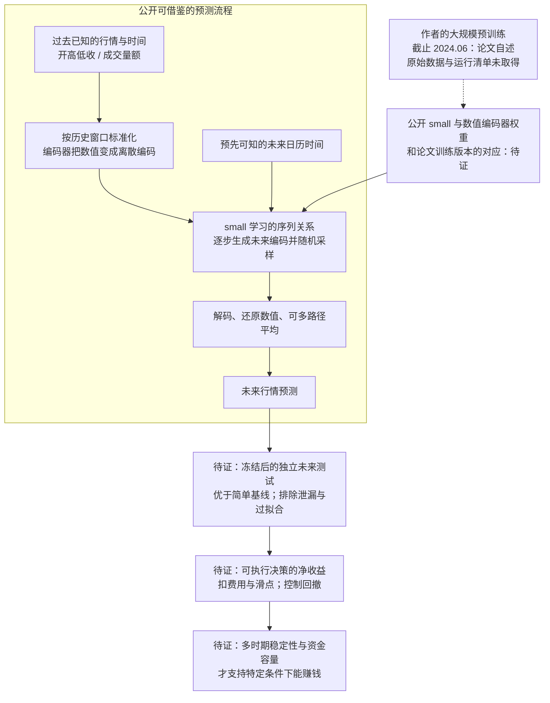

# Kronos-small：数据边界、预测机制与盈利证据

核验日期：2026-10-14。唯一范围：公开论文、作者源码、模型卡、配置、提交历史和有限相关讨论的只读研究。未下载模型权重、安装依赖、执行预测、训练、回测或交易。本文补充上一轮公开预测材料核验，区分作者披露、源码事实、第三方提问和研究判断。

## 1. 结论先行

**论文披露的预训练数据截止时间已核到：2024 年 6 月；论文称测试从 2024 年 7 月开始。公开 Kronos-small 权重是否对应这次训练，仍未确认。** 这是时间设置的披露，不是对全部训练样本的独立核验。[论文附录 D](https://arxiv.org/html/2508.02739v1#A4)

**后续补核后的来源结论（2026-10-14）：**作者在公开答复中列出 WIND、Tsanghi、Binance 等来源，并说明许可限制使其无法分享预训练集；完整样本清单及供应商合同仍未取得。[作者答复](https://github.com/shiyu-coder/Kronos/issues/100#issuecomment-3310349963) 市场隔离疑点仍保留：论文将台湾、印尼、马来西亚归为训练分布外市场，数据总表又包含它们。可能是总表覆盖了被排除的测试资料，也可能是隔离说明不足；没有清单时不能判断，更不能直接指控数据泄漏。[论文附录 B/D、表 13](https://arxiv.org/html/2508.02739v1) 新增独立证据和唯一验证设计见[后续报告](</Volumes/EXTERNAL/亚力克斯 /公开预测资料-20261014/Kronos-small-独立证据与唯一验证设计.md>)。

**个人可借鉴的是公开模型的输入处理、数值编码、预测接口和验证流程。** 是否有持续可交易优势、扣除实际成本后是否盈利、能容纳多少资金，本轮均没有证据给出数值。

## 2. 数据、日期与重叠：分别确认到哪一层

| 问题 | 已核事实 | 未核部分及影响 |
|---|---|---|
| 数据从哪些市场来 | 作者给出跨市场 K 线汇总，并在后续核到的答复中列名 WIND、Tsanghi、Binance 等供应商/交易所来源；K 线记录某个时间段的开盘、最高、最低、收盘价，并可带成交量和成交金额 | 未取得逐项数据来源、采集/修订规则、完整证券清单与供应商许可合同 |
| 预训练截止时间 | 论文附录 D 明示截至 2024 年 6 月 | 本轮核到的是月份，不能自行补成具体某日；也不能据此证明公开权重的实际截止时间 |
| 测试是否在训练以后 | 作者称所有任务测试从 2024 年 7 月开始 | 未取得样本清单、区间边界处理与训练运行记录，实际隔离未独立复核；测试末日、逐市场区间亦未核齐 |
| 测试市场是否没见过 | 作者把 XIDX、XKLS、XTAI 称为训练分布外交易所；表 13 同时列出 Indonesia、Kuala Lumpur、Taiwan | 未见排除清单来解释两处说明；不能据此认定模型已证明能泛化到完全未见市场 |
| small 与论文版本是否对应 | 作者模型卡明确配对 small 与 Tokenizer-base，并引用论文；small 配置的层数、维度与论文 small 架构吻合 | 架构吻合不等于训练记录相同；缺训练 run ID、数据 manifest（样本清单）及论文实验 checkpoint 与发布权重的哈希映射 |
| 权重何时发布 | 两个模型仓库的 `add model` 提交均为 2025-06-30；small 为 `ac5c409`，Tokenizer 为 `9ef143b` | 上传日期不等于最晚训练数据日期；本轮未下载权重，因此未独立校验权重内容 |
| 示例行情是否能取得 | 公开示例引用 `./data/XSHG_5min_600977.csv`；相关用户也报告缺少该文件 | 本轮未取得 CSV；其日期范围、供应商及数据授权 UNKNOWN。代码引用一个路径不证明数据已经发布 |

论文事实来源：[原始论文 v1](https://arxiv.org/html/2508.02739v1)。权重事实来源：[small 提交历史](https://huggingface.co/NeoQuasar/Kronos-small/commits/main)、[Tokenizer 提交历史](https://huggingface.co/NeoQuasar/Kronos-Tokenizer-base/commits/main)、[small 固定配置](https://huggingface.co/NeoQuasar/Kronos-small/blob/ac5c409/config.json)、[Tokenizer 固定配置](https://huggingface.co/NeoQuasar/Kronos-Tokenizer-base/blob/9ef143b/config.json)、[作者模型卡](https://huggingface.co/NeoQuasar/Kronos-small)。样例来源：[固定版本示例源码](https://github.com/shiyu-coder/Kronos/blob/67b630e67f6a18c9e9be918d9b4337c960db1e9a/examples/prediction_example.py)、[第三方 Issue #328](https://github.com/shiyu-coder/Kronos/issues/328)。

与权重截止时间有关的 [Issue #265](https://github.com/shiyu-coder/Kronos/issues/265) 和 [PR #272](https://github.com/shiyu-coder/Kronos/pull/272) 只能作为问题线索：提问与第三方未合并建议不能升级成作者确认。本轮未见可补齐权重训练溯源的维护者声明。

**研究判断：**同一证券出现在训练和测试中，本身不等于泄漏；用它的过去预测未来可以是合法研究设计。需要排除的是未来答案进入训练、模型/参数依据最终测试反复选择，以及把已经见过的市场宣称成从未见过。输入行情有时间戳还不够，权重、数据修订和参数选择同样有时间边界。

## 3. 一张图：从已有行情到未来预测，再到盈利证据

图中“可复制”指源码/接口公开可审查，尚未在我们的环境中验证运行；“待证”指尚无足够证据。预测流程来自源码，最后的验证链是本报告的研究要求。

**怎样预测：**预训练阶段先让编码器学习把行情压成两级数值编码，并把编码还原；随后让序列模型学习根据前面的编码预测后面的编码。已有权重运行时，输入只是过去行情和时间信息，模型逐段生成未来编码，再还原为未来开高低收、量额数值。[固定源码](https://github.com/shiyu-coder/Kronos/blob/67b630e67f6a18c9e9be918d9b4337c960db1e9a/model/kronos.py)

**数值编码器（Tokenizer）**把连续数字转换成适合模型学习的离散表示。**Transformer** 是学习序列关系的神经网络架构。这里使用这种架构处理行情，不需要把股票问题写成聊天提示词。

源码具体做到：仅从输入历史窗口计算均值与标准差；对未来编码采用随机采样；将多条路径的解码结果平均；最后恢复原始数值尺度。调用者提供未来预测时段的日期/时间，不提供未来真实价格。未来日历也必须是当时可知的安排，不能偷用后来才知道的实际成交时点。[同一核心实现](https://github.com/shiyu-coder/Kronos/blob/67b630e67f6a18c9e9be918d9b4337c960db1e9a/model/kronos.py)

**限制：**多路径平均不等于概率已经校准。源码能够输出价格序列，不证明预测方向、幅度或尾部风险正确；编码器对已知行情的“重建图”也不能当成提前预测证据。

## 4. 能复制哪些环节，缺少会有什么后果

| 环节 | 个人可借鉴程度 | 缺少的条件或证据 | 后果 |
|---|---|---|---|
| 准备输入 | 可用自己合法取得、带时间的行情按公开字段组织 | 数据授权、时区、频率、价格修订/复权、缺失值处理和持续性 | 模型的输入与它学过的含义不同；可能把修订后的数据当成当时已知 |
| 归一化与编码 | 源码公开，可复用处理逻辑和作者配套编码器 | 代码版本与权重版本一致；处理参数只能来自当时已知历史 | 研究与应用结果不一致，或误用未来数据计算标准化参数 |
| 使用 small 预测 | 作者公开模型/编码器入口并声明 MIT；无需先重训整个体系 | 运行兼容性、实际推理成本、输出稳定性及数据匹配未测 | 不能仅凭文件大小推算全部成本；能运行也不意味着有优势 |
| 重新预训练 | 可学习方法；完整复刻的数据与资源条件未满足 | 原始跨市场语料、供应商许可、清洗与划分清单、训练记录 | 无法声称复刻作者完整模型；自行少量训练是另一个模型 |
| 独立检验 | 可以借鉴时间隔离、冻结版本、简单基线及可复现记录 | 真正未参与模型选择的测试数据、足够有效独立样本 | 漂亮曲线可能来自重复挑模型、重叠窗口或市场本身上涨 |
| 从预测到盈利 | 是独立的研究环节 | 固定决策规则、真实成本与成交假设、风险约束、容量 | 准确度改善仍可能被成本和亏损尾部吃掉；不能推算可放大资金 |

源码与声明许可：[项目固定版本](https://github.com/shiyu-coder/Kronos/tree/67b630e67f6a18c9e9be918d9b4337c960db1e9a)、[MIT 代码许可](https://github.com/shiyu-coder/Kronos/blob/67b630e67f6a18c9e9be918d9b4337c960db1e9a/LICENSE)、[small 模型卡](https://huggingface.co/NeoQuasar/Kronos-small)、[配套编码器](https://huggingface.co/NeoQuasar/Kronos-Tokenizer-base)。代码/模型的声明许可不能替代行情数据授权。

**第一性原理判断：**模型学习的是历史中可以压缩、复用的统计关系。如果这些关系在未来仍存在，并且能影响一项可执行决策，才可能产生交易价值。市场变化、预测误差、交易成本和风险承受能力会决定价值能否留下。公开权重降低了研究模型的门槛，没有替我们完成这条经济证据链。

## 5. 还缺什么证据才能支持“能赚钱”

先纠正一个容易混用的对象：论文投资模拟选用各系列最大的零样本模型，不是专门对公开 small 的盈利验证。它采用 50/200 只证券的组合及每次交易 0.15% 的固定费用假设。不能把这些模拟结果归给 small 或直接套给个人账户；所读说明也不足以核定我们面对的真实滑点和市场冲击。[论文附录 D：Investment Simulation Setup](https://arxiv.org/html/2508.02739v1#A4)

需要补齐四类证据；这里定义要求，没有开展验证试验：

1. **时间与版本证据。**固定源码、编码器、权重哈希及采样参数；确认截止边界，或选择冻结后的新数据来形成独立测试。测试期间不根据最终结果反复改模型、预测期限或决策规则。作者的截止声明不能替代发布权重的对应记录。
2. **预测优势证据。**在未用于选择参数的数据上，比较“不变价格/零收益预测”等简单基线，同时考察方向、幅度和误差稳定性。重叠预测窗口不是相互独立样本，评价应考虑依赖，避免虚增证据数量。只看价格曲线贴合不够。
3. **净收益与风险证据。**预先固定预测如何变成决策，按当时可成交价格与市场约束估算费用、买卖价差、滑点和拒绝/延迟成交，并评价回撤（资金从高点跌落的幅度）、尾部亏损与相对基准表现。模拟只能支持对应假设下的结论，实际盈利还需真实执行证据。
4. **稳定性与容量证据。**检查不同未来时期和市场条件；检查订单扩大后成本与市场冲击是否吞掉优势。验证支持的是特定市场、期限、规则和资金规模下的优势，不能证明永久收益。本轮不足以估计资金容量，也不能推算财富目标。

本阶段判断：值得继续研究公开 small 的机制；尚不支持“已确认可盈利”。最重要的证据缺口是发布权重与训练数据时间边界的绑定。若现有公开材料始终无法补齐，应保留 UNKNOWN，并用冻结后的未来数据安排验证设计，而非把不明历史区间称为样本外。该设计仍属于后续研究讨论，本轮不执行。

## 6. 来源日期与留存

| 来源 | 来源日期 | 读取日期 | 层级 |
|---|---|---|---|
| [原论文 v1](https://arxiv.org/abs/2508.02739) | 提交 2025-08-02 | 2026-10-14 | 作者原始研究；未独立复现实验 |
| [作者源码固定版本](https://github.com/shiyu-coder/Kronos/tree/67b630e67f6a18c9e9be918d9b4337c960db1e9a) | Git 提交 2026-04-13 | 2026-10-14 | 静态源码，不是论文首次发布时间 |
| small / Tokenizer `add model` | 2025-06-30 | 2026-10-14 | 发布记录，不是训练截止日期 |
| 模型卡可见最新修订 | 2025-09-09 | 2026-10-14 | 作者说明，未提供完整训练清单 |
| Issue #328 | 第三方提问 2026-06-11 | 2026-10-14 | 线索，不能替代维护者确认 |

已留存原论文 HTML、派生文本及两个固定版本配置。静态留存文件与哈希见 [kronos-source-audit-20261014.json](</Volumes/EXTERNAL/亚力克斯 /公开预测资料-20261014/kronos-source-audit-20261014.json>)。HTML 仅作文本解析，没有执行页面脚本；既有预测源码也仅阅读，没有导入或执行。公开权重没有下载。
