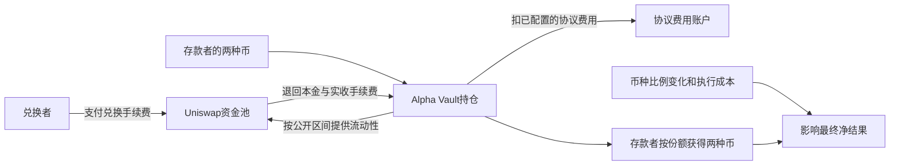

# Charm Alpha Vault：能复制机械操作，尚未证明能复制利润

**结论：找到了比单个钱包成交记录更具体的公开实现：如何安排流动性区间、什么时候允许调仓、如何拆分手续费，都能逐行核对。当前仍不能把它作为“完整规则事前固定、后续扣费盈利可复现”的达标案例：实际调度、历史策略/参数变更及净收益还没有证据闭合。** 这些缺口是UNKNOWN，不是已证明存在私有择时，更不等于个人不能复制公开实现。

本轮只读研究，读取日2026年10月16日，报告生成UTC：2026-10-16T08:20:57.703144+00:00。没有运行代码库、模型、回测、合约调用或交易，没有读账户或凭证。

## 1. 先用一张图说清谁付钱、谁承担风险

下图表示已读源码规定的收费关系，不是某笔已核盈利交易，也不是XTX交易记录。

存款者提供币，承接别人兑换；收入来源是兑换者付的手续费。Vault再按已配置比例，从收取的手续费中分出协议费用。源码中的治理账户可提取累计协议费，但**收费通道不等于经营净利润，更不能直接当个人到账收入**。本轮没有计算该项目实际赚了多少。[AlphaVault手续费拆分及提取](https://github.com/charmfinance/alpha-vaults-contracts/blob/774960877e122da12015878ee3a03dfa58536968/contracts/AlphaVault.sol#L351)

真正应比较的是：收到了多少手续费、持仓组合变化造成多少差额、付出多少费用。没有主动市价换币，不表示资产数量不会因别人兑换而变化，也不保证免受价格趋势、库存风险或损失。本轮没有把官方宣传中的性能和回测图当真实利润原账。

## 2. 公开代码究竟怎么操作

固定源码commit：`774960877e122da12015878ee3a03dfa58536968`。取自正常公开GitHub仓库页的currentOid，再按该commit读取7个源码/脚本/许可文件，未执行。GitHub提交页显示作者日期2021-10-19T14:44:23+01、提交日期14:44:31+01；**提交元数据日期本身不独立证明首次公开时间或当时部署状态**。[固定commit](https://github.com/charmfinance/alpha-vaults-contracts/commit/774960877e122da12015878ee3a03dfa58536968)

本轮主要核legacy的PassiveStrategy，另对照AlphaStrategy；没有把现行AlphaProVault的新功能回填到旧版。

| 环节 | 源码明确规定什么 | 个人能借鉴什么 |
|---|---|---|
| 区间构造 | 把调用时的价格刻度按池网格取整；主要区间围绕它展开；剩余币放一侧区间。上界还含一个tickSpacing，不能把参数当美元宽度。 | 状态、输入、取整与下单区间均明确的机械规则。 |
| 调仓资格 | 指定keeper、最小间隔已过、价格刻度移动达到阈值、偏离历史TWAP在上限内，并满足价格边界条件。 | 将风险保护写成明确条件，而不是凭感觉“行情合适”。 |
| 调仓动作 | 撤出现有区间，核算资产，先放主要区间，再放单侧区间；该策略传给vault的swapAmount为0。 | 可学习以被动成交调整库存，减少主动换币的需求。 |
| 手续费 | 实际Collect包含本金；先减Burn撤出的本金，剩余才是手续费，再按protocolFee/1e6扣协议份额。 | 将本金、毛收入、项目抽成、链上成本分开。 |
| 存取 | 用户按当时持仓比例存两种币取得份额，提现销份额、按比例取两种币。 | 份额账与资金流核验。用户能自行存取并不妨碍基金份额净值研究，仍需完整份额/资产流水。 |

来源：[PassiveStrategy区间与资格](https://github.com/charmfinance/alpha-vaults-contracts/blob/774960877e122da12015878ee3a03dfa58536968/contracts/PassiveStrategy.sol#L104)、[AlphaVault实际动作](https://github.com/charmfinance/alpha-vaults-contracts/blob/774960877e122da12015878ee3a03dfa58536968/contracts/AlphaVault.sol#L276)、[存取](https://github.com/charmfinance/alpha-vaults-contracts/blob/774960877e122da12015878ee3a03dfa58536968/contracts/AlphaVault.sol#L115)

TWAP是时间加权均价的简称，这里通过过去一段时间的价格刻度计算，用于限制当前价格偏离。**这两份已核策略规则没有使用训练模型预测未来价格**；不能推广成整个项目从未使用其他技术。

这里最关键的区别是：**“现在允许调仓”不是“此刻一定调仓”。** PassiveStrategy返回true只是通过资格检查。链上合约没有自行发出交易的能力，仍要keeper送来调用；公开的rebalance.py只做一次地址列表遍历，未定义循环、cron或完整外部调度。keeper是指定调用账户，不自动代表私人主观择时。实际调度是否在其他地方公开，当前仍UNKNOWN。[调用示例](https://github.com/charmfinance/alpha-vaults-contracts/blob/774960877e122da12015878ee3a03dfa58536968/scripts/rebalance.py#L24)

## 3. 三个周期和三个费率，不能混成一个版本

| 资料/对象 | 查到的数字 | 正确口径 |
|---|---|---|
| 署期2021-05-03的官方介绍 | 每24小时 | 当前可读文章的描述；不直接证明某实际vault全历史周期。 |
| 当前可读legacy策略文档 | 每48小时 | 页面发表/更新日UNKNOWN；不是合约强制48小时的证据。 |
| 冻结部署脚本PERIOD | 41400秒，即11.5小时 | 最小间隔请求值；脚本注释约12小时，并非精确调度时刻。 |
| 冻结脚本PROTOCOL_FEE | 5000，注释写5% | 合约分母1e6，所以请求值对应**手续费的0.5%**；注释5%错误。不是本金抽成、年收益或真实部署收费证明。 |
| 本轮所选真实vault的提供商构造参数 | protocolFee=0 | 可支持所声明的**初始协议费为0**；不说明之后始终为0。 |

来源：[2021介绍](https://medium.com/charmfinance/introducing-alpha-vaults-an-lp-strategy-for-uniswap-v3-ebf500b67796)、[legacy文档](https://learn.charm.fi/charm-finance/alpha-vaults/strategy)、[固定部署脚本](https://github.com/charmfinance/alpha-vaults-contracts/blob/774960877e122da12015878ee3a03dfa58536968/scripts/deploy_mainnet.py#L9)、[费用分母](https://github.com/charmfinance/alpha-vaults-contracts/blob/774960877e122da12015878ee3a03dfa58536968/contracts/AlphaVault.sol#L378)。两文档的限价宽度符号L/R也有差异，源码具体版本优先

部署脚本当前启用的POOL还是WBTC/USDC，其他池仅注释列出，不能把这组示例参数统统当作另一真实vault的历史配置。治理在此代码中还能替换策略、keeper、阈值、间隔、TWAP保护、协议费和上限；这表明存在可变控制，**不证明历史上一定修改过或修改未公开**。具体变更要按所选账期核实。

## 4. 为避免空谈，也核了一个明确实例

在读取任何收益前，先保存选取规则：只取固定rebalance.py中**第一个未注释策略地址**，不换地址寻找赢家。

- 策略：`0x1cea471aab8c57118d187315f3d6ae1834ccd836`。
- 其公开提供商构造参数所绑vault：`0x9bf7b46c7ad5ab62034e9349ab912c0345164322`。
- vault构造参数所绑资金池：`0x88e6a0c2ddd26feeb64f039a2c41296fcb3f5640`。

提供商声明为已验证PassiveStrategy和AlphaVault、Proxy标志均0。剔除注释和空白、保留其他Solidity标记及字符串后，所选策略的PassiveStrategy主体796个标记、其内含AlphaVault及所绑vault的AlphaVault主体各2657个标记，均与固定仓库对应合约相同。**这是公开提供商源码声明与源码主体比对，不是本轮独立编译、链上字节码或状态根证明。**

构造参数可解出初始B=3600、L=1200、period=41400秒、minTickMove=0、maxTwapDeviation=100、twapDuration=60秒、keeper=`0x04c82c5791bbbdfbdda3e836ccbef567fdb2ea07`；vault初始protocolFee=0、maxTotalSupply=200000000000000000。这些是初始值，**不能代替任意后续时点的真实策略指针、阈值、费率和调度**。

来源：[策略公开源码/构造参数GET](https://api.routescan.io/v2/network/mainnet/evm/1/etherscan/api?module=contract&action=getsourcecode&address=0x1cEA471aab8c57118d187315f3d6Ae1834cCD836%29%E3%80%81[vault公开源码/构造参数GET](https://api.routescan.io/v2/network/mainnet/evm/1/etherscan/api?module=contract&action=getsourcecode&address=0x9bf7b46c7ad5ab62034e9349ab912c0345164322%29%E3%80%82%E5%AE%9E%E9%99%85%E8%AF%BB%E5%8F%96%E7%89%88%E6%9C%AC%E5%8F%8Ahash%E8%A7%81%E5%8E%9F%E4%BB%B6%EF%BC%8C%E4%B8%8D%E4%BB%A5%E6%9C%AA%E6%9D%A5%E5%85%AC%E5%85%B1URL%E4%B8%8D%E5%8F%98%E4%BD%9C%E5%81%87%E8%AE%BE

这一步已缩小“具体实现/初始参数未知”的缺口，但没有读取该实例的收益、挑选盈利区间或生成交易。精确首次公开时间、后续配置历史和完整调度仍未证，真实持仓、成交、成功/失败费用与扣费表现本轮尚未核，不写成盈利案例。

## 5. 可复用边界和下一步判断

| 项目 | 当前判断 |
|---|---|
| 阅读和借鉴区间公式、资格检查、手续费分账、份额核算 | 可以。这比仅有接口或成交截图具体，适合作为源码研究轮子。 |
| 个人复制自有源码 | 仓库自有源码采用Unlicense，允许研究、复制、修改及商业使用，无性能担保；第三方依赖具体版本和许可未逐项审，不推广为全部组件无条件复用。 |
| 直接调用现存vault的调仓入口 | 此旧策略限指定keeper，普通存款者不是天然keeper。源码公开与现有实例调用权限是两件事。 |
| 复制完整历史运行政策并取得同样利润 | 尚无证据。完整调度、配置变更、真实后续全账和成本还未闭合。 |
| 5000美元或几十万美元能赚多少、能放大到多大 | UNKNOWN。没有用资金比例缩放历史数字，也没有盈利/容量数据可估。 |

许可证：[固定LICENSE](https://github.com/charmfinance/alpha-vaults-contracts/blob/774960877e122da12015878ee3a03dfa58536968/LICENSE)。此处不进行部署、安装或交易；软件复用许可不等于投资、场所或地区准入许可

**当前结论：值得保留为可复用的机械规则样本，暂不列为已验证个人赚钱方案。** 如果取得明确公开的keeper调度和历史配置依据，再加上规则公开之后完整实际账期，结论可以改变。没有这些证据，不把实际发生过的调用倒推为事前固定规则，也不把未知成本记零。

下一项只读研究收敛为一个把调仓触发也写进公开合约的案例，先核规则能否覆盖这个调度缺口，再核其真实全账；本例暂停盈利追踪，不串行换地址挑赢家。不开始开发、回测或交易。原Kronos FAILED、封存结果与独立自动化均保持原状；个人可盈利、容量和Gerko财富目标尚未达成。

## 6. 来源日期、保存方式与限制

- 报告读取日：2026-10-16。逐原始GET有起止UTC、HTTP、Date、bytes与SHA256；官方文档采用web工具原生抽取文本，逐页完成UTC/HTTP/原网络bytes UNKNOWN，不冒充原HTML。
- 2021介绍页面显示日期2021-05-03；现legacy文档日期UNKNOWN；固定源码commit显示日期2021-10-19。未取得独立当日存档或证明首次公开时刻，不用当下可读页面消除历史身份缺口。
- GitHub匿名API两次返回403 rate limit exceeded，均保留原件并停止API请求；按LOCAL_BLOCKERS已验证的正常公开网页/raw路线读取，无登录、凭证、网络或权限变更。公开仓库HTML成功提供currentOid，不将文件SHA冒充Git commit。
- 实例源码来自单一公共提供商，没有独立编译；初始构造参数不同于实时或全历史状态。现行AlphaProVault的permissionless配置未核，不与legacy混用。
- 本次不读取收益排行榜、运行模型/回测/合约、模拟交易或账户。新增付款0，外发消息0。

证据根：`evidence/charm-alphavault-case-20261016/`；主推导`root/source-policy-findings.json`、`root/first-instance-source-and-constructor-binding.json`；官方文案及独立源码、实例/报告审阅位于`protocol/`。本报告各层事实须按其原始证据适用范围理解，不把静态源码审阅通过当作盈利验收。
