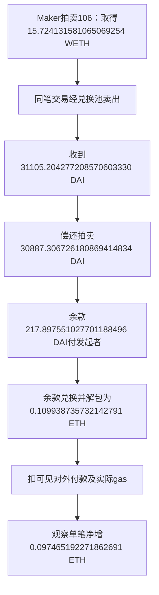

# Maker拍卖套利：真实单笔收支、公开规则与个人复制边界

资料读取日：2026-10-16；交易发生日：2026-02-05。本文只审公开源码、已经发生的交易记录与金额，不运行模型、策略、回测或交易。Dune没有现成账户或额度，未注册、购买或运行查询。

**结论：找到了一笔可核到拍卖、卖出、偿还、余款兑换和当笔实付费用的真实正现金流交易。观察到的ETH净增为0.097465192271862691。它证明这一笔价差确实被兑现；尚未满足“同一操作者事前公开完整规则，后续完整账期所有成功、失败及费用均可核”的全部要求。**

这次比只有收益曲线多了真实原始收支，比只有公开框架多了明确的数量报价、估费和筛选规则。但不能把两者自动拼成“这个公开bot产生了这笔盈利”：交易外层为定制自调用，实际采用的软件、参数和选择规则没有绑定。公开合约可供任何人调用。

最值得个人借鉴的环节是：**比较能实际卖出这一数量的收入与实际买入、执行和失败成本，并让买入—卖出—偿还尽量在一笔不可拆分的交易中完成。**这条思路不依赖先预测明天涨跌；是否能低成本持续捕获这种价差，仍取决于竞争、费用和机会规模，未被本笔证明。

## 1. 这笔钱从哪里来

机制证据来自Maker/Sky的Clipper抵押品拍卖合约与公开回调代码。借款仓位进入清算后，协议通过拍卖回收DAI；买方若能以拍卖成本取得抵押品，并在外部市场换到更多DAI，就可能留下差额。这里赚的是拍卖成本与可执行卖出收入的差，不是无条件利息，也不是一笔预测股票涨跌的交易。

本次真实交易：

- hash：`0x8c06abcb3a94762501ce7064e08616c1541e63b98f185b217403762f8c88cca4`
- 时间：2026-02-05 17:09:23 UTC；Ethereum区块24392025。
- 发起及余款接收地址：`0xfa0253943c3ff0e43898cba5a7a0da9d17c27995`；真实人或机构身份UNKNOWN。
- 拍卖合约：`0x71eb894330e8a4b96b8d6056962e7f116f50e06f`，Take事件对应拍卖106。
- 兑换回调：`0xdb9c76109d102d2a1e645dca3a7e671ebfd8e11a`，提供商返回的已验证源码名为UniswapV3Callee。未独立重编译或验证交易时点运行字节码。

来源：已保存完整交易回执（未随包收录；原相对路径：`运行验证-20261015/evidence/maker-auction-case-20261016/root/target-transaction-receipt.original.json`）、原普通交易记录（未随包收录；原相对路径：`运行验证-20261015/evidence/maker-auction-case-20261016/root/target-recipient-normal-block.original.json`）、Clipper源码原回复（未随包收录；原相对路径：`运行验证-20261015/evidence/maker-auction-case-20261016/root/target-auction-emitter-source.original.json`）、回调源码原回复（未随包收录；原相对路径：`运行验证-20261015/evidence/maker-auction-case-20261016/root/target-callee-verified-source.original.json`）。均有对应读取UTC、URL与SHA256回执。以下是实际记录，不是教学示例。

WETH是可按对应数量解包为ETH的合约代币；DAI是美元目标稳定币，不能默认任何时点都与美元一比一。此处不把DAI直接写成美元收益。路径中间还经过USDC，属于资产兑换流转，不另计一份利润。

Take中的`amt`只是最多买多少。本笔输入请求约17.72416单位，实际收到并卖出15.724131581065069254 WETH；不能拿请求数量计算成交或容量。Take所载剩余债务tab为0、剩余抵押lot为2.000032052345989452内部单位；源码在债务付清后将剩余抵押返给`usr`。`usr=0xabb98818e8ed05b07c784f99784003f6388d53f9`是清算仓位/余抵押接收地址，**不是这笔套利人的地址或额外利润**。单位与事件语义见提取的Clipper源码（未随包收录；原相对路径：`运行验证-20261015/evidence/maker-auction-case-20261016/root/Clipper.verified-source.sol`）；实际转出的WETH量以receipt Transfer为准，不混用内部余额与ERC20余额。

为什么可以先拿抵押品再偿还？该合约在take里先转内部抵押余额、调用回调，之后收回所欠DAI。回调退出抵押品、卖出、将足够DAI加入协议余额，最后支付剩余DAI。读到的代码和当笔流量支持这条同笔结算路径；不需要据此假设操作者预先垫付了全部约3.09万DAI。它仍须有gas和相应授权/执行条件，不能据此断言操作者实际起始资本或“零本金收益率”。

## 2. 扣费后究竟还剩多少

DAI流量先闭合：

`31105.204277208570603330 − 30887.306726180869414834 = 217.897551027701188496 DAI`。

这笔余款随后全部卖出换为WETH并解包ETH，因此发起者最终DAI净变化为0，WETH扣解包后净变化也为0。不能同时把DAI余款、WETH入款和ETH解包入款相加为三份利润。

| 本笔原账项目 | ETH数量 | 处理 |
|---|---:|---|
| WETH解包后实际收入 | +0.109938735732142791 | 与同量Withdrawal事件及已记录native流对应 |
| 向另一地址的可见付款 | −0.011055512871629488 | 收款角色UNKNOWN，全部保守扣除，不擅称builder费用 |
| receipt实际gas费 | −0.001418030588650612 | 536332 gas × 2643941791 wei/gas |
| **观察到的当笔净增** | **+0.097465192271862691** | 上述三项相加 |

另一收款地址为`0x4838b106fce9647bdf1e7877bf73ce8b0bad5f97`。发起记录from=to、自转value1019 wei不当作外部本金，也不重复扣作费用。

池费、价格冲击已经影响本笔实际换出的金额，不能再凭估计费率重复扣；也不能宣称所有隐藏费用都已核清。上述是**已保存服务商原件覆盖的单笔交易现金流**，不含其他失败尝试、交易外部署/授权、运营与关联主体成本或税。native内部转账来自提供商既有历史记录，receipt与Withdrawal相互对应，但未取得独立节点余额证明。

原字节与计算：当前receipt核对（未随包收录；原相对路径：`运行验证-20261015/evidence/maker-auction-case-20261016/root/target-receipt-and-cashflow-crosscheck.json`）、已记录native流（未随包收录；原相对路径：`运行验证-20261015/evidence/maker-auction-case-20261016/root/target-recorded-internal-flows.original.json`）、独立receipt补审（未随包收录；原相对路径：`运行验证-20261015/evidence/maker-auction-case-20261016/reviewer/receipt-addendum.md`）。这不是本金收益率，没有年化、容量或个人未来收入结论。

## 3. 公开程序到底公开了哪些规则

第一份官方[auction-keeper](https://github.com/sky-ecosystem/auction-keeper)主要负责监视拍卖、管理状态和执行外部model给出的价格；估值和是否值得买由另一个程序提供。README明确不防止亏损报价。示例固定价格或市价乘0.85不是已证明的完整盈利策略。固定源审阅（未随包收录；原相对路径：`运行验证-20261015/evidence/maker-auction-case-20261016/protocol/source-scope-review.md`）

更完整的是官方UI及MIP链接的[Sidestream公开bot](https://github.com/sidestream-tech/unified-auctions-ui/tree/main/bot#readme)。当前固定commit `07cfb299b5143595f04a65366ea117ff13d485e6`，Git日期2026-08-25；本次静态核到：

1. 取得适用于拟卖出数量的市场报价和兑换路径，而不只看屏幕中间价。
2. 计算拟购数量×（市场单位价−拍卖单位价），减预计gas及缺少的授权费用，再比较用户阈值T。
3. 新授权后重新评估，发送拍卖take和回调参数。
4. gas使用固定量估算，例如swap722651、每项授权48356；实际发送时另取gas参数。console成功后的代币余额差不是完整费用账。

V3具体路径使用带池费率编码的数量报价接口，因此不能说它完全忽略池费或数量影响；报价到成交之间仍会变，当前固定源的市场缓存为29秒。没有运行报价或测延迟。源范围审阅（未随包收录；原相对路径：`运行验证-20261015/evidence/maker-auction-case-20261016/protocol/sidestream/source-scope-review.md`）、公式与发送补审（未随包收录；原相对路径：`运行验证-20261015/evidence/maker-auction-case-20261016/protocol/sidestream/cost-formula-addendum.md`）

**关键缺口是链下估计净利与链上保护不同。**已读V3参数把`minProfit`设为原始整数1；具体回调源码的单位是DAI的最小单位，即10^-18 DAI。它要求卖出足够偿还并至少留这一点DAI，没把用户T、实际ETH gas或上述额外付款一起强制覆盖。即使交易成功且留有DAI，扣实付费后仍可能亏；失败回滚也不能保证免gas。README甚至允许用户设置负T。公开bot有成本意识，不能称全成本不亏保证。

### “事前公开”核到了哪一层

官方[release v.1.24.0](https://github.com/sidestream-tech/unified-auctions-ui/releases/tag/v.1.24.0)元数据发布于**2025-10-09 07:35:06 UTC**，早于本次交易。按该tag实读四文件：bot README、collateral keeper、fees及V3回调参数模块；四份内容与已读2026 HEAD相同，确认当前可读历史tag中存在阈值、估费、授权后重评与minProfit=1规则。

这不是当日独立存档，也没证明tag从未移动。未把2026其他模块自动回填到2025；更没有证明实际交易发起者使用该bot、tag、阈值或配置。历史四文件核验（未随包收录；原相对路径：`运行验证-20261015/evidence/maker-auction-case-20261016/protocol/sidestream/historical-release/historical-rule-review.md`）

所以当前分层判断是：

| 用户所要证据 | 当前结果 |
|---|---|
| 可读、可依法研究的明确执行/成本程序 | 已取得；主要repo为AGPL许可，具体版本和第三方组件要分开遵守 |
| 早于交易的公开发布线索 | 已取得官方release时间及四个tag文件；独立历史归档/全tag不可变性未证 |
| 真实拍卖成交、抵押卖出、还款、退出余款及当笔费用原件 | 已取得，原始receipt与已记录native流可核，观察当笔正净增 |
| 确认该操作者运行上述完整公开规则 | UNKNOWN：外层定制自调用、程序身份和运营参数未绑定 |
| 固定账期内所有成功、失败、资产期初期末与归属费用 | 未取得；不把两笔近期callee事件或单笔成功当完整账期 |
| 后续样本外持续净利、个人捕获率及容量 | 未证 |

Sidestream所读LICENSE为AGPL v3；auction-keeper声明AGPL-3.0-or-later。不能将主repo许可外推到无独立许可的第三方gist、所有依赖、数据服务或任何商标。允许研究复用不等于当前依赖兼容、合约安全或一定赚钱。

## 4. 我们能低成本复制什么，缺了会怎样

| 环节 | 可以借鉴的部分 | 尚缺证据/能力，以及后果 |
|---|---|---|
| 找价差 | 同时比较拍卖成本与同数量可执行退出报价 | 只看名义折价会漏池费、价格冲击和退出困难，账面有差价却未必净赚 |
| 成本门槛 | 分清预估成本、实付gas、授权、失败与其他付款，按统一资产核账 | 只复制T判断或余额日志，可能把毛余款误写净利；minProfit=1不覆盖全费用 |
| 一笔结清 | 学习先取得抵押、换出DAI并偿还的公开回调结构 | 可减少裸露库存和垫款需要，但执行失败仍可能付gas；合约、路径、权限与资产风险未消失 |
| 数据和软件 | 公开源可按许可阅读；本次历史数据无key免费取得 | 免费历史读取不证明实时延迟、可用性或所有日志完整，更不证明个人能先成交 |
| 竞争与扩大规模 | 认识到机会是有限抵押拍卖和兑换流动性产生的 | 大额会改变可执行价格；他人先成交会消灭机会，增加资金不能制造更多折价 |

对个人最值得保留的不是“抄一个更强的预测模型”，而是**先证明可执行收入超过全部归属成本，再讨论把握机会的速度和概率**。这是经济核验方法；此处没有声称XTX从事该Maker交易，也没有用这笔链上套利替代XTX私人策略。

现有证据支持继续作为研究样本；还不足以建议开发或投入实盘。与Gerko财富1%的距离，当前缺的是可持续净利率及其资本/机会容量、真实竞争后的成交份额、全账期回撤和持续积累路径，而不是只有代码或资金。没有已核总净利池与个人份额，不能做财富目标外推。

## 5. 下一项只读证据任务

若沿本案例继续，唯一下一项应为：**先固定该地址2026-02-05 UTC整日的账期，再核全部交易、成功/失败、代币和native净流及实付费，判断单笔赢家是否被当天其他尝试吞掉。**这是对已发生记录的账本审计，不执行策略、不模拟成交、不回测。第三方转账/其他业务必须另标，不能一律当套利收入或损失；未能取齐就停在覆盖UNKNOWN，不挑选子集冒充完整。

通过只表示该日地址层原账支持净增，仍不完成公开软件身份绑定、未来获利或容量证明。若原始明细缺失或混有无法归属的重要业务，不能靠猜测补全；优先换有原始账包的案例。若完整账日扣费为负，承认该日结果，不能反推整个机制永不赚钱；若为正也不年化。此任务仍在用户只研究的边界内，本报告未执行。

## 6. 原件质量、读取与未确认事项

本笔getLogs最初四条DAI日志缺data和blockHash，初读金额来自代币索引，旧阶段派生稿和坏原件都保留。后来按[Routescan官方历史receipt文档](https://routescan.io/docs/api/etherscan/geth-parity-proxy)，于**2026-10-16 05:43:45.230864—05:43:45.895009 UTC**一次取得完整25-log receipt：21857字节，SHA256 `c23cdf8011df60e66fa0e95cea3270cde005ec63cd7a4d2f9b290ea0c46da1f9`。四条DAI金额与索引吻合；本笔原始金额缺口关闭，没有改写旧坏回复。

这是同一提供商不同接口的交叉对应，不是独立节点证明。Etherscan该目标页首次普通GET为403，已停止，未换工具重取同一受拒资源。所有原API响应、源blob、读取UTC和哈希分别保存在evidence/maker-auction-case-20261016/（未随包收录；原相对路径：`运行验证-20261015/evidence/maker-auction-case-20261016`）。没有页面发布日期的标UNKNOWN；Git提交日期不当部署日期，保存日期不当读取时间。

资料层级：官方repo、release和MIP支持公开程序/机制；提供商原receipt和历史native记录支持已观察收支；“机会可能被竞争、gas或价格变化侵蚀”是据代码与市场结构的推论，不是已测个人表现。操作者真实身份、外层私有程序、历史运行版本、完整账期、其他归属费用、未来收益和容量均未确认。

行为记录：源码与数据被动读取/解析、金额核算和证据保存；新增模型、训练、回测、EVM/eth_call/trace执行、策略、账户、签名广播、交易、付款、安装和对外消息均0。历史`eth_getTransactionReceipt`代理GET准确计**1次RPC格式只读数据请求**，不是执行交易，不能把本阶段追称0 RPC。原FAILED、AAPL封存/评分与Issue85自动化未改；继承实际model/effort UNKNOWN，规则PERMISSIONS-2026-10-14-v1 / ROUTING-2026-10-13-v4。
