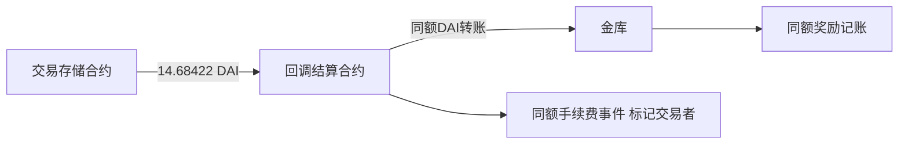

# 第一笔固定奖励：交易费确实进入了金库

核验日：2026-10-18 UTC。当前结果：**在独立公开浏览器显示的同一笔成功交易中，手续费事件、DAI真实转账与金库奖励金额对应；旧RPC奖励原件亦与该记录一致。** 这是局部付款事实，不是完整账户净利、全500条归因或价格预测优势证明。独立审阅未能读取root的浏览器，UI独立层为UNKNOWN；这一限制不写成通过。

## 样本怎么选

按同一持有区块窗内500条既有奖励记录的block、transactionIndex、logIndex，选最早一条；规则先在commentary声明，再输出选择结果。金额早已存在于封存来源中，没有声称从未看过金额，也没有按收益过滤或换样本。

固定交易：[0xa2e287…99e07e](https://arbitrum.blockscout.com/tx/0xa2e287bac295e81e51c2b0234b447dc4f9500d88e552552f094563847d99e07e?tab=logs%29%EF%BC%8Cblock50661898%E3%80%82%E5%85%AC%E5%BC%80%E8%AF%A6%E6%83%85%E5%AE%8C%E6%88%90%E5%8A%A0%E8%BD%BD%E5%90%8E%E6%98%BE%E7%A4%BASuccess%E3%80%81fulfillOracleRequest%EF%BC%8C%E6%97%B6%E9%97%B42023-01-04 08:36:51（UTC+8，即00:36:51 UTC）。奖励记录中的blockTimestamp为0x0，本轮没有用它当实际时间；页面初始加载占位数据及当前美元价格亦未使用。

## 同一笔交易中的两类钱

| 已显示日志 | 金额（DAI） | 能说明什么 |
|---|---:|---|
| 3、4：交易存储合约→回调合约→金库 | 14.684219999999999999 | 实际DAI付款路径 |
| 6：金库RewardDistributed | 同额14.684219999999999999 | 奖励事件与实际入金对应 |
| 7：回调DaiVaultFeeCharged | 同额14.684219999999999999 | 对应被收费交易者，区别于任意奖励标签 |
| 12、13、14：另一笔转账及AssetsReceived | 558.00036 | 另一条资金/风险缓冲记账路径，未当作手续费 |

手续费事件和LimitExecuted中的交易者均为 `0x6e4857043f29f5374010a829426da3fcf49f2e66`，与原850 DAI存款人的地址不同。按已取得接口，LimitOrder枚举中2对应LIQ，日志18显示orderType2、daiSentToTrader0。本轮没有把这个交易者的整段持仓、真实本金回报或自然人身份核完，也没有将事件里的原始percentProfit字段当成独立投资回报率。

14.68422 DAI是**这一次分给整个金库的费用**，不是原850 DAI份额持有人独得的利润。558.00036 DAI也不能全部算个人分红；金库资产、缓冲与份额价格有不同记账规则。另有staking、bot等事件，事件标签不一定代表新增独立现金支付，未逐项相加来制造总收入。

## 证据为什么比上一轮更强

上一轮源码只证明机制存在：特定分支从交易平仓费划出金额，转到回调合约，再调用金库distributeReward。本轮增加同一实际交易的4个同额事件/资产环节，且与既有RPC log6的transaction hash、block、logIndex、emitter、sender和原始金额一致。

所见付款路径为：

仍须区分三个证据层：旧RPC只保存了目标奖励日志；新增转账/手续费/订单字段来自root真实读取的正常公开UI；源码来自独立归档。新增字段是结构化转录，不冒充完整原始RPC receipt或完整原HTML。原始浏览器工具输出属于本轮会话；本地只保存有关字段，未声称完整复杂tuple全部归档。

## 到这里应作什么决定

保留gDAI作为“收费与承担交易对手风险”的机制样本，**停止把扩查全500条当作价格预测模型的突破路线**。扩大归因覆盖可以加强这个金库的历史资金来源说明，但不会自动产生事前预测信号、样本外优势、完整扣费账或可放大容量。这不是判断金库不可能盈利。

原固定存款案例仍只有有限现金变化：四笔资产流增加1.737369382150704725 DAI，九笔已观察交易费用支出0.0004524838 ETH；没有合并为完整净利润，没有估算年度回报或Gerko财富目标的达成概率。相关[成本原账](<../gdai-fixed-case-cost-attribution-20261018/README.md>)和[业务源码](<../gdai-reward-payer-binding-20261018/README.md>)保留。

唯一后续研究任务应回到目标：核一个明确依赖资产价格预测的公开候选，能否把**事前固定信号→完整持仓/成交→费用原账→后续扣费表现**绑定。先核这些原件，不新增模型运行、训练或回测；找到收益曲线不算完成。当前本阶段没有取得该候选入口，不声称已经找到。

## 复核入口与边界

- root/fixed-first-reward-check-freeze.json：固定样本与研究边界。
- root/fixed-first-reward-public-ui-observation.json：实际公开UI所见字段、完整地址链接含义与覆盖限制。
- root/fixed-first-reward-field-match.json：与旧原件的逐字段相等核对。
- owner/source-to-event-checklist.json：仅源码判定表，不是Owner读过目标交易的通过自述。
- alignment-review.json/md：只读目标对齐审查，不冒充首笔交易验收。
- review/及root-acceptance.json：本阶段必要验收层、未核事项与收口决定。

没有重取已403的官方RPC/Arbiscan，没有执行合约方法/源码/EVM、模型、回测或交易，没有新增账户、登录、凭证读取、安装、付款、发送或自动化。独立审阅尝试访问root已开tab时工具返回browser2 unavailable，停止，不换浏览器重试；它不代表root的正常UI读取失败。临时标签由root完成读取后关闭。证据仍有用途，保留。
