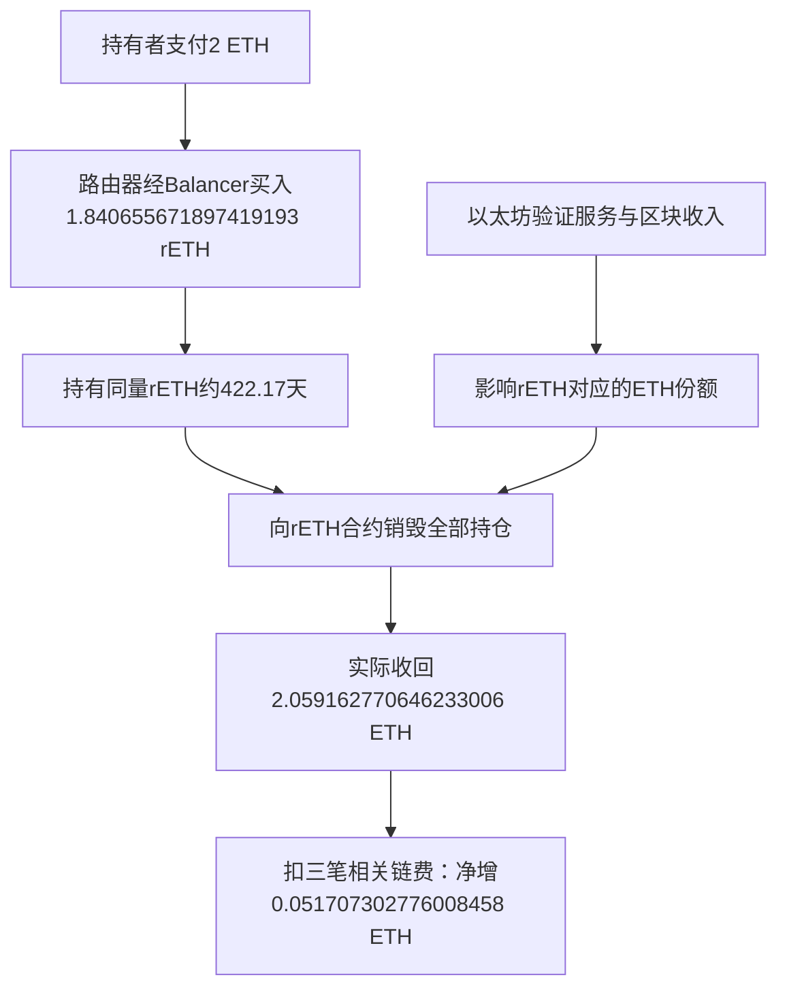

# rETH真实闭环：ETH净增、公开规则与复制边界

**核到了一个更直接的真实正结果：同一地址支付2 ETH取得rETH，持有约422.17天后全部赎回，实际收到2.059162770646233006 ETH。扣买入、一次rETH授权和赎回三笔实际链费，净增0.051707302776008458 ETH。** 这不是当前报价或跨币参考估值；回款实际为ETH。

但它仍未满足用户要求的全部标准：已读公开协议和可复用源码，不等于这个人的入场、退出与风险规则曾事前公开；后续单次闭环也不能证明一套预测/交易策略有样本外优势。这是资本参与质押机制的历史正例，不能冒充XTX定价模型，也未完成Gerko 1%财富目标。

本轮读取日：北京时间2026-10-17，直接GET原件的UTC为2026-10-16 19:28—19:33，原生网页工具另存保存时间并保留实际HTTP状态/读取字节数UNKNOWN。原始数据、URL、读取UTC、原响应和SHA256保存在evidence/profit-case-priority-20261017/。只读公开资料与历史数据，做文本/字节解析、指纹和算术；未运行来源代码、模型、回测、策略、ABI/EVM、SQL或交易，未安装、开户、付款、读凭证、发消息或新增自动化。

## 1. 如何选样本，避免挑出一个赢家

读取收益前固定：Ethereum区块21000000至21007199，rETH合约0xae78736cd615f374d3085123a210448e74fc6393的TokensBurned事件，按区块、交易序号、日志序号选第一条，不按金额或利润换样本。返回17条、第二页成功空；首条为区块21000097、2024-10-19 14:05:11 UTC。

随后只追这条记录的同一地址0x6bfacb79483b493e9b5f7415a3b8d68b95642047，不找更赚钱者。先固定选择再回看原账，减少本轮按结果筛选，但**不是事前投资试验**：历史区间、资产和方向仍由今天的研究选择，不能称为真正预先锁定策略的样本外验证。

[固定范围事件原件](https://api.routescan.io/v2/network/mainnet/evm/1/etherscan/api?module=logs&action=getLogs&fromBlock=21000000&toBlock=21007199&address=0xae78736cd615f374d3085123a210448e74fc6393&topic0=0x19783b34589160c168487dc7f9c51ae0bcefe67a47d6708fba90f6ce0366d3d1&page=1&offset=1000%29

## 2. 谁提供收益，钱怎么走

质押是把资产用于支持区块链验证服务并取得相应报酬。官方说明rETH代表对池中ETH及相应收益的份额，收益渠道包括共识层奖励、区块优先费用和MEV分成。MEV是区块内交易排序等带来的额外可提取价值。具体节点佣金和网络政策会影响持有者所得。[官方机制说明](https://docs.rocketpool.net/liquid-staking/overview.html)

本笔实际路径：

买入来自Balancer交换，**不是直接向协议存入ETH铸币**。买入价格含当时市场与池中成交条件；不能拿今天文档的直接存款费追加入账。赎回源码按网络报告的ETH余额与rETH供给换算，并要求足够可兑ETH。代码说明收入如何传递，不证明本笔差额100%来自某一种奖励。

本轮没有取得买入时完整协议净值快照与全部奖励组成，因此不能将净增精确拆成质押收益、买入溢折价和其他价格因素。官方当前文档也说明直接赎回受池中ETH流动性限制；本例成功退出不保证将来随时原价退出。[公开赎回源码档案](https://sourcify.dev/server/v2/contract/1/0xae78736Cd615f374D3085123A210448E74Fc6393?fields=all%29

## 3. 持仓与费用原账

|项目|实际记录|
|---|---:|
|买入时间|2023-08-24 09:56:11 UTC|
|买入支付|2 ETH|
|取得并最终销毁的rETH|1.840655671897419193|
|赎回时间|2024-10-19 14:05:11 UTC|
|实际赎回ETH|2.059162770646233006|
|买入gas|0.003856747985702742 ETH|
|另一次rETH授权gas，保守计入|0.000768099782418258 ETH|
|赎回gas|0.002830620102103548 ETH|
|上述三笔链费后净增|**0.051707302776008458 ETH**|
|进一步扣同期该地址全部8笔发出交易gas后的差额|**仍为+0.047071655854984431 ETH**|

买入交易0xee4d933a7b220597a2c8b317f19992caa3490e770263d5c93c8579415c123e21：调用正文value=2 ETH，收据显示路由器包装2 ETH为WETH并经Balancer交换，rETH从Balancer进入该地址，数量与退出相同。[买入收据](https://api.routescan.io/v2/network/mainnet/evm/1/etherscan/api?module=proxy&action=eth_getTransactionReceipt&txhash=0xee4d933a7b220597a2c8b317f19992caa3490e770263d5c93c8579415c123e21%29

赎回交易0x8946aaa1ae303a19576d6dca9abe0f774709ff6c3f2de40c11dfda2ab276fbba：同地址直接调用burn，成功收据、销毁Transfer、TokensBurned与原生ETH流的金额对应。买入、赎回两笔手续费均以完整收据gasUsed乘effectiveGasPrice核算。含额外授权在内的其余六笔费用本轮来自正常交易索引，未逐笔另取独立收据；它们不与两笔完整收据的证据强度混用。额外授权指向另一个spender，burn本身无需这笔授权，本表计入它是保守处理。[赎回收据](https://api.routescan.io/v2/network/mainnet/evm/1/etherscan/api?module=proxy&action=eth_getTransactionReceipt&txhash=0x8946aaa1ae303a19576d6dca9abe0f774709ff6c3f2de40c11dfda2ab276fbba%29

代币合约从0至赎回区块的Transfer查询，入账一条、出账一条，各第二页成功空；两条均与对应完整收据逐字段相符。正常交易索引返回10条，己方发出交易nonce0..7连续，共8笔且均成功，第二页成功空。额外rETH授权仅改变许可，未形成持仓转出；其费用仍计入。

扣全8笔gas是保守敏感性比较，其中还含其他活动费用；它**不是整个钱包净利润**，没有把其他资产买卖、转出本金或别的收益混进这笔rETH闭环。税、链下运营/借款等未取得原件的成本不声称为零，不据未知成本否定已核有限ETH现金事实。

没有使用ETH美元价格，因此不是美元收益；也没有年化或把422天结果乘成未来收入。相关投入、回款和费用的计价资产一致，但不能据此认定风险很低。

## 4. 数据质量与完整性限制

实际遇到一项明确漏记：同商tokentx按同地址、同rETH、0至赎回区块查询只返回销毁，漏了买入。若照这个表核账，会把取得成本漏掉，错误地把赎回全额当收入。

本轮不用该表作持仓完整性依据，保留坏覆盖原件，改核合约Transfer入/出原事件、对应收据与正常交易正文。分页终止、入出等量和连续己方nonce提供有限闭环支持；它们不等于独立全节点共识证明或全实体私人账。历史原生流行没有逐条txhash，身份依赖固定请求URL、同区块/时间、成功收据与事件对应，不能称独立完整trace。

20次公开GET全部HTTP200，仍逐份检查正文与字段，不以200本身放行。网络读取现已停止。

## 5. 规则、代码与许可究竟公开到什么程度

|事项|核到的证据|不能推出的结论|
|---|---|---|
|公开经济规则|按网络ETH余额与rETH供给计价，公开burn兑换|某人的具体投资时点、持有时长、退出/止损规则已事前公开|
|验证源码身份|Sourcify同地址chain1，creation/runtime原文match，非代理的服务记录，编译器0.7.6，部署区块13325304|我们独立编译、审计全部可变网络依赖或执行过代码|
|固定GitHub源|136c246524716081a27b47339b3bbb923392ff9a；作者日2023-07-02、提交日2023-08-10|Git对象日期就是首次公开日期；平台签名验证时间实际为2024-11-06|
|关键函数比较|getEthValue/getRethValue/burn/mint/getTotalCollateral/转账钩子文本与验证源一致|整个源文件字节一致或所有依赖一致；实际整文件不相同|
|代码许可|固定源SPDX GPL-3.0-only，实际根LICENSE完整GPLv3文本已读|所有界面、第三方服务、地区、税务和资产活动均自动获同样授权|

Sourcify验证日2024-08-08晚于买入、早于退出，不能补作买入前首次公开时间。Git日期提供版本线索，但没有不可变的首次公开回执，精确事前源公开时间仍标UNKNOWN。[固定源](https://github.com/rocket-pool/rocketpool/blob/136c246524716081a27b47339b3bbb923392ff9a/contracts/contract/token/RocketTokenRETH.sol)、[完整GPLv3](https://github.com/rocket-pool/rocketpool/blob/136c246524716081a27b47339b3bbb923392ff9a/LICENSE)

GPLv3支持在其条件下运行未修改程序及个人私下修改，向他人提供/分发涉及相应义务。本轮只是静态研究，没有运行该程序。源码可研究复用的证据已取得；这不是参与交易、地域适法性或收益的保证。

## 6. 对个人复制和财富目标有什么用

可以低成本学习三个环节：核清一份资产对应的现金权利；追溯买入至退出的全部持仓和实付费用；按同一计价口径比较保留原资产与参与机制的差额。这些不依赖大型算力或AI价格模型。

实际参与则需要承担资产价格、协议/网络、节点惩罚、报告数据和赎回流动性等风险。资金小的时候固定网络费更显著；官方文档当前也提示这点。该历史样本2 ETH规模已经提供真实成本参照，但不能按今天费率、市场价格或借款成本直接外推你的5000美元账户。[当前参与机制与费用说明](https://docs.rocketpool.net/liquid-staking/via-rp.html)

**它证明的是一笔历史资本服务参与的ETH扣链费正增量；未证明价格预测优势或高增长财富引擎。** 增加本金会扩大资产敞口，不会凭空产生信息优势。距离Gerko 1%财富仍缺：可重复的净优势、机会频率、容量证据、长期风险/成本控制，以及把交易收入放大为资本与企业价值的路径。不是换强模型或把本例收益复利外推即可补齐。

本轮另以既有五份报告、两份原账复核：V2小额闭环仍是四类旧候选中最接近的正账，Carver仍保留为传统公开策略研究样本。它们与本例一样，不能将公开协议/程序替代投资者事前完整决策规则。也不要求私人全部bot或真正把所有币卖成一种币，才能承认各自已有的有限历史收益。

## 7. 结论与下一唯一缺证

本轮继续推进了真实净收益证据，并补到可读代码及GPL全文；**全条件可复用盈利案例尚未找到，目标未完成**。目前适合作为知识研究，尚不据此独立立项或承诺资金放大上限。

下一来源核验只围绕一个问题：是否有带可核时间戳的事前完整投资决策规则（选择、入退、费用、风险约束），可绑定随后完整实际正账。不得用后来整理的规则、持有者单次盈利、协议收益公式或漂亮回测代替。这一步仍仅公开研究，不新增实验、模型运行、回测或交易。

证据目录root/fixed-reth-lifecycle-financial-observation.json保存17项实际原件指纹；root/reth-source-license-date-observation.json保存8项源输入与关键函数比较。各独立实质审阅、读取汇总与阶段manifest另存同目录。所有资料保留，不删除。既有FAILED、9400/50/188、AAPL/Issue85结论与安排不变；本轮progress，goal active，非完成或blocked。
