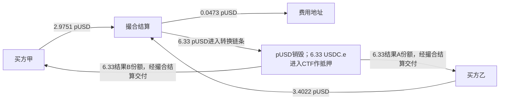

# 两笔真实交易：钱从哪里来，为什么还不能算套利利润

结论：第一笔是现有持仓的买卖；第二笔是不同链上地址分别买入互补结果，结算时创建新持仓。两笔共向费用地址转入0.1625 pUSD，属于本样本可核的毛费用收入，不能当作交易者净利润或平台净利润。第二笔本金报价0.47＋0.53＝1，再加费用，没有展示完整组合折价套利。原用户要求的事前规则、完整持仓、全费样本外盈利案例仍未准入。

读取日2026-10-16；实际事件为2026-04-29 06:26:36 UTC、Polygon区块86161976。两交易哈希始终固定：
- T1：0x4ea2410f71317b7667aeaa9e966239d8873e9048676da98a2c9aa0cfe35edcd0
- T2：0x5248139a1a9d217447048f1c801cc5fbac42d6a51a081471ed9a1c71fcc8ef86

## 1. 先补上遗漏的付款币种

上一轮查询只含Exchange、CTF和USDC.e三地址，遗漏pUSD的Transfer，不能用它声称完整付款账。本轮先记录理由、同一块及同两哈希，再于15:03:06—15:03:08 UTC对同一免费存储历史接口发一次只读POST，取该块全部日志；200、1360418B未截断、2205日志。区块hash与旧响应一致，仅分析固定两交易的34日志（T1为11、T2为23）；旧22条过滤日志逐项原样吻合，新取得9个pUSD Transfer。其余交易未作收益筛选或经济分析。

原件接口和范围遵循[SQD Finalized Stream](https://docs.sqd.dev/en/api/evm/finalized-stream)，请求、响应、哈希、UTC与逐事件对账保存在evidence/prediction-market-two-tx-flows-20261016/root/。提供方最终化声明和两来源一致不替代独立链共识证明；本轮没有eth_call、trace重执行、模型、回测或交易

pUSD地址C011由已读当前官方合约表支持；[固定CollateralToken源码](https://github.com/Polymarket/ctf-exchange-v2/blob/ccc0596074f4dfd62c944fbca4de252893b82b4b/src/collateral/CollateralToken.sol)第121—124行明确6位精度。下文pUSD小数按该公开单位规则显示，CTF数量按对应抵押物尺度显示，同时保留原始整数。未独立匹配该历史块的proxy实现/部署bytecode，也未将pUSD按美元成交价兑换；下列现金流的原始整数不依赖这种显示换算

## 2. 第一笔：卖出收到8，不代表赚了8

地址简写仅用于阅读，不代表独立自然人或不同实际控制人。

| 地址/角色 | 本笔pUSD变动 | 本笔结果份额变动 |
|---|---:|---:|
| 买方B1：0b52…2494 | −8.1152（raw −8115200） | 同一token＋10（raw＋10000000） |
| 卖方S：02e4…fb3b | ＋8（raw＋8000000） | 该token−10（raw−10000000） |
| 费用接收F：115f…ccc9 | ＋0.1152（raw＋115200） | 0 |

实际是同卖方两次交付5份，买方每次转4 pUSD，合计10份/8 pUSD；另由买方直接向F支付0.1152 pUSD。共有3条OrderFilled：两条卖方成交及一条买方汇总，另有OrdersMatched；不能把汇总再算一轮成交。

买方用钱换持仓，卖方用持仓换钱。卖方此前取得这10份花了多少、是否已有对冲、后来整个账户怎样变化均未核，所以＋8是卖出回款，尚无依据写成利润。买方当下支付也不能直接写成最终亏损。

## 3. 第二笔：创建两种持仓，不是凭空多出两份本金

CTF PositionSplit记录同一condition：
0x7880e75cbec05c8e0565ddfb616478536148a0019b4029c0366ab751d75f6496，
parentCollectionId为0，partition为[1,2]，amount为6330000。本轮未取得具体事件名称/结果文字，不擅自给两个token标YES或NO，简称A/B。

| 地址/角色 | 本笔pUSD变动 | 本笔CTF份额变动 |
|---|---:|---:|
| 买方甲：5f8d…8b2c | −2.9751（raw−2975100） | 结果B＋6.33（raw＋6330000） |
| 买方乙：c2be…af12 | −3.4022（raw−3402200） | 结果A＋6.33（raw＋6330000） |
| 费用接收F | ＋0.0473（raw＋47300） | 0 |

甲的两笔本金为0.1551＋2.82＝2.9751；乙的本金3.3549，加费用0.0473＝3.4022。甲、乙本金合计6.33，另有0.0473费用，总支付6.3773 pUSD。实际转账吻合，不是用当前费率公式估出来。

转换链条原量：Exchange向pUSD合约转6330000；该合约随后销毁同量。另见c417…9db1向ada100874…9718转6330000 USDC.e，后者再向CTF转同量。CTF先向ada铸造A/B各6330000，再转Exchange，最终各交付不同买方；中间转移不再算新收入。Exchange和ada在所核pUSD/USDC.e/CTF事件中的中间持仓净变动为0，CTF抵押USDC.e增加6330000。

ada及c417的该历史部署角色未独立验证；不能用当前合约表中不同的adapter地址贴身份。以上地址关系来自实际日志。[固定CtfCollateralAdapter源码](https://github.com/Polymarket/ctf-exchange-v2/blob/ccc0596074f4dfd62c944fbca4de252893b82b4b/src/adapters/CtfCollateralAdapter.sol)可解释“pUSD转换为USDC.e抵押后split”的公开机制，不能当成历史地址实现一致证明

两个结果份额对应单价：2.9751/6.33＝0.47、3.3549/6.33＝0.53；合计1。结合原始CTF事件和公开拆分规则，这是抵押物转成互补条件持仓。两份结果并不意味着同一笔本金变成两倍财富。这批记录未展示同一账户折价买齐并合并回款；不同地址是否同一实际控制人也UNKNOWN。

[Gnosis固定ConditionalTokens源码](https://github.com/gnosis/conditional-tokens-contracts/blob/eeefca66eb46c800a9aaab88db2064a99026fde5/contracts/ConditionalTokens.sol)及同版本IERC1155定义支持事件布局与公开split/merge逻辑。源码本轮只读，未执行或独立匹配历史运行bytecode。两交易的CTF事件已识别为转移/创建；没有把本次创建新持仓当作完成兑付或实现盈利

## 4. 目前能确认的钱赚到了哪里

F地址本样本收到115200＋47300＝162500最小单位，即0.1625 pUSD毛服务费。FeeCharged与实际Transfer一一相符，算一次，不能再加一次FeeCharged。该地址的实际控制人、这两笔以外的出入金和经营费用未核，因此不能写成平台/个人净利润。

T1与T2原生gas仍分别为0.062755456388806832和0.096458350976988162，直接付款者分别为795d…0ce8和815f…1841。它们不是pUSD，未与0.1625裸相减，也未假定费用地址与gas支付者属于同一主体。完整日志中的1010系统事件未另作额外手续费重复扣除；其他原生内部付款/祖先回滚语义与跨期失败成本仍非全账。

这给出一个实际可见的收费环节：交易者向配置的费用地址付款。【推断】个人若想复制这一类收费业务，需要合法取得收费入口、客户订单和运营能力；预测模型变强不会自动获得别人合约的费用收入。该收入属于本例的平台收费机制，不能用它认定XTX核心利润来源。

## 5. 个人能学到什么，仍缺什么

可直接复用的是公开原账与协议规则：区分本金、库存、费用、供应量变化；验证报价之和是否真有折价；检查实际收到份额与付款。当前两笔没有模型预测参与的证据，也没有个人可复制的净盈利证据。

库存卖出盈利需要对应的取得/对冲成本；完整组合套利需要同一可归属资产组合、可成交折价、完整收回与全部成本。我们尚未拿到这两笔的事前策略承诺、跨期持仓与成本、后续兑现、样本外净表现或容量，不把它们当作成功样板，不从这个局部样本否定整个方向。

本次新数据仍为免费探索用途；未来商业生产、自营交易复用授权和当时收费沿上一报告保持UNKNOWN。原合同源码许可条件也不因公开可读而自动放宽。

## 6. 收敛

这两笔可以结束“是否已经看见完整组合套利赚钱”的核验：目前没有这项证据；已确认普通持仓买卖、新持仓创建和毛收费。后续不再重复分析这两笔来寻找不存在于其原件中的利润。

下一条研究只允许在已经取得的同一块2205日志中，按事前确定的时间/索引顺序寻找首个经原ABI确认的CTF合并事件，先固定其交易身份，再检查是否具有单笔闭合资产循环；不按利润筛选或换样本。若只是处置原有库存、没有合并事件或缺成本，就保留该明确结果，不冒净利。该新候选选择和核算尚未执行，仍不运行模型、回测或交易。

证据目录中所有原文、固定查询、原始响应、旧过滤对照与被动解析均保留；没有无用途临时文件需删。原Kronos FAILED、9400封存预测/188窗口、AAPL一次核验、Issue85安排均未改。完整1%财富目标active、尚未达到。
