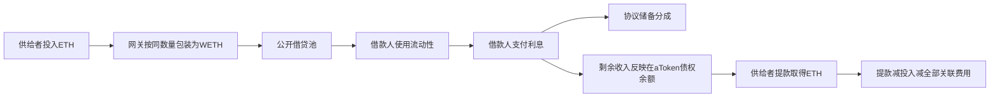

# Aave公开借贷收入：真实正负原账及个人复制边界

核验日期：2026-10-16 UTC。本轮继续公开资料研究；只取得原HTML/固定源码、读取正常公开浏览器页面并做历史原账算术。没有运行模型、回测、EVM、下载的程序或策略，没有安装、钱包连接、交易、付款或外发。

**结论：找到一个公开借贷机制下、扣所核账户全部普通发送网络费后仍有正ETH现金增量的真实历史账户，并核到一个同机制净负的账户。** 正例三次存入合计1.320859413304123221 ETH，2026年两次提回1.353829312023260024 ETH；扣本地址全部8笔发送交易gas后，净增 **0.018299399344017028 ETH**。这是2022—2026特定账户的已实现数量结果，不是回测收益，也不是AI预测优势。

当前通过的是公开机制和特定账户链上账目层。这个匿名账户的金额/入场退出选择没有事前公开，跨账户、交易所/法币和资金机会成本未全核；旧V2也已有退出进程。因此未达到“可照抄且未来持续赚钱的主动交易系统”层，更没有实现Gerko财富1%的目标。

## 1. 第一性原理：谁付钱，为什么付

Aave把供给者的资产汇集为借贷流动性，借款人以抵押物支持借款并支付利息。供给者承担资金占用和协议相关风险，取得部分借贷收入；历史代码另有闪贷溢价进入收入指数的路径。不能把所有毛收入都归入普通借款利息，也不能把代币价格涨幅当成这一机制的收入。

aToken是存款债权凭证；其余额可随收入指数增长，而非每秒另发一笔普通转账。供给利率取决于借款利率、借贷池利用率与协议储备分成。这里不需要预测未来价格来决定每笔利息的分配。[官方历史源码](https://github.com/aave/protocol-v2/tree/682a7d13fec9ee9f3e50412d68d7b00664a3b252)

与XTX可比较的只是“别人为什么愿意付报酬、自己提供什么服务、扣完成本留下多少”这一分析框架。借贷利息和做市价差/预测收益是不同现金流，不能用前者宣称复制了XTX的模型或交易优势。

## 2. 规则、源码、版本和许可

官方2020-12-03[V2上线帖](https://governance.aave.com/t/aave-v2-is-live-megathread/1621)及历史官方仓库支持机制早于本例首次2022年供给已公开存在。固定版本`682a7d13fec9ee9f3e50412d68d7b00664a3b252`的提交记录为2021-02-26；Git日期和今天可读不能单独证明精确首次公开时间。没有把匿名账户的配置策略说成也已事前公布。

实际存提通过旧网关`0xcc9a0B7c43DC2a5F023Bb9b738E45B0Ef6B06E04`，调用参数指定池`0x7d2768dE32b0b80b7a3454c06BdAc94A69DDc7A9`。[官方历史地址簿](https://github.com/aave/aave-address-book/blob/707fb57089f3aac8bb99f7fce7defe1d1d2d7494/src/AaveV2Ethereum.sol)确认其为V2池；网关地址本身不能单独证明版本，因为池是调用参数

旧网关的Etherscan Exact Match源码中，WETHGateway.sol与上述官方版本逐字节相同，SHA256为3896daa06a7fd62134349ad7c50d9c92993b096bce2d335d0eac42d07cb0d89f。未独立编译验证字节码，也未核全部2022—2026代理升级；不能把2021源码中的参数当作后续真实配置。

根许可和主要源码为AGPL-3.0，支持按条款研究和复用，须遵守相应义务；未审全部依赖，不称无条件商用。该旧地址不等于当前推荐入口，2022官方地址簿推荐网关已不同。完整机制和来源原件见 evidence/aave-income-ledger-20261016/protocol/AaveV2-旧WETHGateway-公开机制与边界-20261016.md。

## 3. 正例：从存入到提款的真实账目

地址：[0x63F94428…35E60](https://etherscan.io/address/0x63F944280f054c3fE27B30Bf70AD3977Dbd35E60)。地址页明确列出全部15条普通交易，15份原HTML均取得。该地址发送nonce0—7共8笔，无缺号，其他7笔是外部入金；没有把他人支付的入金gas重复扣成本账户费用

| UTC日期及操作 | ETH数量 | 本账户实际gas ETH |
|---|---:|---:|
| 2022-09-06存入 | 1.118236667446400000 | 0.005501506532759160 |
| 2023-06-07存入 | 0.073151873727240840 | 0.005016431792717619 |
| 2023-06-22存入 | 0.129470872130482381 | 0.003586362842462691 |
| 2026-05-21授权 | 0 | 0.000007764940901804 |
| 2026-05-21首次提款 | 1.353829310218021388 | 0.000046585285111735 |
| 2026-05-21第二次提款 | 0.000000001805238636 | 0.000045479153514766 |

第一笔[存入原件](https://etherscan.io/tx/0x653f2df75c26e297080cbd1a631d921bbf49f70eef0f2194ae435b1f15bf2949)、[首次提款原件](https://etherscan.io/tx/0x8db0100bba0d398bda2e0a7fef191b838308625eed94ce4e128caf35ed2d91ac)、[第二次提款原件](https://etherscan.io/tx/0xe6282d16ee6b3a274cf3f990a8e2984fb94391e14da21a59b8e2883cc0ca90d3)。所有15笔精确hash/时间、输入及费用见独立审阅JSON和报告

| 汇总口径 | ETH |
|---|---:|
| 三次投入本金 | 1.320859413304123221 |
| 两次实际提回 | 1.353829312023260024 |
| 提回减投入 | +0.032969898719136803 |
| 六项核心操作gas | −0.014204130547467775 |
| 核心操作后已实现净增 | **+0.018765768171669028** |
| 再扣周期前/后两笔普通转出的gas | −0.000466368827652000 |
| 扣本地址全部8笔发送gas后 | **+0.018299399344017028** |

这不是最终提现金额1.3538 ETH都算盈利，也不是8次成功的策略收益样本。三次追加本金发生在不同日期，不用“净增÷总存入”冒充严格年化或资金加权回报率。

### 外部入金、剩余持仓和费用排除

- 五笔普通非dust外部入金共1.36471222 ETH，都是本金来源，不算收入。
- 两笔后来各1e-9 ETH的外部零碎入金共0.000000002 ETH，排除收益。第二次极小协议提款是另一件事，已按原件纳入，不能混同。
- 周期前/后普通转出本金合计1.383004989357234308 ETH是资金移转，不当作手续费或独立盈利；其gas已扣。
- [最终转出State](https://etherscan.io/tx/0x469263cab9119cbbe71694204a3a36b35e539c87154aa6d39e82564ecb817aac#statechange)余额为1.363477988171669028→0.000006629986782720 ETH，差额等于实际转出加gas。再加两笔dust，精确等于地址当前显示的0.000006631986782720 ETH。
- 正常公开[aWETH持仓/转账页](https://etherscan.io/token/0x030ba81f1c18d280636f32af80b9aad02cf0854e?a=0x63F944280f054c3fE27B30Bf70AD3977Dbd35E60%29%E5%8A%A8%E6%80%81%E5%88%97%E8%A1%A8%E6%98%8E%E7%A1%AE%E5%85%B15%E7%AC%94%E3%80%81Page1of1%EF%BC%9A3%E6%AC%A1Null%E9%93%B8%E7%BB%99%E6%8C%81%E6%9C%89%E4%BA%BA%EF%BC%8C2%E6%AC%A1%E6%8C%81%E6%9C%89%E4%BA%BA%E8%BD%AC%E7%BB%99%E7%BD%91%E5%85%B3%EF%BC%9B%E9%80%90hash%E5%AF%B9%E5%BA%94%E5%B7%B2%E4%BF%9D%E5%AD%98%E7%9A%84%E5%AE%8C%E6%95%B4%E4%BA%A4%E6%98%93%EF%BC%8C%E6%97%A0%E5%85%B6%E4%BB%96%E8%BD%AC%E5%85%A5%E5%88%97%E5%87%BA%E3%80%82%E8%BF%99%E8%A1%A5%E5%BC%BA%E6%8E%92%E9%99%A4%E5%A4%96%E6%9D%A5aWETH%E8%B4%A1%E7%8C%AE%EF%BC%8C%E4%BB%8D%E6%98%AF%E5%90%8C%E4%B8%80explorer%E7%B4%A2%E5%BC%95%EF%BC%8C%E4%B8%8D%E6%98%AF%E7%8B%AC%E7%AB%8B%E8%8A%82%E7%82%B9%E5%AE%8C%E6%95%B4%E6%97%A5%E5%BF%97%E8%AF%81%E6%98%8E
- 该持仓页精确显示仍有0.000000000000000003 aWETH；不是严格清零。未把这点残余加进利润，也未为它虚构提款费用。State原始存储标签由浏览器解释，未独立验证storage layout和mapping hash。
- Treasury的aWETH铸造属于协议储备收入，不是本人的利润；正常gas已含优先费和燃烧费，不重复扣。

独立现金守恒核算：普通转出1.383004989357234308＋最终转出后现金0.000006629986782720－非dust外部入金1.36471222＝**0.018299399344017028 ETH**，与存提差额减全部8笔gas相同。跨账户或交易所内部费仍未知，故范围准确称本账户可见链上ETH现金增量，不称全部个人资产经营利润。

## 4. 反例：同样供给也会扣费后变负

地址：[0xF276eAFf…f224](https://etherscan.io/address/0xF276eAFf9C20c484A38539ff20227F464e3ef224)。其全部8条普通交易原件均取得，发送nonce0—6共7笔；核心供给为2025-09-10存入、2026-08-03授权和提款

| 三项核心供给范围 | ETH |
|---|---:|
| 存入 | 0.093057571609344372 |
| 提回 | 0.093177459570310452 |
| 毛增 | +0.000119887960966080 |
| 存入、授权、提款gas | −0.000731835899742195 |
| 已实现差额 | **−0.000611947938776115** |

[存入](https://etherscan.io/tx/0xec69dbce2f72eaaafa5ae394beadea6e4b400d3fd098d8566ca13f8d55dcb2e7)、[提款及State](https://etherscan.io/tx/0x95ae0128c6c05f501c8b4702a72f7133486eb6c5ad0b249f4a76161d38d0e045#statechange)。极小aWETH残余未估值，不称严格零仓总NAV。之前USDT兑换还含额外网络费、授权及2.538958 USDT向另一地址转移，身份和用途未经核实，不擅称Aave收费；它们不能用兑换本金当利息，也不会改善上述核心已实现负结果。

本轮并非随机抽样，先查简洁账户，再查已有页面中较大提款的完整账户；不能用两例估计总体成功率、期待收益或最佳本金。正反例只说明账目和成本能改变结论。

## 5. 你能复制什么，缺什么有什么后果

| 环节 | 本轮证据和个人适用性 | 缺少后的后果 |
|---|---|---|
| 找到明确收入支付者 | 公开规则可读，借款人/闪贷使用者付费，协议分配收入 | 把币价涨幅、追加资金或协议储备混入自己的收入 |
| 读固定规则和部署版本 | 历史源码、许可及旧网关/池对应可复核 | 照旧教程进入已退出或规则变动市场 |
| 按原件核净收入 | 不用付费数据或模型即可复核这两个历史账户 | 只看余额增加会把负例判成赚钱 |
| 选择本金、持有期和退出时点 | 此匿名账户的事前计划没有公开；不能复现其私人决策 | 把历史正例的事后选择当成未来固定优势 |
| 提供资本和承担风险 | 资本供给这层技术上通常比预测/抢单简单；本轮没有证明个人现行适用资格 | 钱被占用、低利率/坏账/合约/治理/提款流动性风险仍可能造成损失 |
| 放大收入 | 未核当前需求、利用率、容量与随规模变化的利率 | 不能按本金同比例外推，更不能承诺财富目标 |

如果借款需求不变，增加供给会降低利用率，并可能压低供给利率；这是历史公式的条件推断，不是具体容量实测。增加本金可以摊薄近似固定的网络费，但并不自动获得高回报或克服风险。正例用了多年、净增加量有限，不能作为5000美元快速接近Gerko财富1%的证据。

只供给而没有借款，不能把ETH价格下跌本身说成此账户会遭借款清算；但ETH计价正收益仍可能对应法币亏损。若把供给资产拿去抵押再借款，则要另核杠杆与清算风险，本例不做该操作。

## 6. 为什么不能照搬旧V2

2025-02-04的[Chaos Labs治理提案](https://governance.aave.com/t/arfc-aave-v2-deprecation-update-disable-new-borrows-ir-curve-and-reserve-factor-adjustments/20918)提出继续退出V2、禁新借款并调整收入分配；它是提案，不冒充链上已执行回执。2026-03-26的[继续退出提案及4月2日LlamaRisk评论](https://governance.aave.com/t/arfc-continued-deprecation-steps-of-aave-v2-markets/24351)进一步讨论有序退出，评论称当时V2资产冻结，仅允许提款及还债。此为具名风控方的当时陈述；本轮没有独立读链验证现时所有市场的状态或储备因子

这些材料已经足以阻止“历史账户赚钱，因此今天照旧地址继续存”的推断。我们得到的是历史机制与原账样本，不是现行操作建议，也不迁移到新版本就自动继承收益。

## 7. 准入层级、决策和下一项研究

| 用户所需证据 | 本轮达到的层级 |
|---|---|
| 事前公开收入规则与代码 | 历史协议机制有官方支持；精确首次公开时间未独立存档 |
| 后续真实本金、持仓、费用和现金流 | 两账户23份普通原件、4份State；正例完整显示15条、aWETH动态5条均对应原件 |
| 扣成本后的盈利 | 正例扣本地址全部8out网络费后ETH现金增量为正；不含未知跨账户/法币费用，不计微小残余 |
| 事前公开完整主动投资决策 | **没有**：协议分配规则不等于匿名账户择时/配置已公布 |
| 个人未来可低成本持续复刻 | **未证明**，尤其旧市场退出、现行资格/成本/风险尚未核 |
| 接近Gerko财富1% | **未证明**；不把资本利息冒充预测alpha或可无限放大交易能力 |

因此保留为**公开资本报酬的真实正负核账样本**，通过这一层，不升级为全要求通过的现成量化策略。最可复制且当前已验证有用的是收入归因、完整原账和费用过滤；需要更强模型之前，先判断经济优势来自哪里。

下一项只读研究回到更接近XTX的主动市场服务：优先查事前公开的自动报价/套利规则，要求同一固定实现与后续完整位置、成交及费用绑定，并与被动持有基准比较。不能拿本例收息替代原来寻找主动交易优势的目标；仍不开发、不运行模型、不回测、不交易。

## 8. 原件、复核及访问限制

新证据位于evidence/aave-income-ledger-20261016/；原URL、读取UTC、字节数和SHA256见各read-receipts/manifest。root保存23笔独立普通交易原HTML，网关、账户、token页、4份State及两篇治理原HTML；协议分支另有固定源码/内容响应和官方渲染原件。只核这些取得材料，不声称完整依赖、代码运行或形式验证。

协议身份和收入机制由独立只读分支核清；23笔原账与State由其独立静态核账。后来aWETH动态5行由根正常浏览器观察，和已保存交易原件交叉比对；它不是独立审阅者亲自观察、原CSV或RPC事件导出。导出按钮只点一次，25秒没有download事件，未取得CSV、未重试；不将尝试称成功。网关完成交易索引普通GET403停止并记入LOCAL_BLOCKERS，未换工具读取该受拒索引或提取Cookie；aWETH页面为另一个已正常取得的具体公开holder链接，数据目标不同。

模型、训练、回测、EVM/策略执行、交易、账号钱包连接、付款与外发均0；旧FAILED、封存结果、AAPL和Issue85安排未改。本goal turn和前轮均progress，但总体目标未完成。
