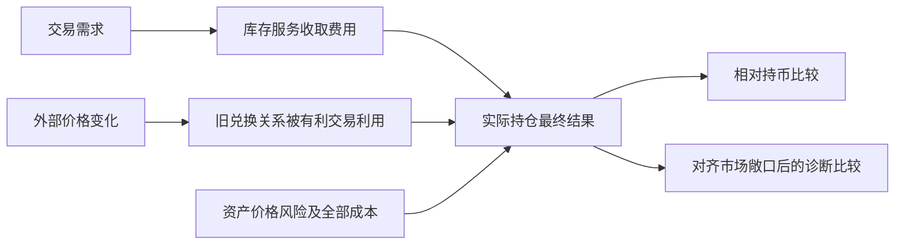

# 公开做市为什么还不等于定价优势

核验日期：2026年10月16日。本轮只读官方规则、原论文及已有记录；没有运行模型、回测、SQL、SDK、EVM或交易，没有安装、登录或付款。所有数字例子均为教学算术，不能当真实业绩。

## 1．对路线的一个重要收敛

**公开资金池能让个人参与收费，但仅持有既有Uniswap V2池的份额，并不能把自己的预测装进去，让池子按个人预测报价。** 所以，被动LP可以解释库存服务收入，不能直接作为“我们复制XTX价格预测和报价能力”的证据。

此前一笔扣四笔直接gas后两币数量净增的历史结果仍成立，第二笔负参考标值也保留。本轮没有换基准把原正结果改成失败；它回答的是更进一步的问题：那笔正结果是否已经显示了可复制的主动定价优势？当前没有。

本轮因此关闭“持有被动V2份额即可复制XTX预测报价”的解释。LP继续保留作收费与库存风险样本；不将前次提出、尚未执行的15天观察当作验证XTX核心能力的实验，也不自动排期。

## 2．XTX和普通V2 LP，控制的东西不同

| 环节 | XTX公开说明 | 普通既有V2池LP |
|---|---|---|
| 估价 | 用机器学习预测参与交易与客户流动性 | 池份额本身不附带私人估价模型 |
| 报价 | 官方称可提供差异化、定制流动性 | 交易外围计算兑换量，池核心按余额与扣费乘积约束检查；LP不能为自己设置私人买卖价 |
| 风险承接 | 官方称承接一段时间风险 | 共同库存随交易变化；持有人可以决定参与或退出，但不等同主动报价 |
| 如何使用自己的预测 | 私人规则未公开，不能推定具体信号或周期 | 若用于选池、参与时间、交易或外部对冲，已经增加另一套决策与执行政策，效果和成本另核 |

XTX部分来自已保存的[官方官网](https://www.xtxmarkets.com/)和[客户页](https://about.xtxmarkets.com/clients/)本轮之前的原始读取，不是生产策略拆解。V2部分据[官方定价说明](https://developers.uniswap.org/docs/protocols/v2/concepts/pricing)与固定[v1.0.1 Pair源](https://github.com/Uniswap/v2-core/blob/v1.0.1/contracts/UniswapV2Pair.sol)，见逐行原件审计（未随包收录；原相对路径：`运行验证-20261015/evidence/inventory-edge-mechanism-20261016/protocol/fixed-quote-control-audit.json`）。

这里说的是“没有持有人专属的独立报价入口”，不是“任何操作都不能影响价格”。实际买卖和库存变化可能移动储备，同时消耗资产并承担风险，不能当免费改价。也没有据此否定其他AMM规则或个人研究主动报价的可能性。

官方定价页另提醒：换币时只依赖即时池内储备可能遭受不利价格，需参考外部价格并限制滑点。该说明针对交易安全；外部报价也不等于真实公平价或未来预测，更不保证LP盈利。[官方原文](https://developers.uniswap.org/docs/protocols/v2/concepts/pricing)

## 3．为什么收了手续费，还可能没有定价优势

做市者一边收取成交补偿，一边可能在信息落后时卖便宜或买贵。**不利选择**就是对手更容易在报价对自己有利时成交。库存还会随价格变化产生市场风险。两者都可能抵消费用；这属于机制解释，不是已量出XTX或两笔LP的具体损失。

原论文用再平衡基准区分市场敞口与做市剩余报酬，后者联系费用减LVR。LVR是相对按外部价格调整同样风险持仓的损失，不等同原样持币差额。模型忽略gas等摩擦；实证覆盖2021-08至2022-07，使用Binance和链上数据。文中有正的剩余报酬结果，仍不是个人全成本利润账。[原论文v6，第3、7、8节与附录C](https://arxiv.org/html/2208.06046v6)

下面用自行构造的理想算术说明为什么两个比较不能混用，不使用真实行情或任何预测。

## 4．教学例子：期末回到原价，不代表过程没有吃亏

**教学假设，非真实V2成交或XTX交易：**池中有10单位资产A、20000单位计价物U，资产A外部价2000 U；采用零费用恒定乘积关系，忽略gas、整数取整、存取及份额稀释。实际V2有费用，不能直接套用本表成交量。

外部价先到4000，再回2000。每步假设池经交易调整到新的外部价。另列一个抽象、零成本基准：每次调整后，持有与池相同数量的A，但按外部价完成持仓调整。它只是对齐风险敞口的教学参照，现实中不能默认取得这种无限深度、零成本成交。

| 时点 | 理想池的价值U | 原样持有10A＋20000U | 零成本调整持仓参照 |
|---|---:|---:|---:|
| 起点，A价2000 | 40000.00 | 40000.00 | 40000.00 |
| A价到4000 | 56568.54 | 60000.00 | 60000.00 |
| A价回2000 | 40000.00 | 40000.00 | 45857.86 |

在第一步，池变成约7.0711 A和28284.2712 U；相当于卖掉约2.9289 A，只收到8284.2712 U。抽象参照若按已到达的外部价4000卖出同样数量，可收到11715.7288 U。回程时，两者买回相同数量A，成交关系仍不同。本轮自行推导的教学算术（未随包收录；原相对路径：`运行验证-20261015/evidence/inventory-edge-mechanism-20261016/root/teaching-only-benchmark-arithmetic.json`）

于是，同一个期末有两种准确但不同的陈述：与原样持币相比差额为0；与这项理想调整持仓参照相比少5857.86 U。后者不是额外转走的一笔手续费，也不是现实可得的无风险收益。表中没有真实费用、模型预测、可成交性或个人资金容量。

**因此，手续费收入、资产涨价带来的收益、相对持币差额、对齐市场风险后的剩余报酬，必须分别说明。** 一项投资可以在其中一个口径为正，不能因此称其他口径已获证实。

## 5．原真实账目怎么保留，怎样避免重复扣损失

| 问题 | 现有证据 | 本轮不作的升级 |
|---|---|---|
| 第一笔实际扣直接费用后是否比持币多 | 原回执已核两币净增 | 不改写成未盈利；也不称已经量得其LVR或定价贡献 |
| 第二笔为何参考标值为负 | 真实费用已足以压低相对持币结果 | 不把参考估值称实际美元卖出或全实体损益 |
| 收了多少费 | 全池输入规则量和两笔份额权重已核 | 权重量不是额外现金，不能再次加到实际赎回上 |
| 能否稳定复制 | 未取得独立时期全成本、可执行规则和容量证据 | 不从论文或教学表继承正收益、胜率或年收益率 |

已有原件及边界见[上轮整合报告](<XTX到个人财富目标-赚钱机制与证据收敛判断-20261016.md>)。本轮未重跑或重算这些历史策略。

从实际买卖、赎回和费用得出的净结果，本身已经包含这些交易造成的库存后果；**不能在实际净额上再扣一遍估计LVR，制造第二次损失。** 诊断比较只是问“相对哪个明确参照多或少”，不是新增现金支出。同样，只有实际实施对冲才会有对应真实对冲费用；抽象参照的理想成交不可当个人实盘业绩。

## 6．对个人突破点的具体后果

你可以借鉴公开规则、完整核账和风险分解。若要借鉴XTX“预测有助于赚钱”的一环，至少还要让预测进入一项你实际能控制的决策，例如是否参与、数量或自己可提交的报价；仅有预测输出，不能自动改变既有池的成交规则。此处是在识别决策接口，不是设计或推荐新策略。

即使具有该控制权，仍缺有效信号、当时可取得的数据、可成交性和全成本净收益。缺其中一项的后果分别是：模型可能没有信息、输入可能含未来、好价格可能成交不到、毛优势可能被成本吃掉。更强模型不能自动补齐它们。

对前次尚未执行的15天提案：它至多研究该库存服务的可执行性和指定持币比较，不能凭短期正结果验证XTX式定价优势。**本轮不扩充、重写或启动该实验；不将新增诊断口径追改成旧实验门槛。** 原Kronos FAILED、封存预测和真实正负历史账均保留。

当前仍不建议将已核配置独立立项赚钱。没有可据以给出资金放大上限或达到Gerko财富1%期限的证据；不以“模型＋LP＋复利”填一个财富计划。后续只接受能实质改变“个人可控制决策下是否有全成本净优势”的新证据，不继续用新增演示替代这个问题。

## 7．来源与执行记录

核心官方文本为Uniswap V2定价与Understanding Returns；公开页未标发布日期，读取2026-10-16。原定价入口正常重定向到developers.uniswap.org。固定Pair源沿已封存v1.0.1版本，只读不执行，不新增运行字节码验证。原件审计（未随包收录；原相对路径：`运行验证-20261015/evidence/inventory-edge-mechanism-20261016/protocol/fixed-quote-control-audit.json`）

论文身份为Milionis、Moallemi、Roughgarden、Zhang，arXiv 2208.06046 v6。原提交记录为2022-08-11，v6上传2026-08-20，正文另写current version 2026-05-03；保留日期标签差异，未自行修成一个日期。本轮不将该论文当另一项已验证可复制盈利案例，不运行其SQL或索取Dune账号。[原始条目](https://arxiv.org/abs/2208.06046)

3次普通公开GET均200，原始HTML共1416786字节；另2次web打开、2次原链接点击、4次文内find，0检索、0重试、0子审阅联网。原始HTML均保存；页面脚本和论文查询均未执行。文本解析首次缺bs4，查询LOCAL_BLOCKERS后改用标准库HTMLParser，未安装或修改环境。来源及回执（未随包收录；原相对路径：`运行验证-20261015/evidence/inventory-edge-mechanism-20261016/root/normal-primary-read-receipts.json`）

未确认：两笔LP的真实LVR/逐交易不利选择、独立公平价、个人可执行对冲成本、XTX私人策略贡献、个人持续净优势与容量。全程无模型、回测、交易或付款；整体财富目标仍未达成。
