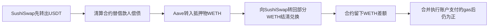

# 普通权限清算案例：真实成交、gas与余额增量

读取日期：2026-10-16，北京时间。全部为公开只读研究、源码阅读和已发生交易的静态算术；没有运行模型、仓库、策略、回测或交易。Carver、ProtoRev及既有样本继续保留，原Kronos FAILED不变。

## 1. 结论与进展

**已取得一笔Aave V2清算的完整公开浏览器交易HTML和交易前后状态HTML：合约增加1.298550505781938468 WETH，执行账户支付0.846085432925289514 ETH gas。将两者按WETH/ETH 1:1兑换数量合并，本笔链上gas后增加0.452465072856648954 ETH等值。** USDT净变化为0。30条日志、131条内部调用及余额变化可交叉核对。

这是普通协议调用权限下、具有具体成交与扣费证据的一笔正结果。它不是一套已经证明长期盈利的个人系统：该清算机器人的源码未在所读Etherscan页面验证公开，全部历史成功/失败交易、部署与运营成本也未闭合。因此原定“事前完整规则及代码、后续完整持仓/成交/费用原账、可低成本复制盈利”的全部要求仍未满足。完整合格案例数量保持0；单笔扣链上gas后正增量证据是新增进展。

原始目标仍是研究可复制的赚钱环节并判断财富目标可行性，未将目标替换成读完文档或找到单笔盈利。

## 2. 谁需要服务，收益从哪里来

Aave是链上抵押借贷协议。借款人抵押资产、借出另一资产；当抵押保障不足时，协议允许清算者替其偿还部分债务，并取得带清算补偿的抵押物。清算者赚取的是替协议处理风险仓位的补偿和处置差额，补偿来自借款人的抵押资产；借款人的债务也相应减少。已读早期协议源码没有要求清算者具备管理员或铸币权限，当前官方帮助也说明任何用户可参与符合条件的清算。普通地址能调用，不等于个人已经满足当地法律、服务条款或实际盈利条件。

这一机制需要借款人、资金池和链上市场，但参与者无需先签下银行或基金客户。关键是及时找到符合清算条件的仓位、正确计算处置后价值，并争取在其他清算者之前执行。这里的已核机制不依赖预测明天价格；协议状态、报价、费用和执行竞争直接决定单笔结果。

来源：[Aave早期LendingPool源码](https://github.com/aave/protocol-v2/blob/3f070d67ecddfb3a66189fd998b4fe72d25ec937/contracts/protocol/lendingpool/LendingPool.sol)、[CollateralManager源码](https://github.com/aave/protocol-v2/blob/3f070d67ecddfb3a66189fd998b4fe72d25ec937/contracts/protocol/lendingpool/LendingPoolCollateralManager.sol)、[当前官方机制说明](https://aave.com/help/aave-101/introduction-to-aave)。当前页面的参数不倒套到2022年，本轮不宣称历史补偿比例已绑定

## 3. 一笔已发生交易的完整经济路径

[交易原页](https://etherscan.io/tx/0x41eddc70253a40cea41587aab1c46c057a1c7247b9aefd1e79917dd00c6b4715/advanced)。Ethereum block14759771，2022-05-12 07:19:37 UTC，页面显示Success。

执行账户：`0x8ca1C2bDfbaF6025284ed1b35BB312490CC39747`；清算合约：`0xAbCf5d4BE599F1C7F71FCbCAE4643A2AA849f4C8`。本轮把该笔交易的这两个执行端合并核算，不认证它们的现实身份或所有权关系。

|步骤|已发生数量|证据|
|---|---:|---|
|SushiSwap向合约转入|39,330.045609 USDT|Transfer与Swap日志|
|合约偿还借款人债务|39,330.045609 USDT|Transfer与LiquidationCall日志|
|Aave向合约转入抵押物|22.807119537915495237 WETH|Transfer与LiquidationCall日志|
|合约向SushiSwap支付|21.508569032133556769 WETH|Transfer与Swap日志|
|合约WETH净增加|1.298550505781938468 WETH|上述差额与状态表一致|
|执行账户ETH减少|0.846085432925289514 ETH|gas账与前后余额一致|
|合并ETH等值增量|0.452465072856648954|前述WETH增量减本笔ETH gas|

这是实际记录，不是教学示例。内部调用顺序为Swap→UniswapV2Call回调→LiquidationCall→归还WETH，USDT先转出后在同一交易内用WETH结清，支持闪电兑换（flash swap，先取得一种资产并在同笔交易内结清）的解释。**它不是Aave闪电贷，不能另外扣一笔假设的Aave闪贷费。** 源码/路由精确实现仍未恢复，不能据此证明任何个人都能无本金复制。

清算合约原本已有110.535859782729284022 WETH，本笔后111.834410288511222490；执行账户ETH从1.974119040991498119降至1.128033608066208605。已有库存与费用资金不能忽略；本笔没有证明这就是资金最低要求，也不把债务金额、原有库存或gas任意选成ROI分母。

WETH是包装ETH，ETH等值按1:1数量解释；本笔利润仍以WETH留在合约。没有实际解包、提取或换美元，所以0.452465不是某钱包已到账ETH或美元现金收入，也未扣未来取出/解包gas、税费、部署、运营及其他交易成本。

## 4. 费用如何对账，哪些仍未知

- Gas Used=698,639，Effective Gas Price=1,211.048099126 Gwei；乘积精确为0.846085432925289514 ETH，并等于执行账户ETH减少。原页显示gas占用，而非用maxFee上限代替实付。
- 基础费燃烧0.839812125610331962 ETH，区块生产者所得优先费0.006273307314957552 ETH，两者已包含在gas合计中，不能再次扣减。
- 原HTML包含131条内部调用，全部Value=0 ETH，没有看到同笔另外向生产者转ETH的支付。8条ERC20转账中，与合约有关的是USDT一入一出及WETH一入一出；余项是借款人债务/抵押凭证销毁及协议金库记账，不加到清算者利润中。
- 兑换实际支付21.508569 WETH已体现池内成交价格、价格冲击和池内费用效果。未独立拆出具体费率时，不在此实际数量上再机械扣假设滑点或池费。
- 没有取得全部历史失败gas、部署、RPC/服务器、数据、维护、税费或链外约定付款。它们影响整套业务净利润；本轮不拿缺少这些资料否认已核本笔数量增量，也不据本笔替代整套业务盈利证明。

**约65.16%的本笔WETH毛差额被gas等值消耗。** 这仅描述该次高gas历史事件，不是现在平均成本或个人未来费率。原页醒目的美元小计随当前币价变化，本轮没有用这些小计计算2022年利润或个人收益。

## 5. 事前公开到哪一层

|层次|结论|
|---|---|
|借贷与清算的公开协议机制|Aave官方2020-12-03公告V2上线，早于2022交易；已读2020-11-26固定源码|
|所读协议入口的权限|LendingPool liquidationCall为external、whenNotPaused；非only管理员，仍需健康度等校验|
|历史精确协议参数/代理升级版本|未全部绑定，不称2020 commit就是2022实际运行二进制|
|本笔真实成交、链上gas、余额增量|已取得完整浏览器HTML并交叉核对，独立归档节点JSON尚未取得|
|实际机器人的完整源码、筛选/出价规则|所读合约页显示未验证源码，未取得完整私有监控/路由/出价代码|
|全部后续持仓/成交/费用与长期净盈利|本轮只核本笔，未完成全历史账|

固定协议文件SPDX标注AGPL-3.0，允许按许可条件研究和复用相应代码，不等于私有机器人的全部代码也取得同一许可。根LICENSE路径404的失败保留，不把失败返回当许可文本。当前新版本Aave机制不直接替换历史V2参数。

[2020年上线公告](https://governance.aave.com/t/aave-v2-is-live-megathread/1621)[所读机器人合约页](https://etherscan.io/address/0xAbCf5d4BE599F1C7F71FCbCAE4643A2AA849f4C8#code)。源码日期证明相应提交日期，首次公开可见时点未独立档案认证；上线公告提供同期协议公开存在的另一路证据

## 6. 个人最值得低成本借鉴的一个环节

**借鉴“可执行净额筛选”：把一个公开规则规定的补偿，与真实可处置抵押物数量、完整融资/兑换成本及gas放进同一张账，筛掉表面有补偿、实际上不够覆盖成本的候选。** 公共源码、交易事件和价格/费用字段可用于只读研究，无需训练模型或机构客户。

这个环节本身还没有证明能给个人带来收益。完整系统仍缺及时且可靠的状态数据、报价计算、竞争出价、失败保护、代码正确性与维护。缺少速度/执行能力，机会可能先被其他清算者拿走；缺少时点和参数校验，可能广播后失败仍花gas；分多笔操作则可能留下币价风险。协议调用权公开并不消除竞争门槛。

与XTX的共同可借鉴点是：为市场参与者提供有价值的执行服务，并用数据和风控保护薄利。这个清算例子并非XTX策略，也不能用它证明XTX利润构成或替代个人价格预测能力证据。

能否放大目前UNKNOWN。需要固定范围内所有成功和失败交易、资金流、全费用与机会量，才能估计净收入、回撤和竞争后容量；一笔0.452465 ETH不能年化，也不能乘以本金假设到达Gerko财富的1%。本轮判断为值得继续知识研究和原账核验，尚无依据独立启动交易项目。

下一项最重要的证据任务仍是**取得普通权限候选的固定规则与完整后续原账并对账**；不以继续挑选赢家替代全样本，也不在当前只研究授权下启动任何实验。

## 7. 其他筛选结果、来源与执行边界

Polymm：MIT公开代码有具体数据/报价/对冲模块，能学习残余头寸如何破坏套利。GitHub仓库创建2026-07-19，作者7月21日说明这是早期已盈利随后衰减的退休Python版；7月29日明确后来继续盈利使用私有Rust版和未公开赔率源。同钱包不等于同策略版本。作者6月30日还说明不是从第一天完整记录订单。因此约5,000美元和后来的650美元均未被本轮升级为开源代码事前固定、全成本原账证明。已仅读取其两个分析脚本源码，未运行、未对其钱包做收益回放。[源码](https://github.com/kachence/polymm/tree/f598cf8a02a19204685db0fac260b292b71283a4)、[公开版本说明](https://kacho.io/open-sourcing-my-polymarket-bot)、[私有重写说明](https://kacho.io/everything-and-nothing)、[订单记录缺口说明](https://kacho.io/why-my-polymarket-arbitrage-bot-lost-money)

另筛公开奖励bot与DLMM钱包看板：前者未取得真实全账，后者仅到Loading入口；没有把奖励估计、汇总PnL或页面到达当已盈利。两条子研究已停止扩展，详见同目录incentives/screening.md。

随后针对源码缺口，定向查Liquity V1普通EOA直接调用公开TroveManager的清算。子研究未找到成功清算hash；根正常浏览器读到合约地址及25条近期记录，所见均为失败/非清算，未选为盈利案例。点击全部1,680条交易列表后出现安全验证，未解决或绕过，也未再从其他通道请求该受影响列表。此局部读取停止不影响已经取得的Aave原件。

本例线索来自Lehar/Parlour的BIS Working Paper1062，发表2022-12-16，其对同一hash报告约0.45 ETH净值；作者圆整数仅用于定位，根代理用原页精确数独立核算，不混用论文示意图。[发表页](https://www.bis.org/publications/working-paper-1062-systemic-fragility-decentralised-markets)

证据根为`evidence/permissionless-case-20261016/`。已保存交易advanced HTML、state原HTML、源码、原论坛JSON、作者原文、读取UTC与SHA256。普通浏览器成功访问后，对同一公开页面及其可见state URL正常HTTP GET均200；没有绕验证、换身份或访问私有接口。PublicNode公开RPC两个历史只读方法返回null，未误认成交易不存在，也未注册归档权限；Blockscout403和web读取失败原文仍保留。

本轮没有账户登录、钱包连接、凭证读取、模型/策略/回测执行、签名广播、下单、付费、安装依赖或公开发消息。AAPL一次核对与作者回复监控不重启、不修改；原目标保持未完成。

独立审阅已完成：另一审阅者从两份原HTML重新读取全部30日志、8项转账和131内部调用，复核费用与前后余额，确认本笔扣gas后ETH等值正增量；同时保留受益/提取权、源码、长期账与成本范围缺口。见`aave-transaction/independent-review.md`。
