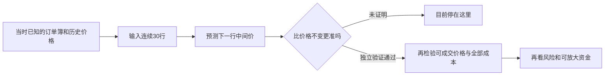

# 比特币公开预测示例：源码能复用，盈利优势尚未证明

资料读取：2026-10-17（UTC）。本轮只读公开网页、已发布代码和既有证据；没有运行代码、训练或预测、评分、回测、交易、下载行情文件或权重。

## 结论

当前研究以“能否复现有用的预测优势”为主线。A股期权权限、券商选择和开户资格不再作为公开模型研究的前置条件。市场仍决定数据含义与适用范围，但不需要先选择交易账户才能读懂模型。

已读到原数据发布者 Martin Søgaard Nielsen（martinsn）的公开 Notebook《Starter: High Frequency Bitcoin Forecasting》全部12个已发布代码单元。它使用 BTC 一分钟订单簿数据，输入连续30行、154列，预测下一行的中间价。代码展示了一个小型全连接模型和一个小型 LSTM（长短期记忆网络，一种处理序列的神经网络）。这提供了可借鉴的研究方法，尚未提供扣费盈利证据，也不是 XTX 的公开生产模型。[原作者 Notebook](https://www.kaggle.com/code/martinsn/starter-high-frequency-bitcoin-forecasting)

核心判断分三层：**方法可以复用；作者每个预测尚不能原样复现；可赚钱优势未得到证明。** 本轮取得的是实际源码证据，而非模型已经执行或实验已经成功。

## 1. 这段代码究竟做什么

| 项目 | 实际公开内容 | 证据范围 |
|---|---|---|
| 身份 | 原作者 martinsn；Version 1 of 1，版本号73901708 | 页面、公开HTML的oEmbed链接 |
| 发布日期 | 2021-09-03；页面时间15:34:58 UTC，HTML JSONLD为15:35:00.2033333 UTC | 两字段相差约2.2秒，分别保留，不强行合成一个精确时间 |
| 文件 | `BTC_1min.csv`，不是前轮查看列名的 `BTC_1sec.csv` | 代码单元2 |
| 规模 | 作者缓存输出为17,113行；删索引列与时间列后154列 | 作者当时的输出，未用本地CSV独立复核 |
| 时间 | 头部5行缓存显示2021-04-07、`+00:00`、相邻一分钟 | 仅这5行，不能证明全文件历史范围、无缺口或时钟定义 |
| 输入 | 连续30行，包含历史中间价、价差和订单簿相关字段 | 代码单元4—8；未见专门构造的“买卖压力”因子 |
| 目标 | 第31行的 `midpoint`（最优买卖报价的中间价格）水平 | 按代码及标准Keras窗口语义的静态判断；不是30分钟后的价格，也不是收益率 |
| 切分 | 前80%作为训练部分；没有随机打散 | 代码单元6—8；假设原行序确实按时间排列 |
| 标准化 | 只用训练段均值、标准差，应用于全段 | 代码单元7，做法有助于避免这一环节的未来信息泄漏 |
| 模型一 | Flatten → Dense(16) → Dense(1) | 单元9；按Keras默认激活为linear，两层组合在函数形式上仍是仿射映射，不应称为非线性预测优势 |
| 模型二 | LSTM(16) → Dense(1) | 单元11；标准LSTM包含非线性门控，与模型一不同 |
| 展示 | 训练10轮；还原价格后与真实价格作图 | 单元9—12；没有数值测试集指标、价格不变基准或交易账 |

源页标明 **Apache 2.0**；配套原作者数据页的 **CC0** 是前轮另行核过的数据许可，不能拿代码许可替代数据许可。两者为个人复用方法提供了积极依据，但不保证数据质量、所有第三方权利、模型效果或具体交易准入。[Notebook及许可](https://www.kaggle.com/code/martinsn/starter-high-frequency-bitcoin-forecasting)、[原数据页](https://www.kaggle.com/datasets/martinsn/high-frequency-crypto-limit-order-book-data)

## 2. 用第一性原理看它可能有什么价值

交易价格由实际买卖订单形成。订单簿记录买卖双方愿意在哪些价格、以多大数量成交；撤单和主动成交会改变这些条件。**研究假设**是：当前这些可观察状态，可能包含下一小段价格变化的信息。它需要在未用于选择模型的数据上检验，不能从“数据很多”“用了LSTM”直接推出成立。

这张图中的后两步是尚未完成的证据链。当前示例直接学习价格水平，输入本来就含最近价格；即使曲线贴近，也可能只是追随现价。只有与“下一时点价格仍等于最后已知价格”等相同样本基准比较，才能知道订单簿与模型是否提供了增量信息。

即使准确预测中间价，也不等于能按中间价买卖。后续若要判断赚钱，才需要加入当时可成交的买卖价、延迟、费用、滑点、未成交和持仓风险。本轮未做这些计算，也没有为此要求先选券商。

## 3. 静态代码审查发现的具体问题

以下根据公开代码及标准Keras滑动窗口语义推导，**没有执行 Notebook**；作者当时精确的TensorFlow/Keras版本没有锁定，因此运行表现仍待未来获授权时核验。

1. **训练边界有一个标签越界。** 训练输入 `[:T]` 配目标 `[30:T+30]`，最后可用训练窗口输入为 `T-30…T-1`，目标为 `T`。在这里T=13,690，恰为首个保留段标签。这是相对80%行切分的边界问题，不是训练使用了后面整段，也不是30个标签全部泄漏。它尚未碰到首个实际测试预测目标 `T+30`，不能据此宣称测试目标已经泄漏。正式方案应明确样本归属并消除此越界。
2. **测试尾部又被截短。** 测试输入先取 `[T:N-30]`，再创建长度30的窗口；按标准语义产生3,364个预测，绘图真实目标 `[T+30:]` 有3,393个，尾部多29个真实点没有对应预测。前段可以按索引对应，不能据此说全部错位；正式评估必须保留时间戳，逐条唯一配对、同长核对。
3. **时间列先被删掉。** 未见对完整行序、重复、缺口、采样截止和事件可用时点的核验。滑动窗口的“下一行”只有在这些条件成立时才可解释成下一分钟。头5行的UTC标记不能代替全文件审计。
4. **没有回答增量优势。** 未给出保留段误差、价格不变基准、与简单线性模型的数值基准比较、按天稳定性或置信范围；公开的Dense模型虽可作为简单模型对照，但这里仅作图，训练误差下降不是样本外优势。作者没有锁随机状态和精确依赖版本，也没有在Output页公布模型文件，不能承诺复现完全相同的预测。

这些是局部可修、可检验的问题，不构成“所有数据污染”“代码没有价值”或“AI预测不可能”的证据。也不能修完后直接宣布盈利。

## 4. 我们能复制什么、还缺什么

| 环节 | 当前能借鉴的内容 | 缺少后会有什么后果 |
|---|---|---|
| 数据与方法 | CC0原数据来源、Apache许可的公开示例、订单簿输入思路 | 许可积极不等于实际CSV已取得、质量已核；本轮未下载行情 |
| 建模流程 | 仅训练段标准化、时间顺序切分、连续窗口、小模型、价格还原 | 不审时点和配对可能把不可用信息或错误对齐当能力 |
| 可解释的研究问题 | 订单簿是否比最近价格增加预测信息 | 直接看价格曲线无法区分模型优势与现价延续 |
| 精确复现 | 公开模型结构和训练脚本 | 缺精确库版本、随机状态、权重，不能保证作者逐条预测相同 |
| 盈利 | 当前未提供 | 缺买卖规则、持仓、成交与全部费用，不能算真实利润 |
| 放大 | 当前未提供 | 缺不同规模下的深度、成交率、冲击与回撤证据，不能推资金容量 |

**最有价值的可复制环节是“用订单簿信息检验下一分钟的增量预测”，不是直接复制LSTM名称。** 无需先复制银行客户网络或机构做市系统。但若最终信号只存在于个人无法达到的延迟、费率或成交条件下，预测有效也可能无法转成个人利润。

尚不能把本案例列为“公开完整账、样本外扣费盈利”的成功案例；它是一个更透明的预测研究样本。原Kronos-small既有FAILED结论、已核历史现金片段和独立AAPL/Issue85安排均不被本轮替换。

## 5. 收敛后的下一步（仅方案研究）

下一项只收敛一个问题：**同一批严格配对、从未用于选模型的时间样本上，订单簿输入是否胜过最近价格和简单线性基准？** 以本来源实际可取得的数据范围重新定义协议，不能把前轮Kraken的34日方案或其他比赛分数搬过来。

方案应事前固定时间划分、目标、可用字段、缺口处理、训练边界与隔离带、基准和通过标准；保留各天结果，不凭单一总体分数或漂亮曲线通过。先验证预测增量，盈利和容量仍需后续独立证据。现有约12日数据即使通过，也只能作有限早期证据，不能证明长期有效。

**当前仍只研究，不运行上述检验。** 个人低成本复用方法的许可与源码条件已取得实质进展；稳定预测优势、扣费收益、容量以及距离Gerko财富1%的资金路径仍未证明。

## 证据与读取边界

- 公开HTML HTTP 200，9,000字节，读取2026-10-17 02:39 UTC；其身份、日期和版本链接可查。HTML不含Notebook实际代码。
- 随后父会话使用既有正常公开浏览器，匿名读到Version 1全部12个已发布代码单元，保存渲染文本与逐单元摘录；未观察到这些代码单元被截断，但这仍不是原始ipynb文件。
- 曾点击一次公开“Download .ipynb”，未获得可验证的文件或返回路径，不记为下载成功；没有重试、登录、Copy & Edit、运行或接受新协议。
- 作者缓存的5行表头样本、训练日志随页面显示；它们不是本机实验、全量数据质量核验或独立绩效。浏览器自动渲染传输量未审计，不能写成零网络数据。
- 正常页面展示的代码许可为Apache 2.0。未找到作者公开的精确权重、逐笔预测、完整持仓成交和费用原账。
