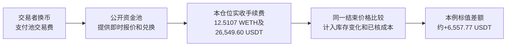

# 流动性提供案例：完整撤资原账与收益边界

公开资料读取：2026-10-16 UTC。本轮只核已经发生的记录、源码和整数账；没有开发、运行模型、回测、执行合约或交易。研究对象为此前保留的Uniswap V3仓位NFT **1338529**，不是重新挑选的模型输出。

## 核心结论

**这次拿到了比前面更扎实的收费业务原账：仓位已全部撤资，实际手续费到账可确认；扣已核成本后的历史同价估值差额为正。** 但它仍不是完整公开、已证明个人可以持续复制的交易策略。

该地址投入约**634.0749 ETH及1,353,746.01 USDT**，约28.5天后撤出全部流动性。扣除撤回本金，实际收取手续费为 **12.510737190763265991 WETH及26,549.598660 USDT**，其中WETH在同笔交易中解包为ETH转给原地址。[建仓收据原请求](https://api.routescan.io/v2/network/mainnet/evm/1/etherscan/api?module=proxy&action=eth_getTransactionReceipt&txhash=0xc7b663a1635627a529e6536417f6225a66278070b5ee108de442a634aa3fc8cc%29%E3%80%81[退出收据原请求](https://api.routescan.io/v2/network/mainnet/evm/1/etherscan/api?module=proxy&action=eth_getTransactionReceipt&txhash=0x7aef61fb075e5dc66e034a01fa64f2e38c9ad1b6e0cf645f435427ec9e3acda9%29

用预先固定规则选出的撤资前最近同池Swap状态，将实际退出资产和原始投入资产都按同一价格估值，手续费约值52,828.17 USDT，库存变化相对原币持有的差额为−46,266.93 USDT。扣两笔实际链上费用及保守全额扣除五笔此前USDT授权费用后，差额约 **+6,557.77 USDT**。这是**历史状态估值比较**，不是资产全部实际卖成USDT后的现金利润，更不是美元收益率或未来预测。原始数量及估值核算（未随包收录；原相对路径：`运行验证-20261015/evidence/amm-lp-case-20261016/root/free-route-check/lifecycle-cashflow-and-historical-mark.json`）。

对我们的启发是：**可以研究复制“为已有交易流提供兑换服务、按公开规则收费”这个环节；不能从这笔赢家直接复制利润金额或推到Gerko财富的1%。** 协议收费路径不需要价格预测模型，操作者是否用模型选择区间与时机仍未知。

## 一笔业务怎样产生收入

流动性提供者（LP）把两种资产放进资金池，让别人可以即时把一种换成另一种。自动做市商（AMM）按公开数学规则调整兑换价格；V3的LP还能指定资金服务的价格区间。交易者支付池的交易费，在当时价格区间内提供流动性的仓位按规则分享费用。[2021-05-05官方上线说明](https://blog.uniswap.org/launch-uniswap-v3)、[公开费用记账源码](https://github.com/Uniswap/v3-core/blob/e3589b192d0be27e100cd0daaf6c97204fdb1899/contracts/libraries/Position.sol)、[区间内费用增长源码](https://github.com/Uniswap/v3-core/blob/e3589b192d0be27e100cd0daaf6c97204fdb1899/contracts/libraries/Tick.sol)

这里的客户是已经通过资金池和路由器换币的交易者。个人不必先去找银行或基金客户，但收入依赖已有交易流和自己实际提供服务的份额。客户付费的原因是获得即时兑换；手续费不是AI凭空创造的钱。

本例是WETH/USDT的0.3%费率池；0.3%是该池对交易收取的费率，**不是LP仓位的收益率**。区间约为1,737.20—2,130.30 USDT/WETH，由建仓交易中的tick边界确定。区间和资金量在建仓时已经公开，入场选择与后来何时撤资的完整决策规则没有公开。此前实际建仓参数与区间核验（未随包收录；原相对路径：`运行验证-20261015/evidence/amm-lp-case-20261016/root/candidate1338529-static-mint-audit.json`）。

下图最后一格是同一结束价格下的标值差额，不能当作实际全USDT结算所得：

这是与XTX“提供交易服务、承担库存风险”可作机制对照的样本。它没有披露或复现XTX的模型、报价系统、对冲或客户业务。

## 已发生的资金账

观察到的仓位事件为：7月22日一次增加流动性；8月19日一次全量减少流动性，紧接一次领取。最初与撤出的流动性整数均为590034172147953513，累计剩余流动性为0；所有权事件仅见最初铸造给原地址，没有后续转移。读取截至2026-10-16 00:00 UTC之前，包含正常分页终止；空NFT仍可存在，不能把“没销毁NFT”当成“没撤资”。[仓位事件原查询](https://api.routescan.io/v2/network/mainnet/evm/1/etherscan/api?module=logs&action=getLogs&address=0xc36442b4a4522e871399cd717abdd847ab11fe88&fromBlock=0&toBlock=26201365&page=1&offset=1000&topic1=0x0000000000000000000000000000000000000000000000000000000000146ca1%29%E3%80%81%E7%8B%AC%E7%AB%8B%E4%BA%8B%E4%BB%B6%E5%AE%A1%E9%98%85%EF%BC%88%E6%9C%AA%E9%9A%8F%E5%8C%85%E6%94%B6%E5%BD%95%EF%BC%9B%E5%8E%9F%E7%9B%B8%E5%AF%B9%E8%B7%AF%E5%BE%84%EF%BC%9A`运行验证-20261015/evidence/amm-lp-case-20261016/root/free-route-check/protocol/lifecycle-events-review.md`）。

| 项目 | ETH/WETH数量 | USDT数量 |
|---|---:|---:|
| 实际投入本金 | 634.074933604560966689 ETH | 1,353,746.011618 |
| 撤出流动性对应本金 | 90.428962086344584172 WETH | 2,449,397.185410 |
| 实际领取总量 | 102.939699277107850163 WETH | 2,475,946.784070 |
| 实际领取减撤出本金，即手续费部分 | **12.510737190763265991 WETH** | **26,549.598660** |

最后一行不是“领取总量减最初投入”。持仓组成已经在服务交易的过程中变化，必须先把撤资本金从领取中剥离。官方源码也明确把移除流动性所得本金与累计费用一并记入可领取款；Collect事件可能有舍入差异，不能只读事件标题就当到账。本笔实际Transfer、解包和原地址收款逐项吻合，未见该笔舍入差。[固定版本仓位管理源码](https://github.com/Uniswap/v3-periphery/blob/464a8a49611272f7349c970e0fadb7ec1d3c1086/contracts/NonfungiblePositionManager.sol)、[接口警告及字段定义](https://github.com/Uniswap/v3-periphery/blob/464a8a49611272f7349c970e0fadb7ec1d3c1086/contracts/interfaces/INonfungiblePositionManager.sol)、实际收支独立审阅（未随包收录；原相对路径：`运行验证-20261015/evidence/amm-lp-case-20261016/root/free-route-check/protocol/entry-exit-cashflow-review.md`）。

建仓发送的ETH略多于实际投入，差额0.000008395127004793 ETH已原路退回，没有把它计为投资本金。退出时102.939699277107850163 WETH全部解包，并同量转给原地址；USDT也全部经过仓位管理合约转到原地址。中间转账和解包不重复计收入。

## 为什么5.28万手续费不等于5.28万净利润

仓位服务期间，资产结构从较多ETH变为较多USDT。ETH相对USDT上涨时，这相当于持续出售部分ETH；与一直拿着原有ETH和USDT相比，LP可能少享有一部分上涨。这是库存风险，不是额外收到一张46,266.93 USDT的账单。

估值价格按事先保存的规则，取退出Burn之前最近一次同池Swap：区块25790241、全局日志263，实际记录sqrtPriceX96为3631106411354512016850449。按WETH18、USDT6小数位换算为 **2,100.481133872785… USDT/ETH**，不是取后续有利价格或另一个平台报价。退出发生在25790244；公开源码支持Swap日志记录其完成后的池状态。小数位另核提供商源码：WETH声明18，USDT构造参数为6；未独立重编译或执行合约。[固定范围内Swap原件](https://api.routescan.io/v2/network/mainnet/evm/1/etherscan/api?module=logs&action=getLogs&address=0x4e68ccd3e89f51c3074ca5072bbac773960dfa36&fromBlock=25790144&toBlock=25790244&topic0=0xc42079f94a6350d7e6235f29174924f928cc2ac818eb64fed8004e115fbcca67&page=1&offset=1000%29%E3%80%81%E7%8B%AC%E7%AB%8B%E4%BC%B0%E5%80%BC%E5%8F%8A%E6%88%90%E6%9C%AC%E5%AE%A1%E9%98%85%EF%BC%88%E6%9C%AA%E9%9A%8F%E5%8C%85%E6%94%B6%E5%BD%95%EF%BC%9B%E5%8E%9F%E7%9B%B8%E5%AF%B9%E8%B7%AF%E5%BE%84%EF%BC%9A`运行验证-20261015/evidence/amm-lp-case-20261016/root/free-route-check/protocol/historical-valuation-and-cost-review.md`）。

| 同一结束池状态下，与原币持有比较 | USDT标值 |
|---|---:|
| 已领取手续费 | +52,828.17 |
| 撤资本金结构变化相对原币持有的差额 | −46,266.93 |
| 两笔实际链上费用：0.001607728054521906 ETH | −3.38 |
| 保守全额计入此前五笔USDT授权费用 | −0.08 |
| 合计差额 | **约+6,557.77** |

如果手续费不足以覆盖库存变化造成的相对差额与成本，即使领到手续费也可能跑输原币持有。价格继续向一个方向移动、区间失去服务份额或交易流不足，也可能改变结果。不能从这一笔正例承诺未来盈利。

这里没有假设一次大额出售ETH的可成交价格，也没有模拟清算或扣一个编造的滑点数字。因此不声称“扣完未来清算滑点的全现金利润”。USDT也没有直接写成美元。

## 前置换币、费用与规则的剩余缺口

截至退出区块25790244，该地址正常交易索引的两页返回88条，其中出站61条，nonce连续0—60。建仓为59、退出为60；两者之间没有该EOA的其他已上链出站交易。五条历史失败交易均更早，不能假称为本仓位期间失败费，也不能据此证明所有别的钱包或账外操作为零。

紧邻建仓前还有nonce58的真实换币：支出125,221.177122 USDT，收到64.581943113032031780 ETH。我们补取了其收据、交易和原生币流；费用0.000011714128858810 ETH。将这笔前置换币及此前全部五笔USDT授权费用也纳入，三个实际操作的资金组按同一结束价比较，标值差额为 **+16,989.73 USDT**。它的起点改为换币之前；额外部分包含换入ETH之后的价格变化，**不能全部归为LP手续费，不能与6,557.77相加**。原始金额和分组核算（未随包收录；原相对路径：`运行验证-20261015/evidence/amm-lp-case-20261016/root/free-route-check/lifecycle-cashflow-and-historical-mark.json`）。

授权供多次操作共用，全部收费归本例属于保守分配，不是已证明这些费用只服务这个NFT。融资来源与利息、其他账户、账外维护成本仍未确认。资金组的正标值不能替代完整经营利润。

## 能复制哪些环节，哪些仍不能复制

| 环节 | 对个人的含义 | 当前证据 |
|---|---|---|
| 收费机制 | 可以学习公开资金池如何按交易服务收费；不必自己建立银行客户网络。 | 公开协议源码、真实领取和实际转账支持。 |
| 查账与风险约束 | 用原始数量区分本金、手续费、库存变化、前置换币和费用。Codex可辅助解析，重要整数与来源仍需独立核对。 | 本例已做，不依赖AI预测。 |
| 代码学习及复用 | 固定版本外围代码为GPL；核心LICENSE列出不晚于2023-04-01转GPLv2或以后版本的条款。遵守具体版本许可，不等于已核个人实际上链使用的全部条件。 | [核心LICENSE](https://github.com/Uniswap/v3-core/blob/e3589b192d0be27e100cd0daaf6c97204fdb1899/LICENSE)、[外围LICENSE](https://github.com/Uniswap/v3-periphery/blob/464a8a49611272f7349c970e0fadb7ec1d3c1086/LICENSE) |
| 区间和择时 | 不能直接照抄历史区间。完整入场、区间选择、退出日和是否对冲的事前政策未公开。 | UNKNOWN；不从历史操作反推唯一私人策略。 |
| 个人5,000美元能否盈利 | 本例实际资本数量远大于个人起步预算；不能按金额比例承诺同样表现。份额、费用、价格路径与区间都会影响结果。 | 尚无个人盈利、稳定收益率或容量证明。 |
| 放大至Gerko财富的1% | 需要可重复净优势、足够交易需求、资金与扩张时的风险控制。更强模型不能代替这些条件。 | 这个目标未达到，也没有可验证的放大路径。 |

本例支持“公开提供流动性可以产生真实手续费收入”，并给出一笔完整撤资后的正历史标值比较；它不支持“已找到一套完整公开且可持续赚钱的个人交易策略”。公开协议机制早于2026年案例；**投资操作政策没有因此自动成为事前公开政策**。两层分开。

## 是否继续投入与唯一下一项

**值得继续一次有限的公开原账验证；当前不独立开发，不做模型或交易试验。** 下一项只核该地址在已固定截止区块25790244以前，同一个WETH/USDT 0.3%池的全部可识别仓位，包含亏损和未关闭仓位，检验这次是否只挑到了赢家。

只收集真实已发生的持仓、领取、转账和费用，不生成模拟交易、不回测策略、不拟合区间。公开查询新增付款0；先确认可完整列举，再核算。若只能取到一部分，报告实际覆盖与缺口，不能将样本说成全部；无法闭合的仓位保持未评分。即使整体历史比较为正，也不升级为事前策略、样本外优势或未来盈利证明。

原件、读取UTC、URL、HTTP状态、SHA-256及独立审阅位于本轮证据目录（未随包收录；原相对路径：`运行验证-20261015/evidence/amm-lp-case-20261016/root/free-route-check`）。数据主要来自同一新索引服务；此前独立Etherscan原件只交叉验证了建仓，未提供独立完整生命周期证明。两次带分页参数的native查询返回NOTOK空字符串，已保留；改用该服务此前已验证的txhash-only参数后取得原件，没有把失败当作零、修改认证或重试被拒网页。

原Kronos FAILED、封存预测与AAPL/Issue85自动化未改。这里的研究与Maker近期任务池筛查分别保存：[Maker阶段报告](<Maker近期任务池-四分支与同事件筛查-20261016.md>)。
