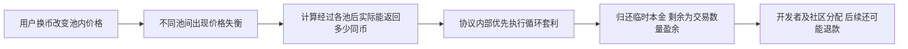

# 真实套利原账：ProtoRev 的赚钱机制与个人复制边界

本轮读取：2026-10-16，北京时间。只读公开资料、源码和已发生交易事件；没有运行模型、策略、回测，未注册、连接钱包/账户、下单、付款、安装依赖或发消息。只对公开既存事件做静态算术，不新增假想交易路径。

## 1. 本轮结论

**找到了一项规则早于结果公开、能读到具体真实套利成交和正数量盈余的案例：Osmosis 的 ProtoRev。** 这比收益截图或回测曲线更具体。但还没有取得完整原始交易JSON、全历史逐笔费用与开发者/退款等分配闭账，也未证明个人能以相同条件成交，所以没有登记为满足用户全部要求的可复制盈利正例。

最关键的发现是：它既用公开数学计算价差，也依赖协议层执行权限——用户交易后自动运行、临时铸造/销毁交易本金、独立gas计量。收益的关键竞争优势包含执行位置与权限，不能仅通过复制源码或更强模型取得。

本次核到的一笔非常大的收益来自异常跨链换币造成的池间失衡。它不是普通行情下个人稳定套利能力的证据；后续还有退款拨款，不能停在最大的利润数字上。

## 2. 对象、事前公开与版本

- [Osmosis Foundation原说明](https://forum.osmosis.zone/t/osmosis-protorev-by-skip-protocol/604) 创建2023-01-31，当前文章版本2更新于2023-11-08，均早于本次2025-08-08交易。官方Discourse JSON原件保留created_at/updated_at/version。这支持机制事前公开，并不等于整个协议以后从未升级或路由参数不变。
- [固定源码](https://github.com/osmosis-labs/osmosis/tree/d31c9b386cd6e7f00eea6334df5a1d04c0507f31/x/protorev)，commit `d31c9b386cd6e7f00eea6334df5a1d04c0507f31` 的提交日期2025-08-07。已保存keeper下rebalance、posthandler、emit、developer_fees、epoch_hook等及查询schema。
- 固定LICENSE实读为Apache-2.0，软件可按许可条件个人阅读和复用；不能由此推断节点服务无限免费、链上部署无成本或个人具备模块权限。
- 代码与真实事件机制相符，但本轮没有把该Git commit绑定为高度41,543,523各验证者的精确运行二进制，也未取得该时点全部参数。因此不称逐字节复现了生产节点。

## 3. 已发生的一笔交易：原件与钱的路径

原件入口：[Mintscan交易详情及Raw Json](https://www.mintscan.io/osmosis/tx/3428B4FC45A7E2E756A27FDCD4801F51A6E890A119751E7DB0EECD477B869DBF?sector=json%29

- Chain：osmosis-1；区块高度41,543,523；UTC时间2025-08-08 15:27:32。
- Hash：3428B4FC45A7E2E756A27FDCD4801F51A6E890A119751E7DB0EECD477B869DBF。
- 页面显示交易成功、code=0。已在正常渲染浏览器展开全部49条posthandler事件，逐条解析的属性数量和页面声明相符；不是运行套利程序。
- **原件保存限制**：页面复制出现Copied，但剪贴板读取为空；没有获得完整raw JSON文件。已保存关键DOM字段转录与原件URL，保留长地址/币种被界面截断的省略号；完整49条紧凑转录在本会话CUA工具回执。不能将这些材料称为完整原始JSON或独立归档节点证明。

币种身份由本次保存的Cosmos chain-registry assetlist单独映射：Noble USDC与Axelar USDC均6位小数，OSMO为6位小数。该映射不回填、改写原始DOM里的截断文本。

|步骤|真实事件读取的数量|核验含义|
|---|---|---|
|协议临时铸造本金|20 Noble USDC|模块有minter权限；不是投资者自有本金|
|第一跳，pool1263|19.99 Noble USDC入池，另有0.01同币扣款；收到110.288340 OSMO|数量账可对上20的全部去向；扣款用途仍与费用接收者单独区分|
|第二跳，pool678|110.288340 OSMO换得19.856896 Axelar USDC|该币种与Noble USDC不是同一链上denom|
|第三跳，pool1223|19.854911 Axelar USDC入池，另有0.001985同币扣款；收到964,351.175691 Noble USDC|中间币余额增量为0；实际成交数量包含池内价格与费用效果|
|销毁/归还本金|20 Noble USDC|不把归还本金算利润|
|事件profit|964,331.175691 Noble USDC|实际返回数量减20本金，分配及退款前的成交层数量盈余|

这张表描述真实公开事件，没有教学造数。原始最小单位和对应事件序号见`protorev/mintscan-dom-selected-events.json`。

数量增量核对：Noble USDC为20−19.99−0.01+964351.175691−20=964331.175691；OSMO为0；Axelar USDC为19.856896−19.854911−0.001985=0。与`protorev_backrun`事件的amount_in、amount_out、profit相符。没有按价格假设重演交易，没有生成新策略收益。

**不能算ROI**：20来自协议临时铸造，不能当个人投入资本，不能据此计算巨额回报率。USDC数量不等于已兑换到账美元；没有做美元汇率/赎回或税后收益推算。

## 4. 它凭什么赚钱，谁承担相应损失

ProtoRev观察用户换币后的池状态，寻找从同一资产出发、经过数个池后回到更多该资产的路径；先计算是否存在正差额，再确定交易数量和路线。它赚的是池间价格失衡提供的可成交差价，属于循环套利；本案例不需要语言模型推荐股票或预测明天价格。

本次大额盈余的背景不能省略：[2025年8月的退款讨论](https://forum.osmosis.zone/t/return-excess-profit-from-protorev-in-exchange-for-20-bounty/3856)说明，一笔大额跨链提币经过流动性不足的换币路线，带来严重滑点。该讨论的作者解释不是单凭我们账目推断的因果证明；交易事件则直接显示了随后发生的池间套利。不能把整笔用户损失与本次profit视为完全同一个数，原文约964482.78与事件964331.175691有差别

一般经济机制上，套利从失衡池获得价值；流动性提供者的资产组合和用户成交价格参与了价值转移。本次异常路由的用户承担大额不利成交。具体全部价值在用户、各池LP、协议及其他收费方之间如何分解，本轮没有重建。

## 5. 费用和后续分配必须分层

### 成交层能确认的内容

实际成交输入/输出和额外扣款均进入上表数量核算，不能在已有实际输出上，再机械扣一次假设滑点和同一笔池费。第一跳0.01和第三跳0.001985的同币额外扣款已纳入数量账；本轮没有独立逐项标定它们全部费用接收者和费率，不能擅自统一称某种手续费。

交易页面gas_used=2,145,487、gas_wanted=2,351,765，交易费25,870 uosmo（0.025870 OSMO）。后处理事件显示该费用从**relayer地址**支出，不是从ProtoRev模块地址扣除；不能错误地将其全部从模块利润扣一次，也不能把整笔交易称为无人支付gas。

所读posthandler源码另设GasMeter，注释及写回流程说明模块执行不计入该用户交易gas。它仍消耗验证者算力和网络资源；源码与事件不能证明整个协议或运营方的全部经济成本为0。

### 开发者分成与退款尚未闭账

所读代码按阶段计算开发者分成，按day epoch从模块余额分配；这不是单笔套利事件中已支付的另一笔fee receipt。2025年的公开讨论采用5%分成，但本轮未取得对应实际epoch分配事件和精确历史配置，故只保留条件计算，不登记已到账。

已用[官方LCD查询proposal969](https://lcd.osmosis.zone/cosmos/gov/v1/proposals/969)，状态`PROPOSAL_STATUS_PASSED`、failed_reason为空，投票结束2025-08-21；其消息要求向指定用户拨付**732,891 Noble USDC**。这项后续用途会改变社区可保留收益。我们确认链上提案状态及金额，未取得独立的收款余额变化/拨付事件原件，未宣称收款已独立核实。

独立复核另确认：即使暂用5%档位，社区份额的80%为732,891.6935256 USDC，与提案整额732,891相差0.6935256；不能将近似口径称为精确结算闭合。

因此964331.175691是**交易数量盈余，开发者分配和退款前**。它不是社区最终保留利润、Skip到账收入、企业全成本利润或一个个人账户的净ROI。后续退款及实际分配不能因初始交易很漂亮而省掉。

## 6. 个人可低成本借鉴的唯一环节

**候选环节：用真实可成交数量核算整条路径，只有全部成本后仍有足够正差额，才认为存在交易机会。** 研究其公开算法和账目不需要机构客户或训练GPU，源码可以按Apache许可阅读。它让我们区分屏幕价差、报价预估、真实成交和最终入账。

但本轮没有证明这一环节在普通个人账户中单独构成赚钱优势：

|环节|个人可否借鉴|缺失后的后果|
|---|---|---|
|用交易数量闭环、统一币种并核成本|可作为低成本研究方法|把币价变化、资金转入、漏费或未成交报价误当利润|
|协议用户交易后自动插入执行|普通账户没有此模块权限|看到价差时，机会可能已被协议或竞争者拿走|
|协议临时铸造并销毁本金|普通账户不能据源码获得minter/burner权限|需要自有资金或另行合法融资，并承担对应成本与风险|
|模块gas处理|普通外部交易不继承|失败、竞争和上链费可能吞掉小价差|
|复制同一利润及容量|未证明|某个异常大单的利润不能外推为日常收益或扩大资金后的收益|

普通交易者还要处理报价变动、部分成交/跨市场时差、失败交易费用和持续维护。把这个模块改写成普通账户机器人，会变成新的执行系统，不能继承协议的本次结果。这里没有开始设计、开发或测试这种机器人。

**判断**：值得作为赚钱机制与执行优势研究，当前不据此独立立项。真正缺的不是一个更强模型，而是普通权限下能够保住可成交净差额的证据；本轮尚未取得。

## 7. 本轮准入判定与其他候选

|用户条件|本轮结论|
|---|---|
|规则事前公开|机制说明先于交易；已有更早固定源码。精确历史节点二进制及全部参数未绑定|
|后续持仓、成交原账可查|本次三跳成交、借还本金、中间资产增量可读；完整原始JSON/全历史账未取得|
|费用原账齐全|可读交易费付款人和数量扣款；池费分项、epoch分成、退款实际拨付及全部运营成本未闭合|
|扣费后盈利|确认特定成交数量链存在正差额；最终全成本/全分配净利润未确认|
|个人低成本复制赚钱|未通过；关键执行条件依赖协议权限|

保持 **全部条件通过案例数量=0**。本轮新增的是一条真实成交层正盈余证据，不是策略盈利准入通过，更不是达成财富目标。

独立子研究另核两个LP候选，未晋级：`coindataschool/univ3lp`虽有具体NFT汇总，但相对原币持有的PnL与美元起终差额不同，缺完整逐笔收据与事前个人策略；`ThanosDrossos/IL_Measurement`有30,058条burn观察，却归并了mint/collect且缺gas，不能当完整前向实盘账。其原文和独立报告保存在onchain目录。没有用只借贷/利息案例替代交易优势，也没有重新运行Carver或先前模型。

## 8. 证据、访问限制与执行边界

证据根：`evidence/complete-ledger-case-20261016/`。下载的源码、官方论坛JSON、当前链上查询、chain-registry、DOM选定字段、静态算术和独立审阅分别保留。各收据含URL/读取UTC/固定版本或hash（适用时）；新目录总manifest只扫描本目录，不扩扫其他项目。

- 官方LCD历史tx GET为404；保留为该入口本次未取到，不推断整条链没有该交易。
- 普通web读取Mintscan为无正文，正常浏览器渲染取得交易，未解决验证码或访问私有API。页面中出现的API代理/资源地址没有被用来读取认证信息。
- 复制JSON未取得内容；展开长数组的一次点击超时后检查实际状态，未盲目重复。后处理49事件已全部显示；主消息组仍有部分隐藏，不把它称为完整导出。
- DAO DAO页面要求接受terms，未点击、未接受；独立使用官方公开链API读取治理提案，不声称读完该页面。
- 正常GitHub GET、官方LCD公开GET与公开浏览器只读均未连接用户账户。没有读取凭证、签名、广播、下单、发消息或修改认证。

保留Carver及所有既有样本、原始封存和FAILED结论；不重启AAPL核对，不更改Kronos回复自动化。

独立静态审阅已完成：数量算术通过；原始JSON、实际运行版本、分成与退款到账缺口保留。另一审阅者仅读已存材料，未重新查询、执行或回测。见`protorev/independent-review.md`。
