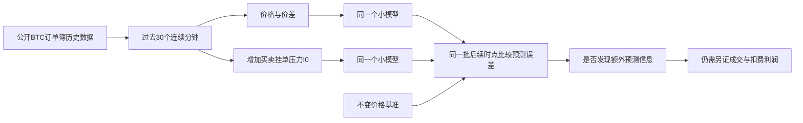

# BTC订单簿预测：一次离线检验方案

读取与整理日期：2026-10-17。状态：研究准备完成，运行许可待确认；未开发适配器，未导入科学计算包，未训练、预测、评分、回测或交易。

**结论：免费原始数据已经取得，下一步可以用现有小模型检验一个具体问题：加入买卖挂单压力，是否比仅看价格、价差更能预测下一行价格。现有资料尚未证明这个公开示例能赚钱，更没有证明它等于XTX的内部模型。**

这一步应当有结束条件：固定数据、时间、模型和比较方法，只做一次。无需先选择券商、开通期权或找机构客户。实际交易渠道、可成交价格与成本属于后续经济验证；目前不能把它们假定为零。

## 1. 我们要复制的是哪一环

订单簿是买卖双方尚未成交的报价清单。最佳买价与最佳卖价的平均数叫“中间价”，二者的差叫“价差”。I0是本次拟检验的公开字段构造：

`I0 = (最佳买档挂单名义金额 − 最佳卖档挂单名义金额) / (二者之和)`。

I0大于零表示这份记录中买侧挂单金额更多，**不等于下一分钟必涨**。挂单可以撤销，信息可能陈旧，也可能没有增量信息。这些正是待检验内容。它是我们的研究假设；没有公开证据表明它就是XTX的核心信号。

原作者公开示例使用长短期记忆网络（LSTM，一种读取序列的小型神经网络）预测下一行BTC中间价。我们借鉴其历史窗口和小网络结构，同时增加严格的输入消融比较：只移除I0，其他条件相同。另加岭回归（对过大系数施加惩罚的线性模型），检查效果是否必须依赖神经网络。[原作者示例](https://www.kaggle.com/code/martinsn/starter-high-frequency-bitcoin-forecasting)

## 2. 已有数据与时间资格

[原发布者数据页](https://www.kaggle.com/datasets/martinsn/high-frequency-crypto-limit-order-book-data?select=BTC_1min.csv)标注数据采用CC0；原作者Notebook的Apache 2.0代码许可与数据许可分别核对，不能扩展为所有被提及仓库均可任意复用。数据版本1最后更新于2021-09-02，示例发表于2021-09-03。我们已于2026-10-17通过正常匿名公开下载取得文件，没有登录、付款或执行作者源码。

| 项目 | 实际核验结果 |
|---|---|
| 原文件 | BTC_1min.csv，33,161,767字节 |
| 原始规模 | 17,113行、156列 |
| 原始范围 | UTC 2021-04-07 11:33:41.122161至2021-04-19 09:54:00.386544 |
| 时间与基础质量 | 时间严格递增，重复时间0，已核数值列无空值、NaN或无穷值 |
| 时间间隔 | 17,041处恰为60秒，71处超过60秒；原因未确认，不等于缺71根K线 |
| 固定训练时点 | 11,950个；另1,710个候选因时间不连续排除 |
| 固定测试时点 | 2,972个；另420个候选因时间不连续排除 |
| 测试日期分布 | UTC 4月17日1,215个、18日1,255个、19日502个，均为部分日期覆盖 |

训练与测试按原始行顺序80%处分割，切点T=13,690。每个目标i只允许使用i−30至i−1行，且连同目标行的30个相邻间隔必须全部恰为60秒。训练目标30≤i<13,690；测试目标13,721≤i<17,113，中间31行隔离。没有补行、插值、舍入时间或依据价格结果筛选。全部模型使用已封存的同一份目标索引。

测试窗口互相重叠，三个日期也不完整，**不能当作2,972次独立验证**。数据时间标签不能证明当时信息实际到达决策系统的时间。若这一点仍未证实，结果只能称为历史下一行预测比较，不能称为可执行的60秒交易优势。

CSV SHA256：`1a4bf5d19f0f9b41f93a7fadacb44f015f8f7eb3212995b77bd70182d99afa93`。训练、测试索引哈希及全部排除项保存在[时间资格核验](</Volumes/EXTERNAL/亚力克斯 /运行验证-20261015/evidence/BTC1min-fixed-evaluation-readiness-20261017/protocol/time-eligibility/time-eligibility-review.json>)；实际原件质量核验见[上一阶段报告](</Volumes/EXTERNAL/亚力克斯 /运行验证-20261015/BTC一分钟原件-实际数据质量与时钟核验-20261017.md>)。

## 3. 固定比较方案

| 对照 | 输入 | 用途 |
|---|---|---|
| LSTM_price | 过去30行中间价、价差；第三通道置零 | 主模型的匹配对照 |
| LSTM_state | 同样历史，加I0 | 主待检验模型 |
| Ridge_price / Ridge_state | 同样两种输入，各展开为90个位置 | 线性诊断，不事后选作主结论 |
| 不变价格 | 直接预测下一中间价等于最后已知中间价 | 必须战胜的简单基准 |

所有输入均只用合格训练窗口出现过的唯一历史行计算均值和总体标准差；目标缩放只用合格训练标签。测试不参与拟合、标准化或选择参数。价格对照在相同标准化后把I0通道置零。训练中恒定的输入列一致映射为零；训练目标标准差为零则停止。

LSTM固定一层、16个隐藏单元、30×3输入，取最后一步输出接16→1线性层。每个窗口从零隐状态开始，不跨窗口携带状态。随机种子20261017；两种输入版本使用相同初始化参数及哈希。所有参数明确初始化为[−0.25,+0.25]均匀分布，不宣称与原Keras默认值等同。固定10轮、批量64、按时间顺序、不打乱，使用最后一轮；不早停、不搜索参数或种子、不改方向、不挑最优轮次。[PyTorch 2.8 LSTM文档](https://docs.pytorch.org/docs/2.8/generated/torch.nn.LSTM.html)

Adam优化器固定学习率0.001、betas=(0.9,0.999)、eps=1e−8、weight_decay=0、amsgrad=False；foreach和fused明确设为False，不能称它们的文档默认值就是False。完整开关见机器可读方案。[PyTorch 2.8 Adam文档](https://docs.pytorch.org/docs/2.8/generated/torch.optim.Adam.html)

岭回归固定alpha=1、float64：训练X和y中心化，求解`(XcᵀXc+I)w=Xcᵀyc`，截距不惩罚。使用NumPy线性方程求解器，无需新增scikit-learn。奇异、非有限结果或求解失败即停止，不换alpha或求解器。[NumPy 2.2 solve文档](https://numpy.org/doc/2.2/reference/generated/numpy.linalg.solve.html)

这是一份透明适配方案，**不复现原作者2021年Keras的精确权重或输出**。LSTM用CPU float32，线性求解及最终误差计算用float64。完整设置见[一次检验方案](</Volumes/EXTERNAL/亚力克斯 /运行验证-20261015/evidence/BTC1min-fixed-evaluation-readiness-20261017/root/fixed-once-evaluation-proposal.json>)。

## 4. 怎样判断结果

先把预测反变换为价格，再计算相对最后已知中间价的预测变化及实际变化；两者使用同一个分母。主指标为二者误差的均方值（MSE，平方后取平均，惩罚较大的错误），**不是投资回报率**。

保留先前约定的初筛门槛：LSTM_state总体MSE必须分别比LSTM_price与“不变价格”低至少1%。两个基准MSE须大于零；基准为零时不存在正的误差改善空间。这里的1%只是误差初筛门槛，与“Gerko财富的1%”无关。

所有四种模型与基准都报告；每个部分UTC日期的差异全部列出。补充平均绝对误差、以基点表示的误差和偏差，但不依靠新增指标改主结论。不得从岭回归中挑赢家替代LSTM主检验；不做按行独立抽样的置信区间，不用短样本宣称统计稳定优势。

| 结果 | 可以说什么 | 不能说什么 |
|---|---|---|
| 有效完成、主门槛未过 | 本配置、特征、时段和预测周期未获支持 | 所有AI预测均无效 |
| 有效完成、主门槛通过 | 获得一个需独立时期再检验的短历史候选 | 已能稳定赚钱、已证容量 |
| 数据/环境/数值错误或资源耗尽 | 本次无效或未完成，记录具体原因 | 模型没有市场优势，或只报已完成的赢家 |

先保存完整逐时点预测、参数和哈希，再汇总测试误差；所有结果保留。历史实际价格早已公开，这种保存不等于在市场结果发生前封存实时预测。

## 5. 成本、资源及执行边界

只读包元数据发现项目环境里有Torch 2.8.0和NumPy 2.2.6；pyvenv.cfg记载Python 3.12.14。本机可见16GiB物理内存。**尚未启动该解释器或导入这些包，不证明二进制可用、速度达标或内存空闲。**已核元数据支持一个免安装候选方案，运行健康检查必须留在未来获准执行阶段。

拟议一次性上限：新增付款0，不安装/升级依赖，不新增下载；CPU最多6线程，四个模型依次处理；累计模型计算及评分最多60分钟、总工作最多4小时、进程峰值内存最多8GiB、新增磁盘最多1GiB。上限不保证完成，必须记录资源使用，任何超限即停止，不自动扩展。

若获准，范围仅包括必要的独立适配实现、对齐与基准验证、现有运行环境健康检查，以及上述一次固定训练/预测/误差评估。版本、导入或确定性请求失败就停止，不临时安装、更换模型或扩大预算。固定种子不保证跨平台逐位一致。

**当前仍只做研究；本方案本身不授权执行。**用户最近明确要求“不运行模型、不回测、不交易”，此前Kronos的一次性许可不适用于这次新数据和新模型。需要一次集中确认后才能执行上述离线检验。任何情况下均不连接账户、读取凭证、模拟成交或收益、下单交易、付款或新增外发。

## 6. 离赚钱和财富目标还缺什么

如果I0确有增量信息，我们可能复制的是“把公开市场状态变为可检验预测”的研究环节。数据与小模型的成本较低；当前尚不能复制XTX的专有数据、持续研发、成交渠道、低成本报价、风险系统或规模。

预测中间价更准之后，仍须分别证实：信息当时已可得；优势大于实际买卖价差、手续费、滑点与延迟；固定持仓和进出场规则在独立时期扣费后有效；回撤可承受；规模扩大没有被冲击成本吞噬。交易费用、滑点、回撤和容量在本次预测检验中**没有核算，不是被设为零**。

没有这些证据，就不能从误差降低换算为收益，更不能从5,000美元推算达到Gerko财富1%的时间。当前判断是：**值得做一次范围有限的预测信息验证；尚不足以立项为赚钱系统。**失败只结束这个固定配置；通过也只获得继续求证的候选。
