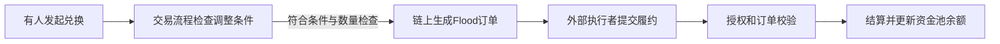

# Bunni V2：触发更公开，但当前源码不作为生产复刻候选

**本轮结论：停止追逐这份源码的盈利案例，保留为机制和风险研究反例。** 官方仓库明确写明Bunni V2曾遭利用、相关问题在该仓库尚未处理，不应原样用于生产。这是这个版本已有的明确反证，不是因为个人资金少而预设不可行。[固定README](https://github.com/Bunniapp/bunni-v2/blob/2b303b8c1b9f8afbb169d62ba52da93d6d2171fe/README.md#L3)

与上一轮Charm相比，这份实现确实把一部分调整触发放进交易流程。但**链上生成调仓订单，仍要经过外部执行、授权和结算**，不能直接当作无外部依赖的成交，更不能从“自动”推断净盈利。本轮未读取实际收益、挑选盈利时段、执行源码或合约。

报告读取日2026-10-16；生成UTC：2026-10-16T08:31:51.423659+00:00。本案例是公开协议研究，不是XTX私人交易或模型的复刻证明。

## 1. 查到了哪个版本

正常公开GitHub仓库HTML显示main currentOid为`2b303b8c1b9f8afbb169d62ba52da93d6d2171fe`，随后按该commit冻结README、LICENSE、BunniHook、BunniHookLogic、RebalanceLogic、BunniZone共6文件及commit页。提交页元数据显示2025-10-22T17:42:59−07，即UTC2025-10-23T00:42:59；这是Git元数据，不是完整策略首次公开、实际部署或修复时间证明。

范围在看候选数据前已保存：只核一个项目的触发、执行依赖、费用/权限和已知事故，不按收益排名筛选，也不更换池找赢家。选择前已注明一般背景中可能存在事故线索，并未假装对该风险毫无所知。

根许可证为MIT，README提醒有些文件采用AGPL-3.0；本轮已读4个Solidity文件SPDX均MIT。没有核完整依赖树、所有文件许可或安全性，**开源复用许可不等于可安全直接上线**。

## 2. “自动调仓”到底自动到哪一步

图是冻结源码定义的流程，不是某笔已执行交易或收益：

| 阶段 | 已核源码事实 | 不能据此认定的事 |
|---|---|---|
| 触发 | beforeSwap中要求已启用rebalance，且出现shouldSurge或之前非零订单已过期，再调用重平衡计算。 | 每笔兑换都重平衡，或到某时刻即完成全部交易。 |
| 数量与定价 | 使用余额、流动性密度函数、历史TWAP价格刻度和滑点参数计算；未满足阈值可不生成订单。 | 预测了未来价格；参数一定有盈利优势；所有池的自定义函数都已核明。 |
| 生成订单 | 记录输入/输出、有效期、zone和订单hash，调用Flood的etchOrder。 | 已被成交、未来必成交、没有延迟或执行成本。 |
| 履约与权限 | 这份BunniZone只接受白名单执行者或当前am-AMM管理者；owner可改白名单。回调还校验FloodPlain来源与订单hash。 | 普通账户天然有现存实例权限；实际部署一定使用这份zone；外部参与就一定存在未公开主观策略。 |

来源：[触发检查](https://github.com/Bunniapp/bunni-v2/blob/2b303b8c1b9f8afbb169d62ba52da93d6d2171fe/src/lib/BunniHookLogic.sol#L546)、[金额/订单构造](https://github.com/Bunniapp/bunni-v2/blob/2b303b8c1b9f8afbb169d62ba52da93d6d2171fe/src/lib/RebalanceLogic.sol#L34)、[zone授权](https://github.com/Bunniapp/bunni-v2/blob/2b303b8c1b9f8afbb169d62ba52da93d6d2171fe/src/BunniZone.sol#L35)、[回调校验](https://github.com/Bunniapp/bunni-v2/blob/2b303b8c1b9f8afbb169d62ba52da93d6d2171fe/src/BunniHook.sol#L567)。

TWAP指通过历史价格计算的时间加权均价，此处用历史价格刻度；流动性密度函数（LDF）规定资金沿价格如何分布。这些是状态和执行规则，不能仅因动态变化就称为AI预测。本轮没有核所有LDF、hooklet、Flood执行引擎或外部执行者程序，也未绑定某个实际部署及历史配置。

## 3. 钱从哪里来，以及谁能拿到

在已读交换路径中，兑换者支付交换费用；费用选择可能走动态费率、附加hooklet或am-AMM管理者分支，另有hook协议费和curator（池管理/策展角色）费用。启用相应am-AMM分支时，计算出的管理者费用还会记给该管理者。[费用选择与拆分](https://github.com/Bunniapp/bunni-v2/blob/2b303b8c1b9f8afbb169d62ba52da93d6d2171fe/src/lib/BunniHookLogic.sol#L348)、[管理者费用记账](https://github.com/Bunniapp/bunni-v2/blob/2b303b8c1b9f8afbb169d62ba52da93d6d2171fe/src/BunniHook.sol#L554)

因此不能拿全平台交易额当收入，也不能拿全体费用当普通流动性提供者或个人净利润。这个项目还包含其他组件；本轮未完整核管理者租金分配、其他收益路径或任何实际收款总额，不据此给项目利润分成填数字。

个人即便复制了区间/触发逻辑，仍需处理库存变化、成交条件、权限、gas和资产安全。某阶段看似稳定的手续费现金流可能被其他损失抵消；本例的已知事故使这一点成为实际证据问题，而不是笼统风险提示。

## 4. 官方事故材料说了什么

官方[事后报告](https://blog.bunni.xyz/posts/exploit-post-mortem/)页面署期2025-09-04，称2025年9月2日Unichain weETH/ETH与Ethereum USDC/USDT两个池合计被盗**约840万美元**。这是官方近似自述，**本轮未独立核精确损失、回收、费用或估值时点**，不能写成已审净损失账。

该文称事故并非重平衡或区间移动引起；本轮未执行攻击或验证具体根因。文中当时恢复了提款，存款与交换仍暂停，修复仍在探索和测试。**2025年文章状态不能直接写成2026年链上实时状态。**

本轮2026年读取的固定README仍明确警告该仓库没有处理相关问题、不要原样用于生产。足以停止推荐这份原样代码的生产复用；它不证明所有后续版本或别的自动流动性项目都不可行。本轮未核其他后续修复、重新部署或安全重启。

不读取和执行事故文章中的攻击PoC/gist/交易链接；不把攻击所得金额当合法策略盈利案例，也不把事故损失归咎于本轮刚发现的外部执行环节。

## 5. 管理员与资金退出还有哪些边界

冻结BunniHook允许owner修改zone、在约束内修改hook费用系数、手动解除某池的提现限制；实际调用和当前配置未核。源码canWithdraw实际判断是**订单期限已过，或者管理员已手动解除限制**。虽然附近注释提到持续重新提交订单可能持续阻挡提现，也不能据注释直接宣称永远锁定或所有当前池不能提款。[管理控制](https://github.com/Bunniapp/bunni-v2/blob/2b303b8c1b9f8afbb169d62ba52da93d6d2171fe/src/BunniHook.sol#L378)、[实际退出条件](https://github.com/Bunniapp/bunni-v2/blob/2b303b8c1b9f8afbb169d62ba52da93d6d2171fe/src/BunniHook.sol#L504)

这些可变权限是需要核的控制点，不代表已经发生恶意修改。本轮没有读取实时状态、执行eth_call/trace、编译或验证部署字节码。

## 6. 对复制和后续投入的判断

| 事项 | 当前判断 |
|---|---|
| 学习状态输入、触发、订单、权限、结算分层 | 可以；可以看清“有信号/有订单/已成交/有净利”是不同证据层。 |
| 复制当前仓库原样上线 | 当前不作为候选：维护者明确警告相关问题未处理。 |
| 根据动态费率或自动调整宣传推断稳定赚钱 | 证据不足；真实持仓、成交、全部相应成本与损失账未核。 |
| 推断个人一定不能做自动做市 | 不支持。这次只排除一个明确版本的原样生产复用，不否定整个方向。 |
| 将它当作Gerko财富1%的实现路径 | 不支持。没有个人净收益或容量证据。 |

**这条源码候选在此收口，不再用它寻找漂亮收益期，也不另行修复、开发或部署。** 与Charm一并保留，作为“公开公式和自动触发尚不能替代完整经营证据”的样本。

下一只读任务转为一个公开收费现金流基准候选：Aave V3的USDC借贷，先核利息来源、公开规则与实际本金/利息/费用能否闭合。它只用于检验个人可复制的收费环节，不替代XTX预测优势研究，也不能把低收益样本当作财富目标已经实现。当前尚未读取该候选收益或选定盈利账户，下一阶段仍不运行模型、回测或交易。

## 7. 记录与限制

证据根`evidence/bunni-v2-case-20261016/`：事前范围、发现搜索原生响应、正常公开仓库HTML、6固定源码与commit页、实际GET回执、官方事故原生抽取、逐项推导及独立审阅均保存。

root实际8次公开GET，均有读取起止UTC、HTTP、Date、bytes和SHA；另1次公开搜索和1次子Agent官方页面读取。官方页是web工具抽取而非原HTML，逐页完成UTC/HTTP/原网络bytes UNKNOWN。源码日期、官网事故自述、当前README警告、实际部署与个人盈利按不同证据层保留。

无模型/训练/回测/策略执行、EVM/eth_call/trace、账户/凭证、安装、交易/广播、付费或外发。原Kronos FAILED、封存预测、旧LP账与独立AAPL/Issue85自动化未改；目标仍active，个人盈利和财富目标未达。
