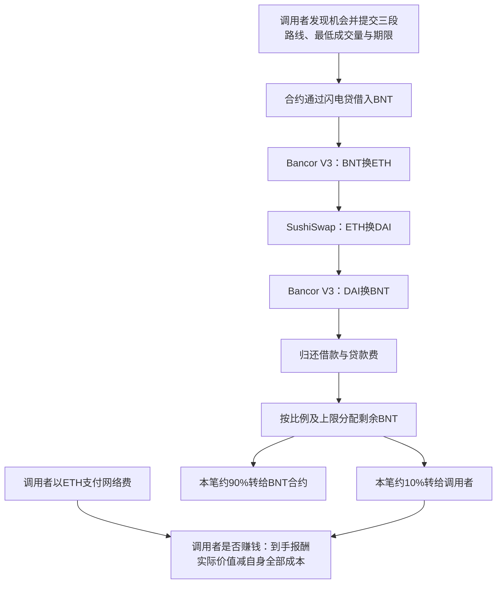

# FastLane历史实现与真实调用：源码及成本边界核验

**本轮补上了这笔实际交易的历史实现身份，并取得该地址的验证源码。可以具体解释“谁提交路线、借什么、怎么换、还款后谁分多少钱”，但仍没有得到一个符合全部条件、扣费后盈利且可照搬的案例。** 关键区别是：合约负责执行和分配；发现机会、保证自己的报酬覆盖成本，仍由调用者解决。

本轮读取日：北京时间2026-10-17；原件读取UTC为2026-10-16 19:09—19:15。交易日期2023-03-19。只做公开原件读取、文本与静态字节解析、指纹和算术；未运行模型、回测、策略、来源代码、ABI/EVM、SQL或交易，未注册、付款、安装、读取凭证、发消息或修改自动化。用户没有Dune账户/额度，本轮全部来自已有可正常访问的免费路径。

## 1. 新证据解决了什么

此前只知道交易目标是可升级代理：同一地址可以换程序，不能把今天的代码当作2023年代码。本轮按目标地址与Upgraded事件查询完整返回页，page1两条、page2成功空，再取最后一条升级的完整收据。收据与索引的区块、交易、日志、实现地址相符。

|历史节点|本轮可核内容|
|---|---|
|实现部署|Sourcify记录区块16827953，2023年3月14日升级前；部署交易0x060ae812…d098d9d|
|交易前最后一条标准升级事件|区块16827963，2023-03-14 18:26:23 UTC；实现0x2fde9e0ce83769e88eaa9fb7be27cb26c385d1b2|
|实际套利|区块16862554、交易序号0，2023-03-19 15:07:35 UTC；0xefa54dd7…64a5db|
|实现源码|Sourcify v2返回950220字节，creationMatch/runtimeMatch原文均为match，验证记录时间2025-06-21 17:01:26 UTC|
|接口对应|历史execute选择码0x73e7b48d、ArbitrageExecuted事件签名，与实际交易输入和日志对应|

[升级事件原页](https://api.routescan.io/v2/network/mainnet/evm/1/etherscan/api?module=logs&action=getLogs&fromBlock=0&toBlock=16862554&address=0x41eeba3355d7d6ff628b7982f3f9d055c39488cb&topic0=0xbc7cd75a20ee27fd9adebab32041f755214dbc6bffa90cc0225b39da2e5c2d3b&page=1&offset=1000)、[最后升级收据](https://api.routescan.io/v2/network/mainnet/evm/1/etherscan/api?module=proxy&action=eth_getTransactionReceipt&txhash=0x207ccebb6116540837b9bd28e3564d8b8cdb38c36d59119e6766b8539a4383d3)、[历史实现验证源](https://sourcify.dev/server/v2/contract/1/0x2fde9e0ce83769e88eaa9fb7be27cb26c385d1b2?fields=all)。

这是有依据的历史版本对应，不是我们独立编译或全节点证明。升级索引和收据来自同一资料商；没有排除所有不发标准事件的存储写入，也不能把Sourcify的match擅写成我们完成exact-match验证。原始源码提取与三份文件逐字节一致，独立审阅未发现实质错误。

## 2. 一张图看清这笔交易如何运作

以下为**已发生交易及对应源码的静态还原**，不是教学假设，也不是新模拟：

闪电贷指同一笔链上交易内借入并归还的贷款。调用者借入本金和合约中转金额都不能算自己的收入。实际路线来自交易输入，交易所编号为2、5、2；代币路径来自事件并与转账相符。[实际交易收据](https://api.routescan.io/v2/network/mainnet/evm/1/etherscan/api?module=proxy&action=eth_getTransactionReceipt&txhash=0xefa54dd73531769bc50d377ea5a2e070fec285bddb53b22f6ad3a7f89764a5db)。

**优势来源的机制解释：**不同资金池的可成交兑换比例在扣除交易成本后存在差额，调用者用循环兑换获取余额，再按协议分成。这需要发现并及时执行仍然存在的差额。已读合约接收调用者提供的路线，本身没有展示AI价格预测、自动寻找最佳路线，或为调用者计算扣除网络费后的净利润。不能把这笔套利说成已经发现XTX的私人预测策略。

## 3. 源码确认的约束，以及容易误读之处

历史BancorArbitrage.sol中execute为公开入口，有防重入、路线数量1至10、借款数量为正、末段目标必须BNT等检查；该函数没有onlyAdmin或调用者白名单修饰。回调验证Bancor网络与自身发起身份，是回调保护，不是外部用户白名单。setRewards则由管理员控制。[历史实现验证源](https://sourcify.dev/server/v2/contract/1/0x2fde9e0ce83769e88eaa9fb7be27cb26c385d1b2?fields=all)。

每段最低输出与截止时间提供成交保护；这不等于“调用者扣费后必赚”。execute与分配函数没有对调用者ETH网络费作净收益比较。按链上交易机制，执行失败也可能产生网络费；本笔收据是成功交易，不能拿它代表全部尝试的成本。（前句为机制推断，不是本轮取得的新失败样本。）

还款后的分配函数读取合约全部BNT余额，并非明确只读取本次交易新增差额。**如果存在原有余额或其他转入，不能将全部分配都称为本次新赚利润。** 这不推翻本笔已核的借还、转账与余额差额，而是限制向其他交易套用的解释。

初始化默认10%与100×10^18最小单位上限，不等于历史状态查询。本笔约90/10来自实际原账，而不是源码默认值或论坛后来拟改50/50的提案。源码标注SEE LICENSE IN LICENSE，本源包未取得被引用LICENSE，不能用后来bot的MIT许可替它作授权结论。

## 4. 用原账检验“成功执行”与“调用者净赚钱”

本表沿用上轮已核原件，本轮没有新询价、换价、重跑或替换交易：

|项目|已经取得的金额或边界|
|---|---|
|借入并返还的BNT|14446372699016692000000最小单位；是本金|
|归还后、分配前的BNT差额|80417431390409824173最小单位；不是调用者全得|
|实际转给调用者|8041743139040982417最小单位，约占差额10%|
|实际网络费|0.010049151215983360 ETH|
|调用者报酬按同笔BNT→ETH实际兑换比例参考标值|约0.002526900492 ETH|
|该参考标值减实际网络费|约−0.007522250724 ETH|

原始金额、实际gas与比例计算见[已保存上轮完整核账](</Volumes/EXTERNAL/亚力克斯 /运行验证-20261015/公开套利实账-收入分配和扣费门槛-20261017.md>)及[实际收据](https://api.routescan.io/v2/network/mainnet/evm/1/etherscan/api?module=proxy&action=eth_getTransactionReceipt&txhash=0xefa54dd73531769bc50d377ea5a2e070fec285bddb53b22f6ad3a7f89764a5db)。

**负数是参考比较，不是实际卖出BNT后的已实现亏损或投资回报率。** 报酬是BNT、费用是ETH，没有取得调用者实际出售报酬的完整结算。参考计算用raw比例约去BNT精度，不依赖未经单独确认的小数位。BNT币数如按18位展示只能标条件，不能据此补造实际结算。

由此能成立的是：看见成功套利、合约余额或协议收入，并不足以证明这位执行者扣费后赚钱。不能成立的是“已经证明该人全期亏损”或“所有套利都不赚钱”。既有Liquity与小额V2持仓的限定正净数量结论照常保留。

## 5. 是否满足“事前规则公开、后续原账完整、扣费盈利、允许复用”

|要求|当前证据与判断|
|---|---|
|事前公开收益机制|官方治理帖显示2022-11-16初帖、11-21回复讨论任何发现机会者可调用、10%且上限100BNT。但正文可编辑，不能由初帖日期证明全部当前文字当时已有。有限支持|
|精确实际版本在事前公开|历史部署/升级已对应；Sourcify2025验证不是2023首次公开时间。UNKNOWN|
|真实成交与费用|本笔成功交易收据、输入、转账及网络费已核；不冒充完整长期执行账|
|扣费后盈利|本笔未取得报酬实际兑换结算；参考值低于gas。未通过盈利准入|
|个人可复用许可|治理支持开放参与；实际核心源码完整许可仍未取得，后来bot MIT不能代替。部分UNKNOWN|
|样本外与容量|没有预先固定规则对应完整后续区间，未证明持续净优势或可放大上限|

[早期官方治理帖](https://gov.bancor.network/t/proposal-improved-value-capture-and-fast-lane-poc/4142)；[2023参数调整讨论](https://gov.bancor.network/t/fast-lane-update-and-parameter-adjustment/4215)。已读官方bot首个v1.0发布于2023-07-24，晚于本笔；截至本笔日期的当前默认分支查询返回空，只能描述该限定查询，不能证明全球不存在更早公开代码。[发布原件](https://api.github.com/repos/bancorprotocol/fastlane-bot/releases/tags/v1.0)。

## 6. 我们可以复制什么，缺失会造成什么后果

|环节|个人能借鉴的部分|缺少时的后果|
|---|---|---|
|跨池价格比较|学习用实际可成交量、费用与分成检验路线；公开数据研究可低成本进行|仅看显示价差，把容量、滑点或协议分成漏掉，毛机会不成为净收入|
|执行合约|研究公开输入、还款和分配约束；本轮只是读代码|不会自动获得机会发现器、竞争排序、有效成本模型或核心代码许可|
|发送前净收益筛选|把“自己拿多少”与网络费、失败费、库存/资金和维护成本放在同一口径|交易成功仍可能不划算|
|完整后续记录|预先固定区间，保留成功、失败、持仓、实际兑换和所有可归属费用|只挑成功交易，无法区分可持续优势与幸存者样本|
|资金放大|先确认每笔可捕获净收入、机会频率和成交容量，再讨论加钱|资金或更强模型不会自动扩大价差、分成或成交份额|

前述可借鉴环节是方法，并非已验证可以赚钱的程序。治理机制让参与有入口，不代表每个参与者都能获得足够报酬。

本笔现收口为**机制与成本样本**。不继续把“找到更多代码”当作已经找到盈利证据；下一来源核验先找有事前可固定规则、完整后续区间账、同一计价口径扣费正结果的材料，再判断是否值得读其程序。仍只研究，不回测、不运行模型、不交易。用户目标尚未完成，当前无法给出可信资金容量，或从5000美元到Gerko 1%财富的可证路径。

## 7. 证据保存与尚未确认事项

主要原件在evidence/fastlane-historical-implementation-20261017/；每份直接GET保存URL、读取UTC、状态、原文、bytes、SHA256。Sourcify原件SHA256为dc97b5725f41e69730834981f4baf24babdcca057c74d08977f7f194f70ec106；提取的BancorArbitrage.sol为8ecc4818d028104c94457e1e7bf1a052721e60753884f064e96b2938020c0e2e。原件保留，不清理。

历史身份、具体机制与事前公开时间分别接受独立实质审阅；审阅不是重新运行交易。当前缺口集中于精确事前公开时间/许可、完整后续扣费正账及未来可捕获机会。没有要求所有私人公司账或秘密才能承认已经取得的有限现金事实。

读取限制：4byte事件签名页普通GET一次403后停止，未换通道重取；事件topic由本地纯数学Keccak及既有源码定义得到，并用已知向量校验。Routescan历史实现sourcecode字段为空，不能按HTTP200冒充源码成功；另从独立Sourcify档案正常取得已有验证源。根据官方当前文档使用v2只读GET，没有提交源码验证或编译。历史存储API未承诺数字区块tag，本轮没有发送未经支持的历史storage调用。原有受拒资源未重试。

既有FAILED、9400/50/188、AAPL/Issue85结论和安排不变。当前为有新原件支持的progress，目标active，并非完成、盈利或容量证明。
