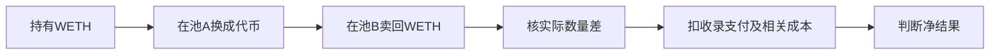

# Flashbots公开套利样本：价差逻辑清楚，完整实盘盈利尚未核得

结论：**本轮仍未找到同时符合“事前公开规则、完整后续持仓/成交/费用原账、扣费盈利及个人复用许可明确”的案例。** Flashbots的simple-arbitrage可用于研究定价、成本和执行逻辑，当前不足以推荐复制部署。不能把代码中的profit变量、模拟流程或检查条件当实际赚钱证据。

固定版本：`03cf1058b5bd8079561e2505efc85f77e357b829`，GitHub提交元数据为2021-06-21 18:24:00−04:00（UTC22:24）；读取2026-10-16。该日期不是独立证明首次公开时刻。原件和时间见[来源及读取清单](</Volumes/EXTERNAL/亚力克斯 /运行验证-20261015/evidence/flashbots-public-arbitrage-identity-20261016/root/retrieval-inventory.json>)，具体事实分层见[规则与身份核验](</Volumes/EXTERNAL/亚力克斯 /运行验证-20261015/evidence/flashbots-public-arbitrage-identity-20261016/root/source-identity-and-rule-findings.json>)。

## 1. 它想靠什么赚钱

【公开代码设计，非真实获利交易】代码比较同一代币在多个池的兑换结果，寻找用WETH买入、再卖回WETH后数量增加的路线。WETH是与ETH按1:1数量包装的代币；套利指利用相关市场价格差进行相反方向交易以争取成本后的差额。

**这里主要比较已存在的报价，不是训练AI预测未来价格。** 代码从池储备计算兑换结果，对若干预设交易量及中间值试算、排序；它是有限启发式，不能称全局最优。报价采用997/1000费率假设并随交易规模体现价格冲击，所以不能说它完全没考虑池费；各工厂实际费率及当前实现未逐一核验。来源：[报价与规模选择](https://github.com/flashbots/simple-arbitrage/blob/03cf1058b5bd8079561e2505efc85f77e357b829/src/Arbitrage.ts)、[储备报价公式](https://github.com/flashbots/simple-arbitrage/blob/03cf1058b5bd8079561e2505efc85f77e357b829/src/UniswappyV2EthPair.ts)。本轮只读文本，未执行这些试算。

【机制解释】两个池的库存和交易流不同，可能形成价格差。套利者与池交换库存，收益若存在来自兑换数量差；本轮没有绑定具体交易，不能说某人实际付出了多少、某执行者拿走多少。官方[README](https://github.com/flashbots/simple-arbitrage/blob/03cf1058b5bd8079561e2505efc85f77e357b829/README.md)明确定位集成示例，并提示广为人知的机会和多人使用会使原样脚本很难盈利。这个提示不等于所有套利都不赚钱。

## 2. “利润检查”覆盖到哪里

执行合约比较付款前WETH数量，要求增加量大于给coinbase的支付；coinbase在这里是代码使用的区块收益接收地址。**这是合约局部条件，不是整个付款账户、其他资产和经营成本的完整损益。** [固定执行合约](https://github.com/flashbots/simple-arbitrage/blob/03cf1058b5bd8079561e2505efc85f77e357b829/contracts/BundleExecutor.sol)。

机器人默认将报价差额的80%设为该支付，源码还包含gas用量估计和交易包模拟流程。必须同时记住：

- 默认80%是配置值，未证明任何真实交易按此付款；余下20%是差额分账比例，不是20%的投资回报率。
- 旧版构造交易时显式使用gasPrice=0，收录报酬另付coinbase。不能在这种假设中凭空再扣一笔正gas，把收录成本重复计算；也不能据此说旧脚本已正确覆盖当前所有成本。
- [EIP-1559](https://eips.ethereum.org/EIPS/eip-1559)要求费用上限覆盖目标区块基础费。若最终旧式交易的gasPrice仍为0、目标区块基础费大于0，就不满足该条件。依赖库是否改写参数及现在是否能运行均未验证；本轮未签名、模拟或提交交易。
- 合约WETH检查没有纳入外部付款地址全部费用和其他初始资产。完整原账要按各资产及实际gas、直接支付分别核对，已经体现在余额变化里的付款不能再重复扣。

因此，源码中有估gas和模拟，不等于我们已取得模拟输出、成交回执或扣费后利润。执行竞争、状态变化和被收录结果仍需实际证据；不能靠换一个更强模型保证这些环节。

## 3. 许可和真实部署都不能混用

| 项目 | 本轮原件确认 | 仍缺什么 |
|---|---|---|
| 仓库身份 | Flashbots官方simple-arbitrage，固定上述提交 | 当前可运行性与实际交易记录未核 |
| 项目许可 | package.json声明ISC | 两个Solidity文件标注UNLICENSED，整套个人实施复用许可未确认 |
| 执行地址 | index从用户必填环境字段读取，默认空；README要求自行部署 | 所读材料未给出可绑定的具体实盘执行部署/交易账 |
| 源码里的5EF…地址 | 客户端将其用于池列表和储备查询 | 查询辅助引用不是盈利执行合约，也未独证其当前部署身份 |
| 先前Flashbots样本 | 另一个simple-blind-arbitrage，固定73c6…，MIT，已保留 | 不能将其许可、测试或结论移植到本仓库 |

[项目声明](https://github.com/flashbots/simple-arbitrage/blob/03cf1058b5bd8079561e2505efc85f77e357b829/package.json)、[辅助地址角色](https://github.com/flashbots/simple-arbitrage/blob/03cf1058b5bd8079561e2505efc85f77e357b829/src/addresses.ts)。本轮没有改变认证、读取你的环境变量或凭证。许可差异不妨碍此次公开资料阅读，但不能据此宣称整套代码已获实施授权。未核到部署绑定也不等于从未有人使用或获利。

## 4. 个人值得学的环节与当前取舍

值得学的是：用可成交规模核报价、统一资产计量、把池费/价格冲击/区块支付/账户gas分开核、检查失败和真实成交、固定版本以便复核。**实际低成本可捕获的净价差尚未证明**；公开公式不能自动带来新机会或成交位置。

该样本目前保留作研究材料，**不作为已找到的盈利案例，不建议据此开工或投入资金**。数据/RPC、运行与维护、资本及竞争成本也没有完整报价；本轮公开读取付款为0，不能说生产运行成本为0。更没有资金容量或Gerko财富1%的路径证据。

下一步将把已有XTX原始研究、Kronos已完成检验和真实链上案例收敛到一次目标差距审计：哪些赚钱机制已经证实，哪些操作个人可复制，复制后仍缺哪一种优势，以及现有证据是否支持一个独立项目。只选一个最重要的可检验经济假设或明确暂不立项，不再把新增代码样本当进展终点。[下一轮只读审计范围](</Volumes/EXTERNAL/亚力克斯 /运行验证-20261015/evidence/flashbots-public-arbitrage-identity-20261016/root/next-goal-evidence-synthesis-scope-before-analysis.json>)尚未执行，不启动模型、回测或交易；研究报告也不冒充财富目标达成。

## 5. 来源与执行边界

14次直接免费GET均HTTP200，原件共989978字节；另3次web页面打开，仓库及EIP正文可读，README所链FAQ返回工具不可访问，保留缺失且未重试。没有API认证、账号注册、安装或仓库代码/策略/SDK/EVM执行，没有运行模型、训练、回测、模拟交易、签名、下单、付款或外发。真实历史正净数量与负参考值、Kronos FAILED及原封存、AAPL/Issue85独立安排保持。
