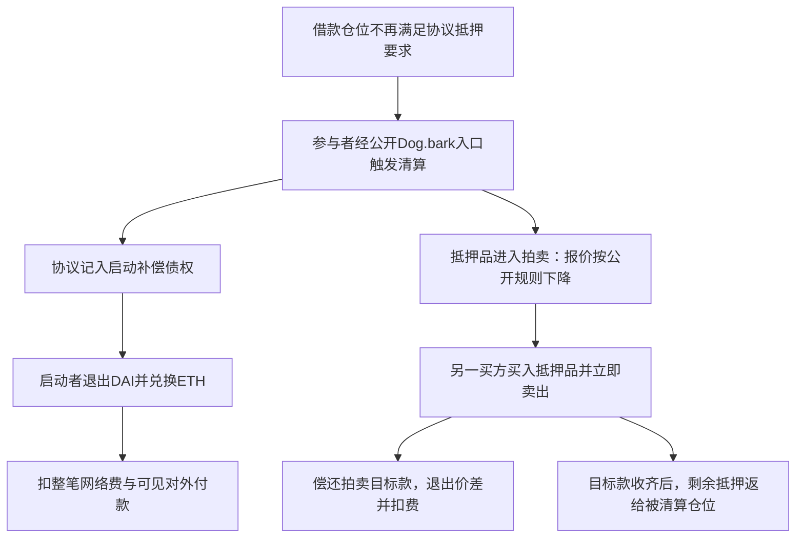

# Maker拍卖106：公开降价规则与两类真实收入

核验日：2026-10-16 UTC；案例发生日：2026-02-05。只读公开源码和已发生记录，未运行模型、策略、回测或交易。

**这次查清了两种不同的赚钱操作：启动清算拍卖的人领取协议补偿；买入拍卖抵押品的人兑现与外部市场的价差。二者都有本笔实际收支证据，但操作者、笔数和收入来源不同，不能合并成同一个人的收益。**

| 操作 | 实际发生的服务 | 已观察扣费结果 |
|---|---|---:|
| 启动拍卖 | 一笔交易启动5场清算，收补偿并兑换退出 | 原发起地址当笔净增 **0.392454550785575657 ETH** |
| 买入拍卖106抵押品 | 买入、卖出、偿还拍卖款、退出余款 | 另一地址当笔净增 **0.097465192271862691 ETH** |

前者最值得作为下一项低成本候选继续查：公开协议为明确工作付钱，入口没有调用者身份白名单，也不要求先预测未来市场价格。难点是发现真正符合条件的仓位、抢在别人之前完成，以及任务池是否足够大。**尚未取得完整私人机器人、完整运营账期、个人胜出率或未来容量证据，不进入开发或交易。**

本例的收益是清算服务报酬和拍卖价差，未取得AI参与实时决策的证据，不把它称为Kronos成功案例或XTX策略复刻。

## 1. 一张图看清谁为什么付钱

协议支付启动补偿，是为了有人把不安全仓位推进清算流程；拍卖则回收目标债务和清算惩罚。补偿先记入内部DAI债权账，本批交易随后将其转为DAI代币并卖出。买方赚的是自己实际卖出所得减拍卖支出及费用，不能把借款人被清算的全部抵押品算作买方收入。

来源：[Dog实际源码](evidence/maker-auction-case-20261016/auction106-history/Dog.verified-source.sol)、[Clipper实际源码](evidence/maker-auction-case-20261016/root/Clipper.verified-source.sol)、[启动批次原回执](evidence/maker-auction-case-20261016/auction106-history/kick-receipt.original.json)。均为提供商公开已验证源码/原记录，本轮未独立编译或核部署字节码。

## 2. 这场拍卖怎样定价

同一ETH-B合约`0x71eb894330e8a4b96b8d6056962e7f116f50e06f`、拍卖id106的返回记录中，只有一次Kick启动和一次Take购买；无Redo重置或Yank取消。另读整个合约历史，是因为Yank的id不带索引，单靠topic1过滤会漏取消。

| 时间（UTC） | 真实事件及数值 |
|---|---|
| 2026-02-05 17:00:11 | 启动。抵押量17.724163633411058706；起拍价 **2150.287944695 DAI/单位**；拍卖目标款约30,887.30672618 DAI |
| 17:09:23 | 552秒后成交。单价 **1964.325124535031849346152080805 DAI/单位**；实际买入15.724131581065069254 WETH |
| 同次购买结尾 | 目标款付清，剩余2.000032052345989452单位内部抵押按源码返给原仓位，不是套利人的额外收入 |

提供商构造参数及源码条件性绑定`ilk=ETH-B`。目标款tab是Dog的累积债务due乘清算惩罚因子chop后取整，**不是原贷款本金**；具体本金、利息和罚金拆分尚未核。

本轮核到当时实际使用的计算器`0x19e26067c4a69b9534adf97ed8f986c49179de18`，公开源码名为StairstepExponentialDecrease（阶梯式指数降价）。历史File参数为：

- 每档60秒；每档乘0.99。
- 552秒经历9个完整档，价格为`2150.287944695 × 0.99^9`，精确等于本笔Take价格。
- Clipper当时buf为1.1，起价从协议预言机价格按该倍数形成；tail为4800秒、cusp为0.45，控制何时需重置。当前成交点不触发这两个重置条件。

这不是事后拟合曲线：cut和step的最后相关设置在2021年，buf/tail/cusp最后相关设置在2022年，均早于2026年交易；本轮所读集合中启动至成交之间没有这些参数更新。核算只做一个已发生价格的算术对应，未执行下载源码、策略或EVM。

**在参数未变且无需重置的条件下，拍卖报价怎样随时间变动是公开确定的；外部卖出报价、费用和谁先成交仍须另查。**起拍价下降8.6482752516359101%是拍卖价格变化，不是买方利润率；9分12秒是启动到成交的间隔，不是已证明的可套利窗口。

Take的最高可接受价max数值等于上一档价格，不能据此推广播、发现或等待时刻。只有一条成功Take也不能证明没有竞争者、失败或未上链尝试。

原件与算术：[生命周期派生记录](evidence/maker-auction-case-20261016/auction106-history/auction106-lifecycle-derived.json)、[价格计算器源码](evidence/maker-auction-case-20261016/auction106-history/StairstepExponentialDecrease.verified-source.sol)、[历史参数与独立审阅](evidence/maker-auction-case-20261016/auction106-history/protocol/historical-calculator-and-params-review.md)。

## 3. 买方的217.90 DAI从哪里来

买方地址`0xfa025…27995`的成交支出和卖出收入均已核原量：

`卖出所得31105.204277208570603330 − 偿还拍卖30887.306726180869414834 = 217.897551027701188496 DAI`。

余款换成并解包为0.109938735732142791 ETH，再扣可见对外付款0.011055512871629488及当笔实际网络费0.001418030588650612，观察净增0.097465192271862691 ETH。DAI、WETH和解包ETH是同一笔余款的不同形态，不能叠加。

公开回调允许先取得抵押品、卖出并偿还，但其`minProfit=1`只要求留下极小DAI余量，不强制覆盖ETH网络费及其他付款。原交易外层为定制程序，不能把这个结果归给Sidestream公开bot，也不能从实际使用约3.09万DAI偿还倒推其自有本金。

详见前轮[买方单笔报告](Maker拍卖套利-真实单笔收支与公开规则边界-20261016.md)。本轮没有重算为新收益样本、重跑模型或覆盖旧原件。

## 4. 启动者的收入已经兑现，而不只是事件里写了奖励

启动交易hash：`0xb29c41fd0b34872acb33791b1ef184aaac03ed66e3525c34293c12c061aeac8c`。

实际发起地址`0x08f97dee6d864282c67b1f1822cd39bd3ea79918`调用helper`0xb1650649cc244311e65c4e9e4f20055834c293e3`，顶层ETH value为0。其receipt含5个Kick：ETH-A的930/931、ETH-B的105/106、ETH-C的289，无Take。另两Clipper提供商源码与本ETH-B Clipper逐字节相同，构造参数分别对应ETH-A/C；仍不是独立编译验证。

对ETH-B106，当时公开补偿规则为**250内部DAI + 拍卖目标款的0.1%**，事件coin为约280.88730672618086941483内部DAI。五场补偿汇总约1412.30177481408953678819内部DAI；转为代币的原量按最小单位向下取整，实际为1412.301774814089536788 DAI，随后同量全部卖出。未把不足一个DAI最小单位的内部残余算现金利润，也未假定期初内部余额为零。

| 整笔5场启动交易的实际流量 | ETH |
|---|---:|
| 补偿兑换并解包所得 | +0.707747839571627240 |
| helper向另一地址支付 | −0.311409049411515985 |
| 剩余付回原发起地址 | 0.396338790160111255 |
| 原发起地址支付整笔实际网络费 | −0.003884239374535598 |
| **原发起地址当笔观察净增** | **+0.392454550785575657** |

实际网络费为1522193 gas×2551739086 wei/gas。helper的所见DAI/WETH收付在解包后相抵，原发起者没有本笔ERC20库存消耗；兑换所得ETH由上述两笔付款精确分完。另一付款地址`0xdadb0d80178819f2319190d340ce9a924f783711`角色/归属UNKNOWN，已全额保守扣除。该付款数值等于兑换所得的44%（按最小单位取整），不能据此断言它是builder费用、固定费率或所有交易都必需如此。

这个例子说明只扣gas会严重高估留下的钱。它核到的是**这一整批**的可见现金结果，不能全部归给106单场，也不能无依据除以5；不包括其他失败尝试、部署、运营、税或其他日期，不是完整操作者收益率。启动者与后来的抵押品买方是不同地址，不能把两笔正增相加为一个人的收入。

原件：[启动回执](evidence/maker-auction-case-20261016/auction106-history/kick-receipt.original.json)、[顶层交易](evidence/maker-auction-case-20261016/auction106-history/kick-transaction.original.json)、[已记录native流](evidence/maker-auction-case-20261016/auction106-history/kick-recorded-native-flows.original.json)、[完整批次算术与源码绑定](evidence/maker-auction-case-20261016/auction106-history/starter-batch-cashflow-derived.json)。Helper源码API为空，未取得它的完整公开机器人或事前选单参数；这不抹去已经发生的收款，也不补出私人策略。

## 5. 个人可以研究复制的一个收费环节

**优先候选：识别符合公开清算条件的仓位，经公开入口触发拍卖，领取协议补偿。**它本身能产生服务收入，收益规则有源码、事前参数和实际兑现记录支持。公开参考程序[auction-keeper固定版本](https://github.com/sky-ecosystem/auction-keeper/tree/f052830953d675612b69a2a5b871c7954de8c110)包含相应监控/触发路径；不是本实际操作者程序的身份凭证，当前兼容性和依赖亦未运行验证。

关键权限区别：`Clipper.kick`受auth保护，个人不能直接把它当开放接口；所读Dog的`bark(ilk,urn,kpr)`为无调用者身份白名单的external入口，由调用者指定补偿接收者。成功仍要求协议live、仓位按协议价格已不安全、全局/该抵押品有清算容量，以及dust、数量、依赖授权和停止状态等条件满足。本轮没有执行当前状态读取或试调用。

| 必需环节 | 能借鉴的公开部分 | 缺少会有什么后果 |
|---|---|---|
| 识别合格仓位 | Dog公开抵押量、累积债务、价格和容量的判断规则 | 价格口径或状态过时，调用失败或不再有可领补偿 |
| 估算全部归属成本 | 本批实际兑换、外付和gas原账；不仅看名义奖励 | 误把补偿毛额当利润，漏掉远高于gas的付款 |
| 完成触发并获得确认 | 公共入口和公开参考代码 | 他人先完成、等待收录或状态变化会使机会消失；本批没展示这些失败成本 |
| 正确部署与限制风险 | 版本、地址、许可、参数逐项核对 | 旧教程和当前配置不同，不能复制历史结果 |
| 有足够任务需求 | 可读历史启动事件和补偿原量 | 技术可做但任务池很小，无法支撑投入或放大 |

这条路线需要链上数据、软件维护、执行和风险控制；当前没有证据要求先拥有银行客户、全额承接拍卖债务或训练集群。实际启动批次value0与补偿变现记录不等于“零本金”，gas额度、已有授权和其他运营资本仍需核，不能算无限回报。

Codex等工具可辅助阅读公开规则、解析原件、核费用和整理异常。本轮得到的就是这些研究产物；尚未证明它能及时发现任务、赢得竞争或安全运营。所读Clipper/Dog/计算器及参考代码按各自AGPL条件研究复用，helper私有源码未取得，不能把主仓库许可外推给它。

## 6. 距离财富目标，最关键的新问题是任务池

同一ETH-B Clipper截至本例目标块的返回集合中，从2021-05-17至2026-02-05共106次Kick，id1—106各一次；这仅是一个合约的历史范围，不是全部Maker/Sky市场，更不是每天106个任务或未来任务率。不能拿一笔5场启动的净增，乘天数或追加本金推Gerko财富1%。

本轮判断：**值得继续一个有限的只读需求验证，尚不值得据此开发交易系统。**唯一下一项是核一个已结束季度（2026年第三季度），在本次已确认ETH-A/B/C三个Clipper地址中，实际启动多少任务、协议共记入多少补偿；核官方地址/版本覆盖，明确这三个分支不是整个市场。

这一步验证的是“近期开出的任务报酬池是否值得研究”，不模拟个人成交或把总补偿当个人净收入。若已确认范围内任务极少、毛报酬不足以支持投入，就暂缓这条具体Maker路线；若需求足够，再核成功捕获和完整失败成本。资本放大也不能制造更多清算任务。两种结果都不代表其他协议或所有量化方向可行/不可行。

## 7. 证据等级和数据质量

本轮读取同一Clipper全历史263条、id106筛选2条以及计算器6条，均补读第2页空结果；取启动交易完整receipt，并复用买方receipt。原量、时间、hash和公式的对应获得独立只读复核；代码与历史参数改善了事前规则证据，未绑定实际私人bot。

质量异常保留：全Clipper日志有62条transactionIndex写成空hex`0x`，包括Kick106；完整启动receipt/交易给出该项0x0。原件未回填，历史同块顺序用全局logIndex核，其他字段和选定receipt分别对照。API成功不能推出所有字段都完整，或同源结果等于独立链上证明。

四个事件topic用[公开签名索引](https://www.4byte.directory/docs/)精确ABI条目作辅助映射，再对照已验证源码、事件形状和原receipt；没有将SHA3冒充Ethereum Keccak或安装依赖。该索引不证明程序部署、操作者身份或盈利。数据取得遵循[Routescan历史日志说明](https://routescan.io/docs/api/etherscan/logs)及[历史receipt代理说明](https://routescan.io/docs/api/etherscan/geth-parity-proxy)；官方文档未显示发布日期则记UNKNOWN，读取日2026-10-16。

完整原件、每次实际UTC/URL/HTTP/bytes/SHA256在[evidence/maker-auction-case-20261016/auction106-history/](evidence/maker-auction-case-20261016/auction106-history/)。历史参数不是当前配置证明；同源数据不冒称独立节点验证，Git日期不冒称某私人程序首次公开。两笔历史现金结果不证明未来稳定优势、个人容量或财富目标。

全程只研究；新增模型、训练、回测、策略/EVM/eth_call/trace执行、交易/广播、账户/凭证、付款、安装和外发均0。已发生receipt/交易通过只读代理GET取得，准确计数见读取回执，不追称0 RPC格式读取。原FAILED、封存和自动化未改，主goal active未完成；规则PERMISSIONS-2026-10-14-v1 / ROUTING-2026-10-13-v4，实际model/effort UNKNOWN。
