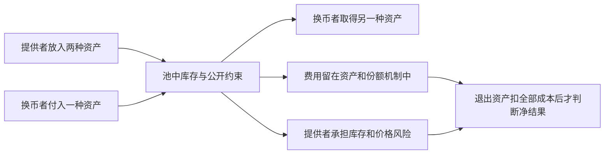

# Uniswap V2公开报价：真实交换需求与盈利缺口

核验及读取日期：2026-10-16。延续公开资料研究，不运行模型、回测、合约、SDK或交易。

**结论：固定的Ethereum Uniswap V2 USDC/WETH池，在2026-10-15完整UTC日的提供商原件中，有1,379条Swap（交换）事件，涉及1,378笔不同交易。公开报价机制确实服务了当天的交换需求。这关闭了本候选“是否还有人使用”的关键未知，尚未证明提供流动性者扣费后盈利，更未证明我们能复制盈利或放大到财富目标。**

可以借鉴的环节已更具体：向需要换币的人提供两种资产的库存，按公开规则完成交换，以费用补偿承担库存风险。该规则不预测未来价格，不能把它称为已复制XTX的私人预测模型。现在无需购买模型或开发程序；最重要的缺口是实际持仓与全部成本后的净结果。

## 1. 身份、范围与实际返回

上一阶段先保存的[固定范围](evidence/amm-v2-demand-20261016/root/fixed-scope-before-requests.json)指定USDC/WETH和UTC **2026-10-15 00:00含至10-16 00:00不含**，不根据返回收益换池或换日期。这是市场需求核验，不是统计意义的样本外盈利测试。

官方[部署文档](https://developers.uniswap.org/docs/protocols/v2/deployments)列出Ethereum工厂`0x5C69bEe701ef814a2B6a3EDD4B1652CB9cc5aA6f`。该工厂按两个固定币地址筛选的历史创建事件，唯一返回：token0为USDC `0xa0b8…eb48`，token1为WETH `0xc02a…6cc2`，池为 **`0xb4e16d0168e52d35cacd2c6185b44281ec28c9dc`**。创建事件在2020-05-05，序号1，原交易`0xd07c…ab3a`。[身份解码及原件引用](evidence/amm-v2-demand-20261016/root/pool-identity.json)

提供商时间映射给出包含边界的区块范围26,194,188至26,201,365。全事件按每页1,000条连续读取，三页分别1,000、1,000、840条，末页已结束；再按每条时间戳筛固定UTC日。

| 核验项目 | 本次提供商原件中的结果 |
|---|---:|
| 全部日志 | 2,840条，均在固定UTC日内 |
| Swap交换事件 | 1,379条 |
| 涉及不同交易哈希 | 1,378个；一次交易可交换多次 |
| Sync储备更新事件 | 1,395条 |
| Mint新增流动性 / Burn移除流动性事件 | 7 / 9条 |
| 同形状的Approval或Transfer日志 | 50条，本轮未进一步区分 |
| 按区块哈希、交易哈希、日志序号检查的重复 | 0条 |

最早Swap为00:00:59 UTC，最晚为23:53:35 UTC。实际Swap主题和数据形状均一致；与已验证ABI（合约公开字段定义）中唯一的“两索引地址、四个非索引整数”交换事件匹配。没有猜测主题哈希，也没有用SHA3替代Keccak。[逐条解码](evidence/amm-v2-demand-20261016/root/fixed-day-decoded-Swap-events.json)，[汇总](evidence/amm-v2-demand-20261016/root/fixed-day-demand-result.json)，[独立原件复核](evidence/amm-v2-demand-20261016/protocol/actual-demand-review.md)

质量限制要保留：8条日志的可选`transactionIndex`为无数值的`0x`，没有修成0；排序使用区块号与全局`logIndex`，不依赖它。[质量说明](evidence/amm-v2-demand-20261016/root/optional-transactionIndex-quality-note.json) 本轮为单一历史索引提供商，未独立读取区块头或归档节点证明全链无漏；成功分页不等于全链完整性证明。事件的`sender`、`to`可能是路由或其他合约，不能当作真实人数、独立客户数或交易动机。

## 2. 钱从哪里来，规则凭什么运行

谁付钱：需要交换两种资产的交易者。池中有可供交换的库存，路由或调用者据此安排交易；原件证明发生了交换，但不证明每个交易者为何选择它，也不排除套利、合约内部操作等用途。

怎样定价：不是让AI给出明天价格。池的两种资产数量和恒定乘积约束共同限制成交；交易越大，相对库存的影响通常越明显。精确说，V2核心合约检查的是**扣除费用因素后的不变量是否满足**，常用报价计算由外围程序完成，不能把核心直接叫预测或报价函数。[官方定价解释](https://developers.uniswap.org/docs/protocols/v2/concepts/pricing)

费用从哪里来：实际源码用`balance*1000 - amountIn*3`进行约束检查，对应3/1000的输入费用机制。**教学示例：**若一笔普通交换输入1,000单位某资产，这个比例对应3单位的费用因素。这不是本池实际某笔收入、独立到账记录或投资回报率。

为何有费用仍可能亏：退出时，提供者持有的两种资产数量可能已经改变；资产价格变化和相对直接持有的损失，可能超过费用。建仓、退出、兑换及其他实际成本还要扣除。官方[收益说明](https://developers.uniswap.org/docs/protocols/v2/concepts/understanding-returns)也明确指出费用与价格变化风险并存。

不能把全部0.3%当某位提供者收入：源码还有`feeTo`与`_mintFee`机制，特定条件下向协议接收地址铸造池份额，影响其他份额的占比。本轮没有核定目标日的具体协议收费状态，不作“全部归LP”假设。LP即流动性提供者。费用通常嵌在池资产及份额中，核退出资产时不能再重复加一次“手续费收入”。

## 3. 公开代码能复用什么，实际操作还缺什么

官方仓库固定提交为`6a9e7c97860676e0992f22a49665760444c1cdf5`。其Pair主合约正文，与该池提供商返回的已验证源码正文在仅统一换行及外沿空白后完全一致。未比较全部导入、编译或证明历史runtime字节码；不能把文字一致夸大为独立运行验证。[固定Pair源码](https://github.com/Uniswap/v2-core/blob/6a9e7c97860676e0992f22a49665760444c1cdf5/contracts/UniswapV2Pair.sol)，[源码与身份复核](evidence/amm-v2-demand-20261016/protocol/source-identity-review.md)

仓库许可为GPLv3，允许按其条件学习和复用；若以后分发修改代码，需要核对该许可义务。它不是MIT，也不自动覆盖所有外围代码、数据服务或前端。提交页面的日期元数据为2026-04-02，早于目标日，但不独立证明精确版本首次公开的时刻。本轮未绕付费或登录限制。[固定许可原文](https://github.com/Uniswap/v2-core/blob/6a9e7c97860676e0992f22a49665760444c1cdf5/LICENSE)

| 环节 | 对个人可复制的部分 | 缺少它会怎样 |
|---|---|---|
| 公开定价与份额规则 | 可免费阅读，不需要复制私人预测模型 | 不理解规则，易把费用、份额与本金混算 |
| 提供两种库存 | 机制可研究，实际参与仍需资产与链上操作 | 没有库存就无法获得对应份额的交换费用 |
| 选择何时进入、退出和承担多少风险 | 本轮没有证明可盈利的个人规则 | 单靠“每天有人交易”不能决定是否值得入池 |
| 实际成本与退出账目 | 可以免费读公开原账，核实际流入、流出与gas | 费用正数可能掩盖库存损失或执行成本 |
| 容量 | 本轮尚未证明 | 日交易量不是我们可获得的利润；增加资金会改变份额和风险，不能线性外推 |

Codex等工具能辅助读源码、整理事件、检查算术及记录假设。它们不能把交易量变成我们的净收入，也不能替代独立原件审阅。

一个已有反例提醒：按时间选择当天最早Mint所在的交易`0x4ada…0e51`，同池随后也出现Burn，两者之间没有该池Swap事件。这仅证明该交易包含新增与移除操作，不能仅凭Mint称其持续做市赚钱，也不能把整个交易其他业务的收益归给本池费用。[同交易原日志观察](evidence/amm-v2-demand-20261016/root/first-Mint-same-transaction-observation.json)

## 4. 当前判断和唯一下一项

**值得继续一次限定的原账核验，尚不支持开发、入池或盈利承诺。** 本轮已经找到仍在运行的公开赚钱机制和实际使用记录；还没有完成用户要求的“规则事前公开、完整持仓成交费用齐全、扣费后盈利”的案例认证，更没有证明财富目标。

唯一下一项固定为上述**最早Mint交易**的实际资产和费用原账：只读该笔历史收据、交易及必要的已记录原生币流，查明它究竟是持仓收费、暂时资产操作，还是其他业务。选择依据是既定日期内最早Mint，不按正收益挑选；这个描述性选择发生在市场日志取得后，不冒充事前样本外实验。若该笔没有可核利润，保留结果，不换交易找赢家。

通过条件是实际资产流和费用能在明确地址范围内核对，足以判断这笔业务的收入来源与净结果；拿不到字段就保持UNKNOWN。即使出现正数，也只构成该笔历史证据，不能证明未来稳定性、个人捕获能力或容量。不会开展模型、回测或交易。[下一项事前取数范围，尚未执行](evidence/amm-v2-demand-20261016/root/next-fixed-first-Mint-transaction-ledger-scope-before-data.json)

本轮17次直接公开GET全部HTTP200，原响应共3,560,575字节；另有6次官方网页工具读取，非同一原HTTP字节收据。子审阅网络0，未读取凭证、注册、付款、安装、外发、模型、回测、EVM或交易。[读取清单](evidence/amm-v2-demand-20261016/root/retrieval-inventory.json) 既有Kronos FAILED、封存预测和其他独立安排保持不变。
