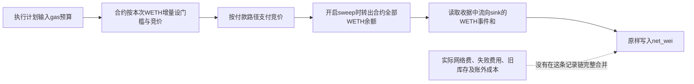

# 公开清算程序的profit追踪：到账字段为何不能直接证明净盈利

读取日期：2026-10-19 UTC／北京时间2026-10-20。固定项目appCryptoCrucible/liquidation，commit `364059aba56e773da01f6507224cf530bbbb1b09`。本轮只读源码，不运行、安装、回测、连接账户或交易。

## 结论

**停止把本项目的自动net账当作“完整扣费后盈利”的证据；保留经济逻辑与组件学习。** 本轮把上次未核的利润输入追到了收据读取、数据库和执行合约，三者足以解释这个边界。继续泛读代码不能替代实际运行账。

它的赚钱设计是：完成协议需要的清算任务，取得补偿，再争取让补偿覆盖债务结算、成交损耗、网络与竞价等费用。这里没有新证明的价格预测优势，也没有新取得的历史盈利结果。我们真正找到了一个公开任务补偿机制，以及一条不能直接作为完整个人利润账使用的记录路径。

**个人可学习筛任务、估补偿、设置最低可留金额和核验到账；目前不能据此认定可以低成本复制整个执行栈，更不能外推资金容量或财富目标。**

## 一、profit实际上怎样生成

`inclusion_feed.rs`对被跟踪交易读取收据。成功时，它筛选指定WETH合约的Transfer事件，将接收方等于profit_sink的value相加，结果传给Included，随后直接存入数据库的net_wei。WETH是包装形式的ETH；profit_sink是程序指定的收款地址。

这是按收据事件取特定地址入账原量的实现，不是只把预测报价当实收；但也不是账户净资产变化。它不要求转出方来自Executor，不抵扣收款地址同笔转出，也不在此扣实际网络费。匹配到零金额Transfer也可返回零，因此Included不保证正收入。

来源：[固定profit生成代码](https://github.com/appCryptoCrucible/liquidation/blob/364059aba56e773da01f6507224cf530bbbb1b09/crates/liq-bot/src/inclusion_feed.rs#L200)、[结果落账](https://github.com/appCryptoCrucible/liquidation/blob/364059aba56e773da01f6507224cf530bbbb1b09/crates/liq-bot/src/inclusion_feed.rs#L333)。这确认源码算法，未调用节点或取得该算法的真实历史输出。

下图是**已读源码的数据路径，不是一次已发生的盈利交易**：

## 二、合约确实考虑成本，但考虑门槛与实际记账不同

Executor先以本次WETH余额增量减计划传入的gasCostWei及govCost，得到竞价计算与最低收益检查的基数。gasCostWei是计划参数；这段实现没有把它变成收据中最终实际网络支出。我们未审其全部生成链，也不认证估算准确性。

竞价有两种路径，不能重复扣除：

|路径|已读实现|对sink入账的含义|
|---|---|---|
|默认、未由钱包另送ETH|先从WETH取出竞价额，转换并付给区块构建者|随后WETH转入可已包含这项扣除，再扣同一项会重复|
|钱包提供msg.value|竞价可由另送ETH支付，余款退还|不能仅凭WETH入账认定该项外部付款已扣|

此外，最终_sweep发送的是合约当时的整个WETH余额，不是最低收益检查里的keep变量。它可能包含此前留在合约的余额；把该转账全算作本次新利润，会混入库存搬移。反过来，执行组内的还本、premium或成交过程已经影响末端资产，不能机械地从末端收款再次扣一次同一支出。

来源：[固定Executor成本与竞价路径](https://github.com/appCryptoCrucible/liquidation/blob/364059aba56e773da01f6507224cf530bbbb1b09/contracts/src/Executor.sol#L293)、[sweep实现](https://github.com/appCryptoCrucible/liquidation/blob/364059aba56e773da01f6507224cf530bbbb1b09/contracts/src/Executor.sol#L355)。本轮没有绑定历史部署或实付记录，不认定这些分支都曾被实际使用。

## 三、数据库没有自动补成全费账

|已读事实|为什么影响盈利判断|
|---|---|
|成功行记录WETH事件和与gas_used|gas_used是用量，不是货币费用；没有实际单价就不能当实付账单|
|Reverted等结果行把net与gas写为None|None是未知，不能当失败费用为零；这条账不能独自结清失败尝试成本|
|完整费用明细另设liquidations表；源码注释明确该pass尚未接线|不能因表中有gas、bid、slippage等列，就认为outcomes已获得全费核算|
|insert_outcome直接插入，去重由调用方负责|数据库自身不提供交易唯一性保证；不能据此断言实际已经重复记账，也不能冒称此层独立防重|
|sum/reconcile读取另一张liquidations表|对账函数存在，不等于自动把当前outcomes转成完整经营净额|

来源：[固定账簿结构与说明](https://github.com/appCryptoCrucible/liquidation/blob/364059aba56e773da01f6507224cf530bbbb1b09/crates/liq-risk/src/ledger.rs#L31)、[插入与汇总](https://github.com/appCryptoCrucible/liquidation/blob/364059aba56e773da01f6507224cf530bbbb1b09/crates/liq-risk/src/ledger.rs#L261)。这是对取得代码的判断，不是对全仓库不存在其他实现或整个项目亏损的判断。

值得保留的工程做法是：缺收据、未配置sink或缺匹配事件时，不伪造成功／零收益；读取失败不推进观察。它保护了未知状态，但没有解决完整费用、历史覆盖与资产归属问题。

## 四、许可结论需要缩小到文件

上一轮根Cargo的`MIT OR Apache-2.0`声明仍然成立；本轮新读的`contracts/src/Executor.sol`首行却明确标为`SPDX-License-Identifier: UNLICENSED`。因此，不能用workspace许可笼统批准这个Solidity执行合约的复制、修改或部署。当前未取得明确覆盖该文件的复用许可，直接复制方案暂不准入；这不妨碍本轮静态理解其经济与记账逻辑。

来源：[Executor文件标记](https://github.com/appCryptoCrucible/liquidation/blob/364059aba56e773da01f6507224cf530bbbb1b09/contracts/src/Executor.sol#L1)、[根Cargo声明](https://github.com/appCryptoCrucible/liquidation/blob/364059aba56e773da01f6507224cf530bbbb1b09/Cargo.toml)。未作全仓库许可或法律意见，不把API的license=null当无许可。

## 五、对我们的目标意味着什么

- **经济来源已经更清楚：**这是争夺公开清算任务的补偿，优势必须来自找到任务、及时执行、控制全部成本与避免损失；不需要先假定有优越短期价格预测。
- **可低成本学习的环节：**把公开任务条件、补偿、本金／库存搬移与真实费用分开。学习和静态核账不需要先部署生产节点。
- **尚未证明可低成本经营：**及时数据、任务捕获率、实际成功失败全成本、持续基础设施成本与文件复用许可未闭合。代码路径不能代替这些证据。
- **尚未证明可放大：**没有可核的任务份额、机会总量和扩资后边际净收益，不推算本金倍增或Gerko财富1%的期限。

**明确决定：本项目“现成净盈利轮子”的证据准入在此收口。** 不再为证明赚钱而逐文件展开整个仓库；保留已学到的补偿、门槛、付款分路、未知保护和记账边界。源码质量、作者是否赚钱和我们能否赚钱，是不同判断。

唯一能改变下一决定的原件是：**固定期间、公开可定位的实际执行原账，成功与失败完整覆盖，并能对上执行地址、收款／库存变化、网络费和竞价付款。** 可以用完整一致的期初／期末权益及外部净入金核经营净额，不必强求每个私人策略细节；收入、费用和资本转入必须正确区分，已进入权益的费用不能再扣一次。交易归因则仍需相应交易原件。

若有这种现成公开入口，再只读准入；本轮没有取得，不据此宣称不存在。若没有现成入口，就保留该项目作源码研究样本，不申请账户、索取私钥或运行它来填证据缺口。六月旧V2限定正数量账继续保留，不因不能绑定同一bot而抹去，但不能移植为此项目盈利证明。

## 六、本轮范围与原件

同一固定tree新增读取三个直接原件：inclusion_feed.rs、liq-risk/ledger.rs、contracts/src/Executor.sol。源Owner在3/4 GET后停止；固定字节、读取UTC、SHA256与Git blob绑定见source-owner原件。方法Owner独立检查利润与费用语义；Root读producer和ledger全文、Executor许可与成本／竞价／sweep相关段。源码取得完整不等于全合约审计，未读部分保留边界。

本轮没有新运行账、利润数值、模型／回测／交易，也未运行这些源码、连接账户、读取凭证、安装、注册、付款、外发或新增自动化；没有读取排除的私人行情目录或QC，没有改旧FAILED、AAPL／Issue85或邮件状态。财富目标尚未达成。
