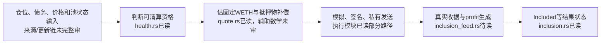

# 公开V2清算项目：可研究组件与净利润证据边界

读取日期：2026-10-19 UTC／北京时间2026-10-20。项目appCryptoCrucible/liquidation。只静态读公开材料，未安装、编译、执行源码、加载模型、回测、连接账户或交易。

## 核心判断

**值得继续一次有限的账务源码核查；当前不能把它当作现成赚钱程序。** 本轮确实从README走到了固定源码：存在Liquity V2资格筛选、补偿预算、发送和结果状态组件，根Cargo明确声明MIT或Apache-2.0。这些是可以学习的公开环节。尚未闭合的是：程序记录的profit究竟来自什么真实到账、扣过哪些费用，以及有没有完整实际运行账和个人可承受的持续成本。

唯一下一原件已经定位：同一固定版本`crates/liq-bot/src/inclusion_feed.rs`，它应解释传给结果模块的profit如何生成。当前不再泛找模型、不读取第11个公开来源、不运行该程序，也不把源码存在升级为盈利。

## 一、已取得的固定身份和许可层级

- commit：`364059aba56e773da01f6507224cf530bbbb1b09`；tree：`0958f715725a563f8ebcbf44c81cc133a2e59f22`。
- 提交作者／提交者时间均2026-10-10 10:16:37 UTC；它不是首次公开时间或历史生产部署的证明。
- recursive tree实际947项、truncated=false；本轮只取得7个源文件，不称读完947项或完整仓库／依赖审计。
- 根`Cargo.toml`的workspace.package明确声明`MIT OR Apache-2.0`。这是一项正面的项目级许可声明，不能继续将许可全部写为未知；GitHub API的license=null不否定这个文本。完整返回目录未见常见独立许可文件名，具体crate继承、文件例外和依赖许可未审，不能据根声明一概批准全运行栈生产复用。

来源：[固定Cargo声明](https://github.com/appCryptoCrucible/liquidation/blob/364059aba56e773da01f6507224cf530bbbb1b09/Cargo.toml)。七个文件的Contents/blob、Git tree和本地Git blob哈希均对应，原文／实际GET时间和SHA256已保存。GitHub匿名公开GET总10次、全部HTTP200，之后停止网络。

## 二、赚钱逻辑：当前状态触发任务补偿

这一已读路径的经济设计是：协议存在符合条件的债仓，执行者完成清算任务后预计取得补偿；程序先判断资格、估补偿，再经模拟／竞价／发送争取被链上接受。它使用当前仓位和价格输入，没有在本轮展示价格预测优势。

以下是**源码设计与阅读覆盖图，不是实盘运行证明**：

### 资格规则是真实实现，不只是README名称

`health.rs`读取债务和利息相关状态，对active／zombie仓位、债务非零、暂停条件及ICR低于分支MCR作判断。ICR是抵押价值相对债务的比例，MCR是该分支的最低门槛。这里确认的是实现了相应V2语义，不是已认证实时状态同步、预言机更新、全部部署参数或主网运行正确。

来源：[固定资格代码](https://github.com/appCryptoCrucible/liquidation/blob/364059aba56e773da01f6507224cf530bbbb1b09/crates/liq-adapters/liquity-v2/src/health.rs#L211)。

### 它预算的是任务补偿，不能把整笔抵押物当收入

`quote.rs`把固定WETH补偿和抵押物补偿估值相加；后者调用传入整仓抵押／债务及稳定池BOLD存款的辅助函数。WETH是包装形式的ETH；BOLD是本协议涉及的债务代币。该适配器明确把调用者偿还BOLD的min/max设为0，稳定池SP是其模型中的对手方。因此，不能把其他协议常见的“执行者先还债、取抵押物”资金要求通套到这一条路径。

本轮未读math.rs的具体常量／公式，也未审真实付款合约；不能给出固定数值、认证所有补偿基数或声称补偿已到账。全仓库支持闪贷的通用设计，也不证明每个协议分支都必须由个人备足借款本金。

来源：[固定补偿预算代码](https://github.com/appCryptoCrucible/liquidation/blob/364059aba56e773da01f6507224cf530bbbb1b09/crates/liq-adapters/liquity-v2/src/quote.rs)。

## 三、模拟、发送、接收、到账是四个层级

|已读证据|实际支持|不能升级成什么|
|---|---|---|
|worker的rpc_verify路径|在相应条件下模拟并检查gas限制|所有工作路径均已做同样节点验证|
|submit模块首个builder接受后返回|某发送端接受提交|交易已上链、成功或赚钱|
|SubmitReceipt::Recorded|程序记了提交记录|已有真实链上成交收据|
|inclusion要求上游提供profit|结果模块不凭空补利润，输入缺失可保留未知|该profit已经按实际到账和完整费用独立核实|

源码中的验证开关与上游调用关系并非全仓库已审；不能仅凭局部分支断言全程序有缺陷。竞价路径又区分优先费与auction_bps等口径，不能把gas单价、比例与总额一律当作同单位实付费。

`inclusion.rs`的Included.profit直接取上游InclusionObs.profit。类型注释称输入经过取证，但本轮没有取得上游生成证据；该注释不是独立认证。它对信息不全的区块避免草率判Dropped，是有价值的未知保护，却不构成完整利润账。

来源：[固定worker](https://github.com/appCryptoCrucible/liquidation/blob/364059aba56e773da01f6507224cf530bbbb1b09/crates/liq-bot/src/exec_worker.rs)、[固定发送](https://github.com/appCryptoCrucible/liquidation/blob/364059aba56e773da01f6507224cf530bbbb1b09/crates/liq-exec/src/submit.rs)、[固定结果观察](https://github.com/appCryptoCrucible/liquidation/blob/364059aba56e773da01f6507224cf530bbbb1b09/crates/liq-exec/src/inclusion.rs#L40)。

同一结果模块还明确没有实测的实时竞争者识别率，常量为None，相关匹配有fixture测试。fixture是用于检查程序行为的固定测试资料，不自动等于真实运行原账。没有因此推断全项目从未运行，也未把事件计数当胜率、净收益或个人任务捕获率。

## 四、个人能否低成本复用

|环节|当前可借鉴内容|仍缺的实施证据|
|---|---|---|
|资格筛选|按公开状态／门槛筛任务|输入同步、部署参数与异常状态处理的完整性|
|收益预算|分开补偿与债务本金，先算候选收入|辅助数学、实际补偿和所有费用定义|
|发送／观察|把记录、接受、上链、实收分开；缺数据保留未知|实际任务份额、成功失败全账、完整链路是否正确|
|资源与维护|README同时给出生产节点内与Standalone两种形态|硬件、同步时间、数据服务、延迟与月成本实测|

生产README描述Linux上的Reth节点扩展，与Lighthouse共置，首次回放历史日志并要求节点同步；同时列有Standalone独立进程，后者仍经节点RPC模拟。**生产配置不等于所有组件最低要求。** 本轮没有测RAM、磁盘、CPU、同步时长或预算，也未确认Standalone能否仅靠普通第三方RPC达到同等捕获能力，不能称普通电脑零成本，也不能凭Reth名称就断言个人一定做不了。

来源：[固定README资源与执行说明](https://github.com/appCryptoCrucible/liquidation/blob/364059aba56e773da01f6507224cf530bbbb1b09/README.md#L5)。所读README还把部分行情／fusion组件列为未接入路径，不能按目录名称推断已有预测优势。这里只确认相应自述，未运行检查。

## 五、继续／停止与唯一下一问题

**继续一次静态账务核查，不进入部署或资金投入。** 相比只有宣传的线索，本轮取得了实际资格与报价实现、项目级许可声明和明确的结果输入边界，足以支持再核一个决定性接口；还不足以构成可直接复刻的盈利轮子。

唯一下一文件在已取得的固定tree中明确存在：`crates/liq-bot/src/inclusion_feed.rs`，blob `b8de0e614ba72fa8efdb5c3ce65efa281d92d2c2`，12,749B。本轮没有读取它。下一只问profit怎样生成：是否用真实WETH到账／账户变动或合约事件，减实际网络费、竞价／builder和其他成本；怎样处理失败、缺数据、重复内部转账；输出究竟是估计、局部交易差额还是完整经营净额。

如果它仍只接估计／模拟／fixture或不能解释关键扣费，不把profit字段当已证盈利；若需另一个紧邻组件解释，只在下一事前固定范围内核，不能把审947项当必经目标。即使这个字段定义核清，还需要实际完整成功／失败原账才能验证历史净表现。计算设计正确与真的赚到钱继续分开。

既有六月Liquity V2七次尝试的限定正净数量事实保留，但没有证据把它归给这个仓库；本轮不重算旧账，也不因缺同一私人bot而否定学习部分公开操作。当前没有个人持续净优势、可扩大机会量或Gerko财富1%路径的证明。

## 六、来源覆盖与执行边界

Source Owner固定repo／commit／tree后取得README、Cargo和5个Rust文件，共7文件，10次匿名GET均200，原HTTP正文合计639676B。Root核41件manifest文件字节数和SHA256、7个Git blob与tree身份，方法Owner实质审资格／预算与执行／结果模块，范围见其最终回执；未读部分不当作缺实现。

Root实际读取Cargo全文，README资源／执行／未接入组件段，quote全文和inclusion前185行；方法Owner读取health和quote全文、worker／submit／inclusion生产实现相关段。没有把源码取得字节等同完整语义审查。Source实际峰值CPU／RSS没有平台测量，记UNKNOWN，不把计划2核或GET并发数当已测资源通过；原体／磁盘量按回执保留。

全部网络在10GET后停止；没有运行源码／模型／EVM、安装依赖、加载凭证、连接账户、回测、交易、付款、注册、外发或新自动化，没有读取排除私人行情目录或QC，也没有改变旧FAILED、既有AAPL／Issue85或一次邮件状态。新文件均保留作证据，无清理。财富目标尚未达成。
