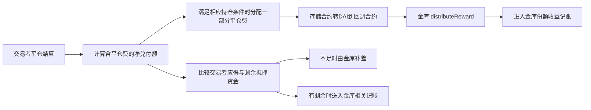

# 金库奖励由谁支付：已取得收费与风险承担源码

核验日：2026-10-18 UTC。当前结论：**取得与公开初始实现线索对应的 GNSTradingCallbacksV6_3 源码，明确存在平仓费→金库奖励、金库承担交易净兑付差额的路径。** 尚未证明固定窗口933条奖励全部来自该路径，也没有证明完整净利、重复性或容量。

## 当前证据与历史阶段分开

最初的Sourcify查询只返回付款代理壳，见 owner/reward-payer-source-review.json；这一步没有找到业务实现，结论保留作历史。随后在独立Blockscout正常公开网页取得新的具体初始实现线索，并只读该唯一地址的独立源码档案，形成 owner/reward-payer-implementation-supplement.json。

- 已有RPC查询返回的933条RewardDistributed，索引sender均为 `0x6c612c804c84e3d20e3109c8efd06cd2d8b28f46`，固定存入—赎回区块窗内为500条。唯一键、emitter/topic、removed字段已核；没有使用记录中0x0的blockTimestamp，也未对每条重新取得资产回执或独立验证全链完备。
- 初始GToken源码从 `_msgSender()` 取直接调用者，从该调用者拉取资产后发出奖励事件。因此这里的sender是直接付款层，不是最终出资人或交易者身份。
- [公开部署交易](https://arbitrum.blockscout.com/tx/0x0c45dda801a83896aa524ce34a7681eba2b3dc6aae74ff62016937d6c7d1d604?tab=logs)完成加载后显示：block49275558、创建目标代理、首个Upgraded指向 `0xae31db60aa9a82502d5d63dab3e4cd5f8bd06121`；同时有付款代理向gDAI金库的DAI授权。保存为root/public-browser-initial-implementation-observation.json。它是浏览器派生证据，不冒充完整raw receipt。
- [该实现的独立Sourcify档案](https://sourcify.dev/server/v2/contract/42161/0xae31db60aa9a82502d5d63dab3e4cd5f8bd06121?fields=sources,compilation,metadata,deployment,abi)记creation/runtime exact_match、GNSTradingCallbacksV6_3、部署block49275550，早于上述代理及本例。verifiedAt2024-08-08不是2022事前公开源码日期，provider匹配也不等于本地独立复编译。
- 当前公开地址页的实现也指向该地址；这不能证明中间从未升级。完整历史升级窗口与原始部署回执仍未补齐。

## 源码说明的赚钱机制

以下是所识别源码路径，不冒充逐笔历史交易的全部归因。

1. `GNSTradingCallbacksV6_3.sol` L750—760 调用getTradeValue时纳入closingFeeDai+nftFeeDai，计算给交易者的净兑付额。
2. L773—780 **仅在trade.positionSizeDai>0的分支**，按closingFeeDai×daiVaultFeeP/100计算金库奖励；先从storageT向回调合约转DAI，再调用vault.distributeReward，发出DaiVaultFeeCharged。
3. L789—805体现交易对手方风险：交易者应得大于剩余抵押资金时向金库取差额；有剩余则送入金库相关路径。不能把所有交易者亏损直接称为份额持有人到账利润，缓冲和份额价格另有规则。
4. L170—182允许onlyGov调整分配比例，要求三项之和100。注释举例的40不是历史实值；本轮未取得当时实际比例及其变更完整记录。

这是一条**收费、结算和风险承担**机制。它能解释资金提供者为什么有可能获得回报，也解释为什么可能亏；它不是这份源码所提供的未来价格预测模型，更不等于拿到了XTX的私人预测策略。

## 对个人复制的实际含义

可复制的是研究方法：把收入对应到真实付款方、把收费对应到所承担的风险、把本金和赎回总额分开，再核全部成本。公开源码也让结算规则可以核查。

仅复制源码、换更强的AI模型，并不会产生交易客户、真实手续费流、风险缓冲、可持续收益或资金容量。这些不能从本例的短期资产增加推出。参与一个现有金库与复制其机构业务或获得价格预测优势是不同任务；本轮没有进行参与资格、当前参数或投资推荐。

本例现有成本核验见[双币种原账报告](../gdai-fixed-case-cost-attribution-20261018/README.md)：上述四笔资产流+1.737369382150704725 DAI，九笔已观察费用−0.0004524838 ETH；抵押、完整负债/关联成本与同期计价仍有缺口，不能当完整扣费利润。

## 研究决定和下一条证据

保留为公开收费与风险机制样本。**暂不接纳为“可低成本复制的价格预测赚钱案例”。** 当前财富目标未达成，没有新增稳定盈利或容量证据。

若继续这一固定案例，最有价值的新证据是：将已观察到的奖励事件与当时有效回调版本、DaiVaultFeeCharged及实际DAI转账逐笔绑定，证明哪些钱来自交易费，再核相关完整成本。已有源码路径只说明可发生的机制，不能代替这些原件。不更换赢家，不因一次增值外推年化，不运行模型/回测或交易。

本阶段Owner两次独立Sourcify GET；root一次精确地址检索和独立公开浏览器只读。检索的四个交易hash不在固定933条内，仅为线索，未并入样本。已403的官方RPC与Arbiscan资源未重试；未读凭证、登录、执行合约函数/源码、安装、付费、运行模型或交易。临时浏览器标签将在完成读取后关闭；原件及报告保留作证据。

独立验收分为原始caller索引和新增实现机制两个有限层，见review/；root-acceptance.json记录当前层级与未通过事项。
