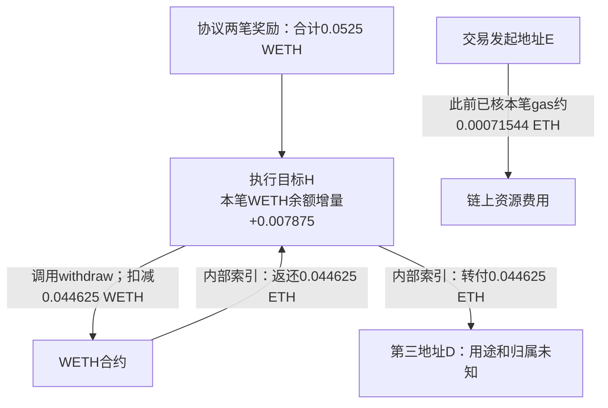

**本笔奖励到账之后，还有拆包和转付：索引记录 0.044625 ETH 转给第三个地址；执行目标的 WETH 本笔余额增量为 0.007875。**因此，不能把 0.0525 WETH 奖励全归给交易发起者，也不能将后续 ETH 转付再加为一份新收入，或未经用途证据就全部扣成费用。

| 环节 | 本轮原件支持的事实 | 不能由此推出 |
|---|---|---|
| 发起交易 | chainId=1、类型0x2，原交易与封存receipt的hash/block/from/to/index相符；`value=0` | 没有此前投入、预存、部署或其他资本成本 |
| 协议付款 | 复用先前已核两笔奖励，合计0.0525 WETH，进入执行目标H | 全部属于交易发起者E或某个个人 |
| 同笔拆包 | WETH `Withdrawal` log0x98：H拆包0.044625 WETH；内部索引同额记录WETH合约→H的ETH | 拆包再创造0.044625 ETH收入；这些可替代WETH能逐枚认定来自新奖励 |
| 同额转付 | 内部索引H→地址D，再付0.044625 ETH；D既不是H，也不是E | 它必然是费用、区块竞价、退款、某个人收入或已认定的利润分成 |
| H的WETH数量变化 | 本receipt全部5条WETH日志中，H有两笔Transfer入、一次Withdrawal，无Transfer出/Deposit/未知WETH事件；据此同笔增量+0.007875 WETH | H最终余额、全部资产净值、个人到手或全成本净利润 |

可观察到的流程如下。图中的资金移动是同一交易内的数量关系，不表示已证H、D与E属于同一主体。

H=`0xbeef43294893c7a20644a9309e88458a0234beef`；E=`0xbeefc43ce9a0275ff2c716e4864c25e271dcbeef`；D=`0x4838b106fce9647bdf1e7877bf73ce8b0bad5f97`。地址关系是直接字段事实，控制人和最终收益权为UNKNOWN。

本轮只读取同一既定[交易](https://etherscan.io/tx/0x4aa768849ca73b9e978a709c38c920e781202ef389ea59db9cb95bf95d9c1056)的两份公开历史原件：[交易对象GET](https://api.routescan.io/v2/network/mainnet/evm/1/etherscan/api?module=proxy&action=eth_getTransactionByHash&txhash=0x4aa768849ca73b9e978a709c38c920e781202ef389ea59db9cb95bf95d9c1056)、[同tx内部转账索引GET](https://api.routescan.io/v2/network/mainnet/evm/1/etherscan/api?module=account&action=txlistinternal&txhash=0x4aa768849ca73b9e978a709c38c920e781202ef389ea59db9cb95bf95d9c1056)。读取时间UTC 2026-10-19 22:27:55–58，两个响应均HTTP200，原体共1736B，已保存SHA。没有运行本地trace、EVM、调用输入、预测模型或回测。

内部索引返回status=1、OK、两条isError=0的call记录，区块26194916、时间1792031183与封存事件相符；每行未提供txhash、blockHash、transactionIndex或traceId。故缺失身份字段以请求URL绑定和已提供block/time分层，不伪造字段，也不认证索引覆盖全部内部流。第一条金额与receipt实际Withdrawal完全相等，第二条与第一条同额且共享H这一中间地址；这支持拆包及转付解释，不构成独立节点重放或完整trace证明。

Withdrawal的语义来自上一单元已取得的canonical-WETH9源码：withdraw减少调用者WETH余额、按同一原量发送原生币并发事件；18位单位和精确主网地址映射沿用既有来源。机制Owner仅用纯Keccak签名数学匹配Withdrawal主题，空串及Transfer已知向量校验通过，未执行Solidity或EVM。本轮没有补做历史部署字节码认证。

同笔WETH增量的数量恒等式为：`52500000000000000 - 44625000000000000 = 7875000000000000`个原始单位。它是H在该receipt日志与已绑定WETH语义下的代币余额增量，不是余额查询或净利润。先前的“协议奖励减该笔gas为正”交易级局部结论保持原范围；不得把H这项WETH增量、D的ETH收款和E的gas任意拼成个人投资回报，也不得把两跳ETH各算一次收入。内部行的gasUsed已经属于交易执行的一部分，不能叠加扣费。

**第一性原理上的新信息是：任务报酬存在，且实际执行链上包含转换、分配与多个角色。**我们要找到可复制赚钱环节，既要知道协议为何付钱，也要知道哪一角色获得哪项报酬、承担哪些成本以及凭什么取得任务。当前角色用途尚未证实；单看金额关系不能给它命名为佣金或竞价机制。

下一项最小只读求证是：查看这个精确执行目标H是否已有公开验证源码/ABI或明确的角色、支付规则原件，以解释这次转付和留存的用途。先查公开原件，不反推为已恢复私人策略，不扩大到其他钱包或日期寻找盈利样本。若源码缺失或不能对应历史版本，就保留用途UNKNOWN；完整期间的尝试/失败/运营成本与我们能否获胜，仍须后续另外证明。本轮没有新增钱包史、失败尝试账、手续费假设、净收益重算或交易。

当前决定：保留真实付款和数量变化的正事实，继续这一个角色与支付规则的只读核验；不据此投入资金、开发机器人或宣称已有可扩大的净优势。两次公开读取已达本单上限。完整来源与解释保存在`root/protocol.json`、`source-owner/receipt.json`、`source-owner/result.json`及`mechanism-owner/native-flow-binding.json`；最终独立审阅另存`review-owner/review.json`。
