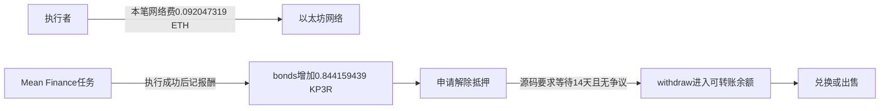

# Mean Finance：网络费、锁定报酬与兑现边界

读取与核算日期：北京时间2026年10月20日。**金额已核出，但上一轮“代币转账”的解释需要收窄：按取得的匹配验证源码，这笔事件给执行者增加的是锁定报酬bonds，并没有直接增加可转账钱包余额。** 报酬记账事实保留，尚未证明本笔兑现或完整净盈利。

| 固定2022年4月13日交易的项目 | 精确结果 | 含义 |
|---|---|---|
| 本笔实际网络费 | **0.092047319075328723 ETH** | 由收据gasUsed × effectiveGasPrice得到；包括基础费与优先费，不再另加优先费 |
| 本笔报酬数量 | **0.844159439296797270 KP3R** | 按匹配源码18位精度解释的bonds计入，不是现金或wallet balance入账 |
| 净利润、收益率 | **未确认** | 两种币不能直接相减；本金、兑现、失败及其它可归属成本尚未闭合 |

固定交易为0x09ea6864558767835981a5f241c8134386b90381161fac87638a48944624878c。本轮只做了一次固定原件的正式整数核算，未换样本或重跑。网络费原量为92047319075328723 wei；报酬原量为844159439296797270。没有使用币价、假想卖出、投资回报率或账户收益曲线。[原始收据](https://api.routescan.io/v2/network/mainnet/evm/1/etherscan/api?module=proxy&action=eth_getTransactionReceipt&txhash=0x09ea6864558767835981a5f241c8134386b90381161fac87638a48944624878c)、[EIP-1559手续费规范](https://eips.ethereum.org/EIPS/eip-1559)。

## 钱的实际路径

**本笔已经核到网络费及bonds报酬；本笔到解锁、领取、卖出的完整链还未建立。** 14天是申请解除抵押后的源码等待条件，不是已证明本笔在14天后自动到账。

## 为什么必须修正Transfer的含义

新取得的Sourcify记录绑定链1、同一KP3R地址，creationMatch与runtimeMatch均报match，并提供源文件。源码关键处：

- L547声明decimals为18。
- L1070–1077：workReceipt扣任务credits，再调用_reward，发出KeeperWorked。
- L1107–1111：_reward增加keeper的bonds和totalBonded，发出Transfer(job,keeper,amount)，没有增加balances。
- L1409–1410：可转账余额查询返回balances；L1446–1452的普通转账才会修改该余额。
- L1283–1304：unbond后满足等待、无争议等条件，withdraw才把相关资产转进余额。

本笔Transfer的from是job，紧随的KeeperWorked字段也与上述奖励分支相容；普通receipt(this)支付分支的转账来源则应为token合约自身。因此**不能仅凭事件名字Transfer，就认定收到即刻可出售的币**。[匹配源码与验证记录](https://sourcify.dev/server/v2/contract/1/0x1ceb5cb57c4d4e2b2433641b95dd330a33185a44?fields=all)

验证服务时间为2024-08-08，记录的部署块为11143904。上述解释以该匹配源码适用于本笔为条件；没有本机编译、独立历史运行字节码或状态证明，也不把2024验证时间冒充2022执行前的公开时间。上一轮原始事件、金额编码和收据均保留；旧文中“支付/转账”不能继续解释为已增加钱包可支配余额。

## 后来确有领取记录，但不能全部算给这一笔

按事先固定的同一调用者、同一核心合约、目标块之后的事件查询，取第一条KeeperUnbound记录，再取得其交易与完整收据：

- 交易0x08f44a5eb2f4766c0669f2f07f449b1201f0006ce59b16a414e6268f4c8d9692，UTC2022-04-21 15:40:24，状态成功。
- 调用withdraw，参数是KP3R地址；收据显示token合约向同一调用者的Transfer，随后是同量KeeperUnbound。
- 按匹配源码，这条路径实际修改balances，与前述_reward的bonds记账不同。

这证明该调用者存在后续聚合领取记录，**不证明0.844159439296797270 KP3R已单独被领取或卖出**。聚合领取金额不同；没有完整待解锁账及逐笔归属，不把它的全部金额记作本次任务收入，也没有计算其出售价格或本笔净利。[领取原始收据](https://api.routescan.io/v2/network/mainnet/evm/1/etherscan/api?module=proxy&action=eth_getTransactionReceipt&txhash=0x08f44a5eb2f4766c0669f2f07f449b1201f0006ce59b16a414e6268f4c8d9692)。

## 一个影响后续核账的数据问题

固定token交易索引查询从目标块开始、升序、第一页10条，却只列出2023年以后的记录，既未列本次2022年奖励事件，也未列上面已取得完整收据的2022年余额领取。不能把这个查询当作完整的2022年报酬/兑现索引，不能把缺项填成零或据此认定从未领取。

另一个事件查询接口能返回本笔已知KeeperWorked，并返回后续解锁/领取记录。**缺项原因仍未确认**，不一概称索引bug，也不认证事件接口全历史完备。解锁和领取各只取第一页10条，没有分页闭合；固定供应商head只用于限定查询结束块，不证明连续实时服务或今天的任务活跃状态。

## 对“我们能不能复刻赚钱”的影响

已能解释的机制是：执行者先付ETH完成工作，获得KP3R形式的报酬权利；解锁、领取、兑换还涉及后续条件。**推断：** 即使报酬按某种gas补偿公式计算，付款资产不同、等待期间价格变化、执行失败及领取兑换费用，仍可能消耗表面溢价。零抵押注册也不等于无需ETH周转资金。

可借鉴的是明确付费需求、任务资格与可执行性检查、精确费用记账；当前还没有证据支持个人复制后净盈利或扩大资金。公开代码、记账奖励、可转账余额、实际出售收入和企业全成本利润，是不同证据层。

**决定：保留为历史执行报酬样本，暂不推进开发或交易。** 下一步只接受一个有边界的实际闭环：同一观察周期内，收入、解除抵押、领取、实际兑换与可归属成本可以对应。缺少这种归属时，停止把本例升级为盈利复刻依据，保留已发生的正报酬和领取事实。

本次费用/兑现核查9次公开尝试，主动在12次上限内停止：8次匿名GET200、1次原生EIP正文读取。期间用户另问Alchemy注册入口，另作1次官方域名检索并提供链接；没有注册、登录、读密钥、创建应用或调用Alchemy接口，也未将其当盈利证据。合计10次公开读取。未付款、执行来源代码/ABI/SQL/EVM/trace、eth_call、模型、训练、回测或交易。原有FAILED、AAPL未评分、其它正事实和关闭范围不变。财富目标未达成。

