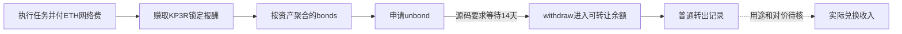

# Mean Finance：赚取报酬、解锁领取与卖出收入

读取日期：2026年10月20日。**新原件确认：同一执行者确实申请解除KP3R锁定，随后取得可转让余额；固定窗口内还出现了一次普通转出。当前仍不能把它们归为4月13日那一笔报酬的卖出收入或净利润。** 这条支线保留为历史报酬机制样本，停止继续追查收款钱包，不进入开发或交易。

## 已核到哪一步

以下是实际交易，不是教学例子；时间均为UTC，来自保存的供应商事件/收据时间字段。链、交易、区块、调用者和日志身份已交叉绑定，但没有独立节点的完整历史状态证明。

| 时间 | 已核原记录 | 能支持的结论 |
|---|---|---|
| 2022-04-13 00:00:34 | 09ea…执行任务；旧固定核算为0.844159439296797270 KP3R报酬、0.092047319075328723 ETH网络费 | 赚取锁定报酬，不能将两种币直接相减；本轮没有重新核算 |
| 04-21 15:40:24 | 08f44…提取较早的聚合待领取资产 | 按匹配源码的正常领取路径，不能是04-13新增报酬完成14天等待后的领取 |
| 04-21 15:41:52 | 3fc604…调用unbond，资产参数为KP3R，记录可领时间05-05 15:41:52 | 有真实解除锁定申请，不是自动发现金 |
| 05-05 15:46:15 | a96f…调用withdraw(KP3R)，成功；收据有token合约→同一执行者的Transfer和KeeperUnbound | 与上述申请同资产、同原量word的真实余额释放记录；不把聚合量全算给09ea… |
| 05-09 15:51:40 | 908258…调用KP3R自身的transfer，转向6aff…；状态成功，收据仅一条Transfer | 真实普通转出；收款主体、用途及对应兑换收入未确认 |

申请和领取的原交易分别为[3fc604…](https://api.routescan.io/v2/network/mainnet/evm/1/etherscan/api?module=proxy&action=eth_getTransactionByHash&txhash=0x3fc604cb51cf101369f5a0343fbe17e721c2b10066731a816d78a62377aa0267)、[a96f…](https://api.routescan.io/v2/network/mainnet/evm/1/etherscan/api?module=proxy&action=eth_getTransactionByHash&txhash=0xa96f5671ae94a290e141fd7aeb3d07253a970ef7959665ee05a92a60c84708f9)；[领取收据](https://api.routescan.io/v2/network/mainnet/evm/1/etherscan/api?module=proxy&action=eth_getTransactionReceipt&txhash=0xa96f5671ae94a290e141fd7aeb3d07253a970ef7959665ee05a92a60c84708f9)与[后续转出收据](https://api.routescan.io/v2/network/mainnet/evm/1/etherscan/api?module=proxy&action=eth_getTransactionReceipt&txhash=0x9082585f35cbf9dd3f45a04a1f11217b9e3598875b2266a47209bca85eeac7ff)均已保存完整原JSON、URL、UTC、响应状态及哈希。

图中代表机制及已观察的不同记录层级，**不代表4月13日单奖已逐币追踪贯穿全部箭头**。

## 为什么4月21日的早一笔提款应被排除

匹配源码的_reward只增加bonds（L1107–1111）。unbond才把申请量加入partialUnbonding，并重设对应资产的14天等待期限（L1283–1287）；withdraw只支付partialUnbonding，不会把后来新赚取的bonds顺手取出（L1294–1304）。即使旧等待期限已经到期，新奖励也不能因此自动进入旧批次；再申请unbond则会重设期限。

因此，在该源码历史适用的前提下，04-21的08f44…不能通过这个正常领取路径提取04-13才产生的锁定奖励。这比“暂时无法分摊”更明确。治理slash/revoke确有转给governance的其他路径（L1323–1343）；本笔是KeeperUnbound正常领取记录，不据此推出任何治理补偿或关联主体转付。

源码由[Sourcify匹配记录](https://sourcify.dev/server/v2/contract/1/0x1ceb5cb57c4d4e2b2433641b95dd330a33185a44?fields=all)提供，验证时间为2024年。它不是独立认证的2022历史运行状态，也不能冒充当时已公开的策略规则。这里的排除和机制解释均保留该条件。

## 已经领取，为何仍不能称本笔赚钱

1. **奖励按地址、资产聚合。** 新取得的unbond/withdraw参数补齐了资产身份，两笔原量word相同，实际领取事实成立。源码没有为每个job或单笔报酬分开保存可追踪的领取lot；本轮没有完整本金、追加抵押、各任务收入与期间状态账，不能采用事后币龄分摊把整笔领取指定给09ea…。
2. **普通转账没有给出卖出对价。** 固定窗口为该次领取块14718091至下一条既存领取块14810362。针对同一token、同一发送者的日志查询第一页1条、第二页成功空；这只闭合了供应商在该过滤窗口返回的分页，不认证全链索引无缺漏。按预先规则选最早转出，取得的908258…是transfer，收据无同笔换回资产腿。其数量word也不同于上述领取批次。收款地址的控制者和是否为交易所均为UNKNOWN；没有把缺项填零，也没有把它叫作卖出或无收入。
3. **本金与完整成本没有闭合。** 旧单笔网络费是真实已付费用，但聚合报酬的生成成本、失败成本、解锁/领取/转出费用、实际兑现对价及其他可归属成本还未形成同一口径的账。本轮只解析身份、原量word和时间，没有计算新费用、币价、虚拟卖出或收益率。

**会计边界：** 本轮追查的是实际兑现。核历史期间总损益并不要求逐笔卖出；若有完整、一致计价的期初与期末净资产，可用净资产变化减去所有者净投入（投入减提取／分配）。已体现在净资产中的费用不重复扣除，账户外可归属成本另核。本例这些端点、资本流和成本也未闭合，因此仍不能核定期间净利润。

## 谁在为工作付钱，也需要分清

这是自动执行工作取得报酬的机制，不要求执行者先正确预测短期币价。按匹配源码，job的credits可经预存资产、治理增加KP3R credit并铸币、或流动性相关credit铸币等不同路径获得（L852–876、909–914、971–981、1029–1047）。**本笔credit的实际资助来源尚未核明**，因此只称“执行服务报酬／协议补贴待归因”，不能直接写成终端客户现金付费，也不能断言本笔一定由增发支付。

**行业知识推断：** 一套程序可以把任务识别和执行自动化，但收入上限取决于有偿工作量、任务资格、竞争与报酬资金来源；增加本金并不会按比例制造更多工作。KP3R锁定期间的价格变化还会改变最终购买力。公开代码本身不证明今天存在足够、可进入且扣费后有利的任务。

对个人可借鉴的环节是：先找有明确付费需求的工作，核任务资格，再用事前固定方式记录成功、失败、收到什么和付出什么。当前没有足够证据把本例升级为个人净盈利方案、资金容量或接近Gerko财富1%的路径。

**本支线决定：停止追加钱包追踪和开发，保留已赚取报酬、实际解锁领取及普通转出的正事实。** 如将来出现可归属的完整周期收支原账或公开结算证明，再重新评估；不会仅为补齐图表继续猜测收款人。

## Alchemy登录后的实际进展

用户自行登录后，侧栏最初位于已登录的建项目引导页。跳过项目类型选择并选择Free后，进入仪表盘；Usage页面显示本月0/30M CU、剩余30M，1/5个应用。账户显示一个Ethereum默认应用；其具体生成时点未独立核定。引导页自动显示过密钥，随即隐藏，未复制、写入本地原件或使用；没有点击另建应用或创建密钥，没有升级付款或修改安全配置。

免费账户登录和额度已确认，具体历史查询方法、数据返回与该方法实际CU消耗尚未验证。当前8次链上原件读取均经已有匿名公开接口完成，没有使用Alchemy认证接口。CU/s与请求数/s不是同一单位，不作换算。可在[Usage页面](https://dashboard.alchemy.com/usage)查看当前用量；本地仅保存不含秘密的UI事实回执。

本单固定8/8次GET后终止外读，未改样本、钱包或规则，未执行来源代码、ABI、EVM、eth_call、模型、训练、回测、交易或新自动化；新增付款0。所有原件保留，未触碰私有Bitstamp档案或QC。全局财富目标仍未达成。
