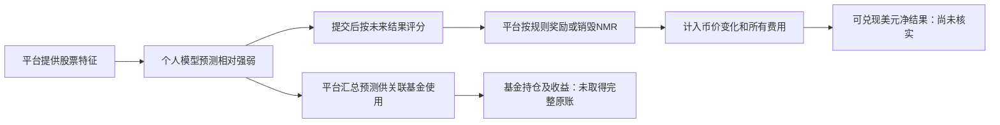

# Numerai官方示例：有预测评估路径，未通过完整盈利案例准入

结论：找到了一个在本轮限定旧索引中未被充分覆盖、明确围绕个人机器学习预测的来源。Numerai可作为“数据—模型—事后评分”的研究样本；本轮没有取得能把固定公开模型、原始预测、全部结算和成本连起来的原账，不能声称已找到可复制净利润，更没有证明能达成Gerko财富1%。没有运行、注册、提交、质押或交易。

## 钱如何流动

官方文档说明，Numerai收集预测并组合供基金使用；参与者获得的是比赛规则下的NMR奖励或损失，而不是基金股权、基金分红或自己的股票成交利润。按质押说明，Numerai为结算合约提供奖励储备；没有独立核验每份奖励储备的经济来源或可持续规模。[入门](https://docs.numer.ai/)；[质押及结算](https://docs.numer.ai/numerai-tournament/staking)；[条款](https://numer.ai/terms)。

## 具体核的是哪一个

选择官方示例相关的 `NB_EXAMPLE_MODEL`，不是从榜单最高收益开始筛选；选择并未事前封存，看到结果后也不能声称盲选。公开资料把它列为barebones示例notebook关联模型。模型页显示 `benchmark_models` 账户、当前0.05 NMR质押、`1Y Return` 0.49%、MMC reputation -0.0013。这里只是读取平台摘要，没有计算新收益。[模型说明](https://docs.numer.ai/numerai-tournament/models)；[公开模型页](https://numer.ai/nb_example_model)。

0.49%不能写为美元净利润：官方回报定义使用已结算奖励／销毁与投入NMR的口径；API还并列提供假定质押的理论回报。本轮没有从原始字段和逐轮原账绑定该网页标签属于哪一类、准确起止日、分母，也没有取得币价、兑换、链费、计算成本后的净账。当前质押量不能乘这个百分比倒推出过去到账金额。链上Merkle根和总负债也不等于每个模型的完整结算明细；个人claim证明的部分接口要求模型／质押者认证，本轮没有调用。

## 有哪些可复用材料，边界是什么

|环节|已取得证据|关键限制|
|---|---|---|
|代码|官方example-scripts仓库及MIT许可证；入门页给出LightGBM示例|未绑定历史NB_EXAMPLE_MODEL的固定代码、权重、版本和逐轮预测；MIT软件许可不覆盖数据|
|数据用途|2026-08-31条款§4.2明确覆盖为比赛训练模型及生成预测|限比赛用途；不得反解股票身份或挪作外部商业数据；外部云／软件处理有保密及用途条件，当前Codex数据流程未证满足|
|预测任务|股票未来相对表现，当前v6默认60个交易日目标|不是具体股票美元价格；不能直接等同买卖指令|
|评分设计|按时间推进、重叠标签间隔、提交后评分有文档依据|文档方法不是该历史模型权重始终不变的证明，也不是实际净利润|
|现行版本|v6于2026-10-16开放数据准备，11月6日才开放提交；v5.0—v5.3非live下载已退役|不能拿新的v6示例冒充旧模型1年表现的复现|

来源：[MIT许可证](https://github.com/numerai/example-scripts/blob/master/LICENSE.txt)、[数据](https://docs.numer.ai/numerai-tournament/data)、[API与评分身份](https://docs.numer.ai/numerai-tournament/api)。代码许可证本轮读取的是移动master，未取得固定commit；一个目录链接读取被工具拒绝，未换通道取同一受限目录。

## 准入判断

事前精确模型／权重／数据身份：未取得。后续完整持仓成交：未取得，比赛参与者本身也没有直接交易这些股票。逐轮真实质押、奖励、销毁与全部费用：未取得。独立扣费美元盈利：未证明。因此，它未满足用户要求的完整可复现、扣费后盈利交易案例，不能替换这个验收目标。

可学习的是任务定义、可复用基础模型、时间隔离、预测先提交后评分，以及把评分、代币结算、美元净利润和容量分开。不能声称它已解决自己的股票数据、预测优势、成交执行或规模问题。当前没有参与资格和中国内地适用性核验，本轮研究不构成参与或质押建议；没有申请账号或改变地区。

若继续只读核验，唯一有价值的下一项是：能否公开取得一个固定示例模型的历史代码／数据身份及完整逐轮实际结算、链费与兑换成本原件。模型页面的一个百分比不够，不要求用户交出其他人的私有权限，也不把注册账号当作本轮必要步骤。本轮16次公开内容读取上限包含一次预留独立条款读取，正文发布日期未标注的均UNKNOWN；主要网页读取完成于2026-10-18 07:33—07:37 UTC，正常浏览器条款读取位于该时间窗内。完整来源结果和字段边界见 `numerai-native-public-document-reads.json` 与 `numerai-candidate-audit.json`，去重范围见Owner文件。独立审阅结果另存。
