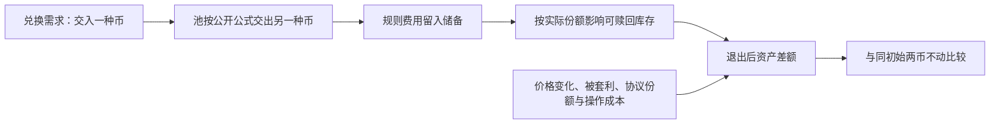

# 从真实正账到可复制环节：收入、库存风险与资金放大

读取日期：2026-10-19 UTC／北京时间2026-10-20。结论来自已封实账、独立经济口径审阅及本轮官方收费页。没有新跑模型、回测、数值仿真或交易，没有重算封存金额。

## 一、核心结论

**我们已有一个真实的、扣除已识别直接费用后比原样持币更好的持仓事实；尚没有稳定、可扩大的个人赚钱方案。** 两者应分别承认。缺私人择时不能抹去过去赚到的数量，也不妨碍学习公开库存服务；一个成功持仓也不能证明往后选任何时点都赚钱。

本轮收敛出的可复制环节是：**依据公开规则提供库存供别人兑换，收入留在池中；按同资产持币基准核算库存差额和全部成本。** 如果未来用预测，真正需要检验的是“交易前能否判断成本后增量有利”，而不只是下一根价格误差更小。这是研究推断，不是已经验证的新模型。

KMLM的一份财报缺失只影响其收入归因，不构成整个财富目标的硬依赖。该拒绝资源保持停止，不再反复要求用户文件才允许其它安全研究推进。本轮也不恢复已关闭的LP盈利／扩资gate；不把整理旧正数称新盈利发现。

## 二、已有真实记录究竟支持什么

下列金额逐字引用已封结果，未新计算；USDC为代币数量，ETH为原生币数量，不冒充美元现金或投资回报率。

|对象|已封的直接费用后资产差额|正确解释|
|---|---|---|
|第一笔实际持仓|+9.361165 USDC；+0.003166085877958365 ETH|在已核持仓及四笔已识别直接费边界内，两币都比同初始币量原样持有更多。无需假设USDC等于1美元，也无需挑有利ETH价来得到正号。|
|第二笔固定候选|+3.728808 USDC；−0.002586370539203196 ETH|两币符号混合；封存的退出Sync参考口径为负，不等于任意价格下都负，更不能合成未来胜率。|

原件入口：[首笔完整闭环](../../V2小额持仓闭环-两币扣费后净增与复制边界-20261016.md)、[两笔固定对照](../../V2两笔固定持仓对照-真实费用与个人复制边界-20261016.md)。本轮独立方法审阅确认，同初始币量／外部投入和gas资源必须统一：额外用于gas的币不能算新增收益，持币对照应保留相同资源；已经在赎回中包含的费用不能再加一次。

首笔约799天、第二笔约1950天的实际持有期不能用退出当天的交换量代替。退出日收费预算和个人份额后续都已做过：1379次Swap、9个Burn锚点、25次供给变化；首笔只参与该日6次交换，第二笔1374次。不会再派一次“补收费预算／份额分母”。这些是旧事实，不是本轮新取数。

另一个最早Mint特殊交易的正组件来自STACY分配／旧权利出售，不能当作该池交易手续费。首笔完整持有期的交易费、非Swap注入、协议稀释与库存变化尚未逐项拆分；因此能承认资产净差，不能把它全部精确命名为已独立测量的手续费或预测alpha。

## 三、谁付钱、为什么付、风险落在谁身上

这是自动做市池的库存服务：提供者预先放入两种资产，兑换者按规则把一种资产交给池，取走另一种。交易者为即刻兑换承担规则费用；池中的流动性提供者共同承担库存变化与逆向选择风险。事件中的sender可能是路由或程序，不能直接当最终人类客户。

本轮实际读取的[Uniswap官方Fees页](https://developers.uniswap.org/docs/get-started/concepts/fees)说明：V2每次交换收0.30%，费用进入储备；当前页面列LP为0.25%、协议为0.05%，并说明feeTo控制协议收费、协议份额为交易费的六分之一。页面称2025年12月治理后V2协议费已开启。

**这是当前官方文档声明，不是本轮对旧持仓历史feeTo状态的链上认证。** 不能回写旧毛规则预算，也不能把0.30%全部永久归个人。页面发布日期UNKNOWN，实际正文取得于2026-10-19 19:59 UTC；两次真实301后最终HTTP200，没有读取新行情／合约状态。

## 四、赚钱条件：先填上库存与成本差额

币价变化时，池会按规则改变两种库存数量。币价大涨，池可能逐步卖出上涨币、换回另一种币；所以账户总价值上涨，仍可能少于原样持币。费用收入必须覆盖这块相对差额和增量成本，才构成对本基准的优势。**收手续费本身不保证净赚钱。**

下面是独立审过的**教学模型**，不是XTX策略、实际交易或已跑实验。设初始两币按外部价各占一半，以Y币计价，初值V；期末相对价为r>0；g是固定LP凭证归属库存乘积的期末／期初比；C是尚未计入库存的增量成本，以共同期末Y口径计量。假设期末库存比恰等于外部价、无中途自身增减LP、无额外本金／捐赠／补贴，并忽略整数／成交差异，则：

`LP期末价值 = V × √(r × g)`

`同初始两币原样持有 = V × (1+r)/2`

**胜过持币需要：** `√(r × g) > (1+r)/2 + C/V`。

若池价只是贴近外价，这只是近似关系；标价不等于可执行卖价。g已经包含所占份额变化／协议稀释，不是全池k的简单涨幅，也不自动等于纯手续费增长。若gas付ETH，须保留ETH原量后按同一期末口径比较，不能混入任意支付日美元价；已进入库存的费用不再扣。

这组式子只解释需要预测的经济条件，没有从旧持仓拟合g或证明任何公开模型能事前判断它。官网本轮只支撑费用机制，公式由独立符号推导得到，不冒称官网给出了上述推导，也不拿理想模型推翻真实双币正账。

## 五、为什么资金不能按收益率直线放大

再作一个**教学假设**：同一窗口可分给全体LP的费用R已扣协议分流，原LP资本L，新增资本a，份额按同口径／恒定时间权重分配，且加资不改变交易需求。那么新增资本的毛分配为：

`R × a/(L+a)`。

随着a增加，固定操作费F摊到每元资金上会下降；但单位资金分到的费用也会下降。因此，单位净差R/(L+a)−F/a不保证单调。在R和L固定、只扣固定F且不含库存等其它损益的教学条件下，总毛分配R×a/(L+a)随a增加并趋近R；总额扣固定F后也不会因此下降。现实中的R、流量、冲击和库存风险会变化，实际总净利仍未知。本轮没有为它们估数，所以不给“能放大到多少美元”的假答案。

更大的规模必须有新增可服务需求、份额或成本优势。模型更强不自动创造客户付费；增加本金也不自动产生更多交易需求。这是我们研究XTX时可以借鉴的经济问题，尚未复刻其专有预测、客户渠道或执行体系。当前没有Gerko财富1%的可验证路径或达成期限。

## 六、哪些能学，哪些还不成立

|环节|个人可借鉴|做不到／没证据的后果|
|---|---|---|
|公开报价与库存规则|理解公式、按原始记录核资产与份额|知道公式不代表拥有比竞争者更好的交易条件|
|收入归因|把交易费、库存变化、分配奖励和资本搬移分开|混算会把一次性注入或本金当持续收入|
|成本和风险约束|完整记授权、建退、失败与协议分流；用同资产基准|小额持仓可能被固定费用吞掉，大额可能承受更大库存损失|
|事前预测|检验能否预判“费用覆盖风险与成本”，而非只比较价格MSE|本轮没有已验证信号或模型，不能声称稳定净优势|
|放大|先核可分费用与份额随资金变化|没有这些数据就不能线性复利外推|

Codex等工具能帮助读公开规则、核原始数据、检查时间边界和记账；本轮已体现这些作用。它们生成的解释、公式和代码不自动成为赚钱证据，真实原件、独立口径及未来表现仍需分别验证。

## 七、当前决定与唯一后续问题

**停止本支重复验账和寻找更多赢家；保留已核正账与公开机制。当前不进入开发、资金投入或交易。** 两位Owner均未找到一份已定位、未做且足以改变持续复制／扩资判断的小原件；不把宽泛的799天全期缺口包装成已经就绪的新派单。

如果继续只读研究，唯一值得推进的假设是：**公开研究是否提供了“事前可得数据能判断费用机会相对库存／被套利风险”的可复核证据，并正确处理交易费用、协议分流、样本外与信息时序？** 先找原始研究对机制和证据的说明，不恢复私人择时、不跑新模型或回测；理论关系或历史手续费曲线不能冒充盈利验证。若没有这样的新证据，就不为该假设另开模型实验。

本轮新增的是符号经济条件、容量边界和当前官方收费口径核对；没有新盈利样本、收益率或投资回报验证。KMLM原件依赖继续单独保留，不阻断此处已授权只读研究，整体目标仍未达成。

## 八、实际覆盖与原件

候选Owner读16份既有报告／直接封存结果；方法Owner全文读两根报告，独立核资产向量与纯符号公式，另读当前官方收费页；Root读已封收费预算、候选报告、方法推导和官方可见收费段。未把取得旧文件等同重新认证全链。

Source三次公开GET为301／301／200，原体合计297157B，最终HTML296990B；费用正文已读，未取得专门的无常损失或增发稀释官方原文，不冒称不存在。原URL／UTC／哈希与覆盖见source-owner/。原local-only协议之后，Root在Source行动前以任务消息限定新增三官方读取；root附录如实后记该范围，不冒称新的预注册实验。

没有新金额运算、模型／训练／回测、第三方源码／JS／EVM／RPC执行、账户／凭证、交易、付款、安装、外发或自动化；没有访问排除私人行情／QC，没有改旧FAILED、AAPL／Issue85或邮件状态。实际CPU／RSS与实际model／effort无平台测量回执，UNKNOWN。新文件均保留为证据，无删除。
