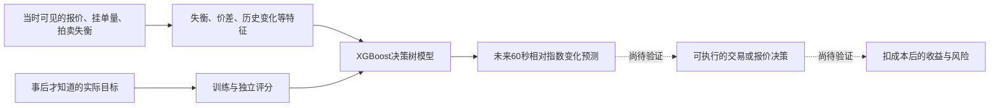

# 价格预测模型：我们究竟能复刻哪一层

**结论：研究重心回到“从当时可得的数据中提取预测增量”。已找到一个能具体拆解的美股公开模型：Optiver收盘预测竞赛参赛者的XGBoost方案。官方目标、原始训练代码、公开推理页面及该推理Notebook的Apache 2.0许可已取得证据；完整权重、全部依赖及独立预测优势尚未验证，真实交易盈利也未证明。它不是XTX生产模型。**

读取日期：2026-10-17 UTC。你明确不想在A股交易、偏向美股或加密资产，因此A股准入研究已停止，已得材料保留，不继续问券商、开户或资产门槛。地区信息保留为以后执行适用条件，不用来阻断公开预测模型研究。当前仍只研究：无模型运行、训练、回测、账户、付款或交易。此前Kronos失败和Ribbon已核现金事实均不改写。

## 1. 从第一性原理看，预测为什么可能产生钱

预测模型将当前信息转换为对未来的估计。关键不是输出一个看似精确的价格，而是其中是否包含**尚未被当前价格充分反映、且能在未来重复利用的信息**。

教学框架，非XTX私人公式：

`一笔买入的预期交易收益 ≈ 对未来可退出价值的估计 − 当前可成交买价 − 成本 − 风险预留。`

估计错误、优势太小、出现信号后无法按预期成交，都会让这条链失效。对做市而言，还要考虑什么报价会被成交，以及成交后是否更可能向不利方向走。这里解释一般机制，未宣称XTX逐笔使用本公式或公开了相应参数。

XTX公开公司演示把深度学习与定价、价格预测联系起来，同时强调市场信号弱、关系变化和拟合噪声的风险。这支持“数据→模型→定价判断”是值得研究的核心；演示没有提供生产模型特征、预测期限、权重或完整交易决策。[XTX演示，央行公开托管，第4及6页](https://www.bankofcanada.ca/wp-content/uploads/2026/04/Use-of-Artificial-Intelligence-in-Market-Making-XTX-Markets-020326.pdf)。读取2026-10-17，返回正文未标发布日期，文件路径不能替代发布日期证明。

市场和交易场所不作为现在的先决筛选，但**模型预测的对象、信息和时间尺度仍须明确**。同一套学习方法可以研究迁移；把小时K线换成订单簿，或把收盘拍卖换成全天交易，会改变问题，不能直接继承原模型成绩。

## 2. 这次找到的真实公开对象

对象为Optiver主办的“Trading at the Close”，任务涉及纳斯达克股票每日收盘前十分钟的订单簿与拍卖信息。原作者ADAM./hookman发布“9th place”方案并直接链接训练仓库。名次按作者原文标识，不冒充本轮重新独立核验了全部排行榜。[官方任务](https://www.kaggle.com/competitions/optiver-trading-at-the-close/overview)、[作者原文](https://www.kaggle.com/competitions/optiver-trading-at-the-close/writeups/adam-9th-place-solution)。

训练源码固定在[提交16d78a85…](https://github.com/ChunhanLi/9th-kaggle-optiver-trading-close/tree/16d78a85e2c8b2e4146341fe61acadafc1f22f93)，提交时间2024-03-26；取得100,338字节原始Notebook，Git blob身份一致。提交日期不等于首次公开日期，也不证明和获奖时提交的全部文件完全相同。仅静态解析，没有执行Notebook。

本轮原生页面提取最初未读出官方Data与推理正文，随后正常匿名浏览器渲染补齐了关键内容。旧审阅中的“精确官方目标未读到／推理页未读到”属于较早快照，已由[浏览器补充证据](</Volumes/EXTERNAL/亚力克斯 /运行验证-20261015/evidence/sse-mainland-covered-call-eligibility-20261017/root/browser-primary-target-inference-supplement.json>)限定更新，不继续把已解决事项列为阻断。

## 3. 它预测什么，怎样预测

官方Data页明确：预测未来60秒的个股WAP变化，减去同时间内合成指数WAP变化，单位为基点。WAP是按报价两侧数量加权的价格；合成指数由Optiver为比赛构造，不直接等同某只可交易ETF。1基点等于0.01%。[官方数据定义](https://www.kaggle.com/competitions/optiver-trading-at-the-close/data)。

目标公式按官方页面：

`y = 10000 × [个股WAP(t+60秒)/个股WAP(t) − 指数WAP(t+60秒)/指数WAP(t)]`。

它不是“下一分钟的美元股价”。**教学示例：**若个股跌1%、指数跌1.1%，这个相对目标仍为+10基点。预测相对表现正确，不意味着单买股票会获得正收益。此例不是比赛真实交易或盈利记录。

以下图展示公开案例的研究链，最后两步是尚未验证的赚钱环节：

图中的事后答案只用于训练与评分，不能在当前预测时作为已知输入；已过去、已公开的标签可以使用，但须按实际发布时间处理。

**数据。**官方输入包含买卖报价、两侧数量、可匹配量、拍卖失衡方向和规模、拍卖指示价格及WAP。数量字段按美元名义金额表示，价格字段经过相对拍卖起始WAP的转换，不能把输入中的数字直接当成真实美元成交价。官方还说明，每个新交易日开始时，API提供上一整天的实际标签；示例的前三个日期重复训练末尾且不评分。这些细节决定过去标签什么时候可用。[官方数据页](https://www.kaggle.com/competitions/optiver-trading-at-the-close/data)。

**特征。**特征就是交给模型的数字。原始训练代码实际计算了买卖数量失衡、拍卖买卖侧量、报价差、失衡动量、历史滚动统计、过去相对价格变化、跨股票汇总及过去目标统计。例如“卖量减买量，再除以两者之和”描述两侧压力；它不是独立获利公式，挂单还可能撤销。训练代码的股票编号和指数权重也不是已恢复的真实股票身份。

**模型。**XGBoost通过一组决策树学习特征与目标的关系；所读训练代码优化绝对误差，核心目标是预测误差，不是净利润。代码导入了其他算法库，不表示最终方案同时使用所有算法。公开推理版本加载5个XGBoost模型文件，并读入157特征选择JSON、股票中位数缩放JSON和历史标签文件。[固定训练仓库](https://github.com/ChunhanLi/9th-kaggle-optiver-trading-close/tree/16d78a85e2c8b2e4146341fe61acadafc1f22f93)、[公开推理版本168871272](https://www.kaggle.com/code/hookman/9th-submission?scriptVersionId=168871272)。

作者介绍中的种子安排，与推理版本可见的5个模型文件，不足以建立所有训练文件和最终权重的一一身份绑定；不能把两处模型数量相加，或声称全部权重已经取得。

**更新。**推理页可见接收已揭示标签、保存近期信息和后续再训练逻辑。比赛允许按其规则在线更新，因此提交后未来市场评价不等于模型永久冻结。本轮尚未逐行读全最终聚合和全部更新分支，不能声称已证明每个分支严格无泄漏。浏览器对较长代码单元的AX文本有截断；页面可读不等于完整源码文件已导出。

## 4. 成绩证明了什么

比赛评分为平均绝对误差MAE，即每次预测与真实目标相差的绝对值，再求平均；越低越好。官方说明以提交截止后取得的真实市场数据评价。这个设计比单看训练期拟合更有价值，但不自动证明个人交易可盈利。[官方任务与评价](https://www.kaggle.com/competitions/optiver-trading-at-the-close/overview)。

作者公开推理页显示Private Score **5.4352**；这是该页面显示的竞赛分数，未由本机重跑，也未在本轮核得同一隐藏区间的“始终预测零”基准。它不是5.4352%的收益，不是美元利润。Notebook内保存的本地验证MAE约5.87049是另一个口径，也不能和该分数混成改善率。两个模型、数据或区间不同，不能直接以Optiver的MAE比较Kronos的MSE，宣称已找到更赚钱模型。

静态核查还有两项应在独立复刻时处理：

- 日期编号390前后作训练／验证，但股票中位数缩放先使用了全部已载入数据；本地验证预处理没有严格隔离。
- 另一个训练段使用打乱的五折划分，不是逐段向未来验证。源码中先计算未来移动、再滞后的特征要检查最终时点依赖，不能只看到负shift就判作弊，也不能未经检查就判安全。

这些是所读训练代码的具体限制，不是对比赛官方未来测试泄漏或作者作弊的结论。未取得实际持仓、订单、成交、费用、回撤和容量记录，**本案例当前属于公开预测方法，不属于已核实的扣费赚钱案例。**

## 5. 能否复刻：给出分层答案

| 层次 | 当前判断 |
|---|---|
| 学习输入、目标、特征和XGBoost流程 | 可以，已有具体原始代码与官方定义 |
| 复用公开推理代码 | 该Notebook页面明确Apache 2.0，须遵守相应条件；不自动覆盖其他仓库或私有文件 |
| 原样加载同一批权重、输出相同预测 | 尚不能：5个模型、特征／缩放JSON等外部原件及身份未齐，页面显示私有输入 |
| 从原始数据完全重训、复得该私榜分数 | 未验证：数据权限、预处理、依赖版本、完整推理和隐藏评分数据仍缺 |
| 在新美股或加密数据上独立重做同类方法 | 值得研究，但迁移后是新验证，不能继承原竞赛分数 |
| 复制XTX的生产预测优势 | 未取得相应生产代码／特征／权重证据，不能这样命名 |
| 复制实际盈利及扩大到财富目标 | 未证明，仍需独立预测增量、经济可执行性及容量证据 |

许可要分开：GitHub训练仓库根目录未见明确LICENSE；新读到的推理Notebook则明确Apache 2.0。比赛数据受[官方竞赛规则](https://www.kaggle.com/c/optiver-trading-at-the-close/rules)约束，相关条款限定竞赛用途；公开代码许可不把数据变成可任意用于个人自营交易的数据。本轮没有接受规则、登录或下载比赛数据。这不禁止正常阅读公开说明与代码，也不能推成独立金融研究一概不可行。

成本也分开：作者公开页面显示P100上约162.4秒的已保存演示运行记录；页面日志提醒不能用该API版本估计隐藏测试运行时间。它不是全部训练成本、当前电脑成本或本轮执行回执。原训练配置要求GPU，完整RAM、训练耗时及个人实际费用仍UNKNOWN；本轮新增付款0，没有模型执行。

## 6. Kronos教给我们的具体教训

已有50股、9,400条预测对应188个同步窗口，固定Kronos-small用法的MSE比不变价格基准高4.074%。该结果与全部记录已核，保留FAILED，不重新运行或换种子。原AAPL188窗同样未过。它们反对的是相应固定配置的优势主张，不能唯一分解为模型本体、共享数据或输入语义哪一项导致，也不能否定所有价格预测方法。[既有实际检验](</Volumes/EXTERNAL/亚力克斯 /运行验证-20261015/transfer50-20261015/50股真实评估报告-20261015.md>)、[本轮原件定位核对](</Volumes/EXTERNAL/亚力克斯 /运行验证-20261015/evidence/sse-mainland-covered-call-eligibility-20261017/root/existing-Kronos-prediction-evidence-qualification.json>)。

因此不再走“拿一个预训练模型报价格，就假定能赚钱”的路径。新的研究对象必须先说清输入信息、预测目标和期限、时间顺序与简单基准；完成预测检验后再看经济用途。交易成本仍然重要，但不再先用开户或交易所问题代替模型优势问题。

## 7. 唯一后续研究问题

**先核能否以低成本取得获许可、时点含义完整、能够重建该类订单失衡输入及未来目标的研究数据。** 这直接关系到能否独立学习同类预测规律，属于模型复刻本身；不查询开户或券商。现有小时OHLC只有开高低收，不能直接代替秒级订单簿和收盘拍卖输入；不能把改了信息集与期限的新模型冒称原样复现。

后续核验以字段、真实可用时间、历史跨度、标签形成及简单基准为核心，不先下载大数据或运行模型。若只能取得部分信息，就明确能复制的方法子集与新假设，不能承诺表现不变。此阶段应收敛为一个明确的预测问题，不再无限找排行榜或宣传收益曲线。

当前判断：值得作为具体模型方法继续研究；尚不具备宣称可复制盈利的证据。要达到Gerko财富1%，仍缺持久净优势、扩大后容量和资本积累的证据，不能由一个预测分数推算。原始富豪榜未核项保持，不在此编造美元财富目标。

证据包：[初始作者与官方材料审阅](</Volumes/EXTERNAL/亚力克斯 /运行验证-20261015/evidence/sse-mainland-covered-call-eligibility-20261017/protocol/predictive-model/source-review.json>)、[后续官方页面及推理许可补核](</Volumes/EXTERNAL/亚力克斯 /运行验证-20261015/evidence/sse-mainland-covered-call-eligibility-20261017/root/browser-primary-target-inference-supplement.json>)。前者是较早快照；被后者明确补齐的字段以上述新原件为准。全部为阅读和静态解析，未开发策略、运行模型、回测或交易。

