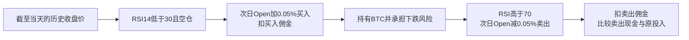

# 公开交易案例：BTC日线七笔交易，哪些账能复核、哪些盈利证据还没有

核验日期：2026-10-15，北京时间。源码固定提交：`52a8543b0283dbc25e98ed49c66ffc11adf231c6`，提交时间为2026-02-25 02:14:02 UTC。读取时间及各原件SHA-256见同目录source-receipts.json。本轮仅公开资料与既存记录审阅；没有导入或执行项目策略、生成新信号／新持仓、运行模型、回测、接账户或交易，新增付费0。

## 1. 结论

**找到一份能逐笔核算的公开案例，但没有找到可以继承其现实盈利结论的成功案例。**候选是Ares-Infenus的BTC-USD日线RSI项目。公开行情、规则源码和七笔完整往返交易，使我们可以核对：原记录如何持有BTC、进出价如何计入滑点、佣金如何扣除，以及这些记录合计赚多少。

七笔记录的净利润合计4,456.68美元，对应10,000美元初始资金、期末现金14,456.68美元，算术闭合。这只是历史假设成交记录的一致性。原始信号及运行配置回执、逐日现金／持仓账、独立分项费用日志没有完整保存；风险路径存在已确认的时序缺陷。因此，**严格的“四类原件全齐且可原样复现”门槛尚未完全通过；将它接纳为透明账目研究样本，暂不接纳为个人盈利策略候选。**不等待Kronos作者也能取得这些进展。

来源：[固定源码与原报告](https://github.com/Ares-Infenus/rsi-backtesting-engine/blob/52a8543b0283dbc25e98ed49c66ffc11adf231c6/README.md)、[原始七笔记录](https://github.com/Ares-Infenus/rsi-backtesting-engine/blob/52a8543b0283dbc25e98ed49c66ffc11adf231c6/reports/trades.csv)、[原始指标表](https://github.com/Ares-Infenus/rsi-backtesting-engine/blob/52a8543b0283dbc25e98ed49c66ffc11adf231c6/reports/performance_summary.csv)。本轮没有复现原策略生成这七笔交易的过程。

## 2. 四类材料实际有哪些

| 材料 | 已取得并核实 | 限制 |
|---|---|---|
| 公开行情 | 88,876字节Parquet，1,826行；UTC 2020-01-01至2024-12-30，实际范围内每日连续、无重复；OHLC均有限正值、包含关系无异常；成交14个进出价均与对应日Open加减0.05%一致 | 来源代码为yfinance/Yahoo BTC-USD；不是已核实的某家交易所可成交报价。没有上游下载日期及授权原件；质量检查不证明原始行情真值 |
| 策略代码 | RSI14，空仓且RSI<30买入，持仓且RSI>70卖出；下一日开盘假设成交；单品种、全额现金投入、不做空、不加杠杆 | 代码是阈值条件，不要求与前一日RSI比较后确认“穿越”。未重算信号，尚未绑定实际生成七笔交易的命令及环境 |
| 持仓记录 | 七笔完整进出日期、成交价、BTC数量，可定位各记录对应的持有区间；七笔均已平仓 | 未独立导出逐日现金／持仓快照，不能把我们从记录推导的账说成原始账户账 |
| 费用记录 | 原CSV保存每笔gross_pnl与net_pnl；差额可核总佣金，成交价已经包含滑点；源代码给出双边佣金和滑点规则 | 未保存独立entry_fee／exit_fee／slippage字段；下面分项金额是按固定规则核算，非交易所扣款凭单 |
| 汇总与运行证据 | 保存收益CSV；代码和数据都有指纹 | notebook的33个单元无保存输出，全部执行计数为空；依赖仅设最低版本，没有完整锁定环境／原始运行清单 |

原件：[行情](https://github.com/Ares-Infenus/rsi-backtesting-engine/blob/52a8543b0283dbc25e98ed49c66ffc11adf231c6/data/BTC-USD_2020-01-01_2024-12-31_1d.parquet)、[参数](https://github.com/Ares-Infenus/rsi-backtesting-engine/blob/52a8543b0283dbc25e98ed49c66ffc11adf231c6/src/config/settings.py)、[信号逻辑](https://github.com/Ares-Infenus/rsi-backtesting-engine/blob/52a8543b0283dbc25e98ed49c66ffc11adf231c6/src/strategy/rsi_strategy.py)、[执行逻辑](https://github.com/Ares-Infenus/rsi-backtesting-engine/blob/52a8543b0283dbc25e98ed49c66ffc11adf231c6/src/backtester/engine.py)、[费用逻辑](https://github.com/Ares-Infenus/rsi-backtesting-engine/blob/52a8543b0283dbc25e98ed49c66ffc11adf231c6/src/execution/broker_simulator.py)、[依赖](https://github.com/Ares-Infenus/rsi-backtesting-engine/blob/52a8543b0283dbc25e98ed49c66ffc11adf231c6/requirements.txt)。

## 3. 它凭什么赚钱，钱来自哪里

RSI（相对强弱指标）把最近上涨与下跌的力度压缩成一个数。这里的假设是：一段明显下跌后买入，等价格反弹后卖出。它不预测精确目标价，也没有AI模型。假设若有效，收益来自持仓期间BTC价格上涨超过交易成本；它不向大客户收服务费，不赚做市买卖差价，不是已拆出的XTX私有策略。

第一性原理上的条件是：**选中的持有时段，其可实现价格变化产生的收益，必须覆盖成本及所承受的风险。**“跌得多”本身不保证随后反弹。一次下跌也可能延续数月。原记录第4笔由2022-05-10持有到2023-01-12，净亏5,734.47美元，直接说明该风险。对于“市场参与者反应过度”的行为解释，只能视为待验证的机制假说，这七笔记录不能证明因果。

### 一笔保存的假设成交，不是实盘，也不是新教学捏造

原CSV第1笔：2020-03-13 → 2020-04-30，持有48天。

| 环节 | 保存值或静态核算 |
|---|---:|
| 交易前现金 | 10,000.00美元 |
| 来源行情买入日Open | 5,017.8310546875美元/BTC |
| 加0.05%买入滑点后的成交价 | 5,020.339970214844美元/BTC |
| 买入佣金 | 10.00美元，按交易前现金×0.1% |
| 买入数量 | 1.9899050779966365 BTC |
| 来源行情卖出日Open | 8,797.669921875美元/BTC |
| 减0.05%卖出滑点后的成交价 | 8,793.271086914063美元/BTC |
| 卖出金额／卖出佣金 | 17,497.7747880513／17.4977747881美元 |
| 卖出后现金 | 17,480.2770132632美元 |
| 净利润 | 7,480.2770132632美元 |

这里“能核算”为：保存进出价与来源Open及滑点公式完全相符，数量×价格、佣金及现金增量可以对齐；**没有验证它在真实市场能按这些价格成交，也没有重算当时是否出现了原规则信号。**原CSV为每笔收益列使用“扣除买入佣金后的持仓成本”作分母；不能直接连乘其return_pct列来替代完整现金账。

## 4. 扣费后是否有效

对已有七笔固定成交做静态核账，不构建新策略路径：

| 项目 | 金额／结论 |
|---|---:|
| 初始资金 | 10,000.00美元 |
| 七笔gross_pnl合计 | 4,638.12美元，已包含进出价滑点 |
| 双边佣金合计 | 181.44美元 |
| 七笔net_pnl合计 | 4,456.68美元 |
| 期末现金 | 14,456.68美元 |
| 全期现金增幅 | 44.5668%，非年化 |
| 按同一组既存成交数量测得的滑点价差 | 90.68美元，已进入gross_pnl，不得再扣一次 |

精确现金闭合残差不超过1.82×10^-12美元。以上费用是该代码的假设：买入佣金按可用现金0.1%计算，卖出佣金按卖出成交金额0.1%计算；不冒充用户实际账户费率。按同一组数量计算的滑点差额也不是一条“去掉滑点后资金会如何复利”的反事实策略。

| 笔数 | 持有区间 | BTC数量 | 原存净利润（美元） | 原gross−net总佣金（美元） |
|---|---|---:|---:|---:|
| 1 | 2020-03-13 → 2020-04-30 | 1.989905 | +7,480.28 | 27.50 |
| 2 | 2021-04-26 → 2021-07-29 | 0.355641 | -3,277.59 | 31.70 |
| 3 | 2021-12-11 → 2022-03-30 | 0.300042 | +15.04 | 28.43 |
| 4 | 2022-05-10 → 2023-01-12 | 0.468936 | -5,734.47 | 22.71 |
| 5 | 2023-03-10 → 2023-03-18 | 0.415895 | +2,915.17 | 19.89 |
| 6 | 2023-08-18 → 2023-10-21 | 0.427290 | +1,265.97 | 24.08 |
| 7 | 2024-06-25 → 2024-10-21 | 0.209826 | +1,792.28 | 27.14 |

七笔五赢两亏。首笔净赚7,480.28美元，超过全期总盈利；其余六笔净额约为−3,023.60美元。这只是既有记录的贡献分解，不能解释成“删除首笔后重跑策略”的收益。

**回答须分两层：在原记录、原假设费用下，净收益为正且账可闭合；是否存在可持续、可执行、优于简单持有的优势，尚未建立。**原notebook文字自己承认低于买入持有，但没有已保存、与策略相同费用和时点的完整基准账，本轮不据其图或文字认证超额收益。样本只有七笔，没有独立、未参与选择的样本外记录；不是通过统计检验的交易优势。

### 已确认的估值时序缺陷

[engine.py](https://github.com/Ares-Infenus/rsi-backtesting-engine/blob/52a8543b0283dbc25e98ed49c66ffc11adf231c6/src/backtester/engine.py)第126—146行：先以**当天收盘价、执行前持仓**记净值，再按前一天信号执行当天开盘成交。这会让买入日快照仍是旧现金，卖出日快照却仍按当天收盘价估值已卖出的持仓。期末强平也在最后快照之后，没有再记录平仓后净值。

因此：原报告列出的最大回撤−64.6%、年化7.65%、Sharpe0.263等只能列为**发布者保存值，未验收**；不能拿来评估风险或预测未来。此缺陷并未自动否定七笔既存成交的净利润算术，也不能单独证明信号使用了未来价格。我们没有修代码、重建新净值或重跑来“纠正”它。

## 5. 我们可以低成本复制什么

| 环节 | 现实可借鉴部分 | 缺少它的后果 |
|---|---|---|
| 数据留存 | 固定历史文件、记录来源与许可、检查时区／缺失／重复／OHLC | 同一规则换数据就变结果，难以定位原因 |
| 规则表达 | 使用明确可读、事前固定的条件；日频不需大型算力 | 只靠“看起来跌多了”无法复核选择是否一致 |
| 成交与费用账 | 保存每笔数量、参考价、成交价、双边费用、现金变化 | 会把毛收益当净收益、漏掉费用或重复扣滑点 |
| 时点一致性 | 信号只用当时可得信息；成交与估值按一致时钟记录 | 可能产生未来信息泄漏或错误的回撤／风险指标 |
| 风险约束 | 明确允许损失、投入比例和退出条件后才考虑执行 | 本例全额持有且无止损，反弹未到前可以承受很大亏损 |
| 独立验证 | 区分历史拟合、样本外记录、模拟成交及真实成交 | 历史盈利无法回答今后是否仍有优势 |

这些研究环节可以在普通电脑上完成；本轮获取和读取原件的新增付费为0，没有评估未来数据订阅或交易费用，也不把本轮零成本外推为永远零成本。Codex／Claude可以帮助理解、检查、记录和独立核账；不构成收益来源。该规则无需AI即可表达，换更强模型不能补齐成交、成本、许可、样本外和容量证据。

没有成交量参与率、盘口、冲击及规模变化测试，因此不能从1万美元的假设账户推到几十万美元的有效容量，也不能推到Gerko财富1%。这是容量证据缺失，不是证明个人永远做不到。

**本轮取舍：借鉴透明记录与研究流程，暂不采用RSI交易规则，不进行修复或试验。**这是对一个公开案例的拆解，不是已决定开展个人反转策略。

## 6. 许可、独立性与待核事项

- [MIT许可](https://github.com/Ares-Infenus/rsi-backtesting-engine/blob/52a8543b0283dbc25e98ed49c66ffc11adf231c6/LICENSE)适用于作者的软件和相关文档；不能自动替Yahoo或上游行情提供方授予数据交易／再分发权。
- [yfinance原始项目说明](https://github.com/ranaroussi/yfinance#readme)将工具定位为研究教育用途，并要求核Yahoo数据条款，提示个人用途。它不是Yahoo授权原件。本轮点击其Yahoo条款链接返回999，未重试或绕过；此样本行情用于后续模型评估、交易及再分发的适用许可保留UNKNOWN。不以该缺项阻止其他公开资料研究。
- 项目只有两次提交，notebook为空输出；“production-grade”等自述不作为质量或盈利背书。
- 未取得原始逐日信号、现金／持仓快照、分项执行日志、锁定运行环境、未触碰的样本外记录和现实容量证据。七笔账闭合不能代替这些层次。
- 需要改变“暂不作为盈利候选”判断的证据：**固定规则在公开之后、特定合法可用市场上的连续样本外记录，附完整持仓及全部实际适用费用，并能和正确时点的净值逐日对账。**这是一项证据要求；本轮不启动生成该证据的实验，也不等待特定作者作为继续研究的前提。

## 7. 为什么没有采用看起来更漂亮的GOOG示例

并行核查了Backtesting.py官方旧GOOG均线10/20案例：固定2020提交a95b259aabea2f086a4f1322fb9329048251c241，其保存93笔已平仓线段与2,148个行情／净值点。旧版将0.2%只通过开仓价一次性调整计入；原件缺独立费用和期末仓位／现金，已平仓收益不足以解释期末净值，故未准入完整账目案例。旧notebook结果也不与2026官网更新结果拼接。它没有被用作本BTC案例的盈利证据。

另一个Freqtrade官方backtest-result.json为测试fixture，其首笔部分保存字段不满足通常现货扣费恒等式；没有把软件测试数据当真实业绩，也不据此判断整个引擎有错误。TradingStrategy.ai的旧策略链接返回404，另一候选部分大文件读取失败且代码／记录版本绑定未确认，未冒充已审完整。其余搜索结果若仅说明“运行后会生成文件”，不算已发布完整记录。

## 8. 证据与本轮执行边界

- [独立逐笔核账、原件哈希、基础数据质量与已确认缺陷](</Volumes/EXTERNAL/亚力克斯 /运行验证-20261015/evidence/public-case-20261015/rsi-btc/independent-ledger-review.json>)
- [固定源码及行情原件读取清单](</Volumes/EXTERNAL/亚力克斯 /运行验证-20261015/evidence/public-case-20261015/rsi-btc/source-receipts.json>)
- [GOOG未准入审阅](</Volumes/EXTERNAL/亚力克斯 /运行验证-20261015/evidence/public-case-20261015/backtesting-goog/case-admission-static-audit.json>)
- [Freqtrade fixture未准入审阅](</Volumes/EXTERNAL/亚力克斯 /运行验证-20261015/evidence/public-case-20261015/freqtrade/fixture-admission.json>)

Owner：根代理负责筛选、来源／许可、机制解释和报告；独立子代理负责保存记录的静态核算与风险路径代码审阅。所有既存Kronos预测、评估协议和结果保持原样；没有把这个案例当作Kronos正结果，没有新增任何作者留言、自动化、模型、回测或交易。
