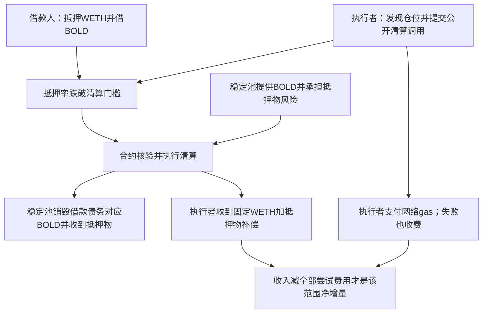

# Liquity V2：公开清算补偿、真实到账与完整普通交易费用

读取日期：2026-10-16 UTC。本轮只下载公开原件、读取代码和对真实历史交易做静态核账；模型、训练、回测、交易、账户连接、付款及外发均为0。Carver及既有样本保留，Kronos的FAILED结果不变。

后续更新：五次WETH失败已逐仓位对应先前成功清算，另核一笔竞争者将约95.97%补偿直接支付区块收款方。见[竞争成本与实际净收入](</Volumes/EXTERNAL/亚力克斯 /运行验证-20261015/LiquityV2竞争成本-已清算仓位与实际净收入-20261016.md>)；本报告原钱包七次尝试净增量保持不变，新竞争者金额另列。

2026-10-16范围审阅更新：七次尝试网络费后的历史ETH/WETH数量正增已经成立；完整私人策略、整个经营实体与未来持续盈利是另一级主张，不作为否认该历史净增的理由。完整事前机会选择/发送规则仍未知，不能把公开协议规则升级为全策略事前锁定。当前分层说明见[历史赚钱案例与个人复制缺口](</Volumes/EXTERNAL/亚力克斯 /运行验证-20261015/真实赚钱案例-Liquity七次尝试与个人复制缺口-20261016.md>)。

## 判断

找到一个比仅有收益曲线更扎实的真实执行案例：Liquity V2清算。公开协议规定成功执行者领取补偿；原始交易、代币转账、失败费用及成功前后持仓可查。一个地址公开列出的全部8条普通交易中，1条是0.5 ETH入金，7条是随后清算尝试，1次成功、6次失败。将7次网络费用全部扣除后，该地址的ETH/WETH数量净增加 **0.039100539874301130 ETH-equivalent**。

这是已经发生的、原账支持的正净数量结果。它尚未满足“完整赚钱系统可以照搬”的要求：执行者寻找机会、筛选标的、出价和发送时机的完整事前规则与软件没有取得；完整普通交易列表不等于所有内部调用、所有代币历史或经营账。不能把本案例写成经过验证的个人持续盈利策略，也不能推出容量或美元投资回报率。

## 1. 谁需要它、谁付钱、凭什么赚钱

Liquity是以加密资产作抵押、借出BOLD稳定币的公开协议。Trove是协议中的抵押借款仓位。抵押物价格跌落、仓位抵押率低于清算门槛时，协议需要及时处理债务，保护整体偿付能力。执行者提交可被清算的仓位编号，合约核验条件并执行清算。

本次WETH分支真实成功交易的资金关系为：

固定部分由借款人预存的gas储备支付；可变部分来自被清算的抵押物。执行者为协议提供及时的风险处理服务，领取事先规定的报酬。它没有从银行、基金取得客户，也不需要在本笔调用中预测未来价格。[官方说明](https://docs.liquity.org/faq/borrowing)

重要区别：本笔执行者没有从自己钱包拿出3,004 BOLD替借款人还债。债务抵销资金来自稳定池。将协议资金当作执行者本金，会算出错误的资金需求和收益率。

## 2. 事前规则与实际部署是否对得上

三条证据相互支持：

1. 官方2025-05-19上线公告公开链接文档和代码库，并列出BOLD地址`0x6440…01D`，早于2026年的实际清算。[上线公告](https://www.liquity.org/blog/liquity-v2-is-live)
2. ChainSecurity《Bold Code Assessment》日期为2025-05-14，第5页将`abe7cbfbd465fba3812282c51773455766a70e96`列为Final Version，涵盖TroveManager和Constants。本轮下载PDF并检查该页。审计记录的是收到版本的日期，不能单独充当首次公开发布时间，也不是盈利审计。[审计原件](https://reports.chainsecurity.com/Liquity/ChainSecurity_Liquity_Bold_Audit.pdf)
3. 实际收款目标合约为`0x7bcb64B2c9206a5B699eD43363f6F98D4776Cf5A`。本轮安全解析Etherscan标示Exact Match的源码包，抽出的TroveManager和Constants与上述审计版本、2025-05-13 Git版本均逐字节相同。TroveManager为89,534字节，SHA256 `8b18c9fe6480a8966eea792e5f23e4b1e1aff2536f16f3c9a9162ba39d818490`；Constants为3,687字节，SHA256 `7c83831f63c06866ab9f5bdecb4197beb24b516879676a7145e87849584aeba3`。[部署源码](https://etherscan.io/address/0x7bcb64B2c9206a5B699eD43363f6F98D4776Cf5A#code)、[审计版本代码](https://github.com/liquity/bold/blob/abe7cbfbd465fba3812282c51773455766a70e96/contracts/src/TroveManager.sol)

合约页所链创建交易另取得原HTML，显示2025-05-19 09:19:47 UTC成功，早于所核2026年交易。[创建交易](https://etherscan.io/tx/0x98f9d0232b889d1679c2685820c1cd2976f674b10c5173691a46988135f783ee)

本轮没有独立编译并重做字节码验证；Exact Match是区块浏览器的验证声明。没有当时网页存档或首次verification时间原件，精确的首次公开时点仍未确认。上述证据支持协议机制早于结果已存在并有公开披露，不能升级为执行者完整策略事前冻结。

`batchLiquidateTroves`为public入口，没有清算者白名单。它检查仓位状态和抵押率，没有可清算债务则`NothingToLiquidate`回滚，失败不付补偿。固定报酬为每个清算仓位0.0375 WETH；可变部分在本版本按稳定池抵销所对应抵押物的0.5%计算，上限2个抵押资产单位。不能把这一公式无条件套到纯再分配或稳定池不足场景；WETH分支的两部分都是WETH。[固定源码](https://github.com/liquity/bold/blob/abe7cbfbd465fba3812282c51773455766a70e96/contracts/src/TroveManager.sol)

## 3. 一笔完整成功交易的原账

交易：`0x2f7f282bae9388e4b4f3ebf36d09725a39eb221efe59445bbea7b2a73e35d4c3`；2026-06-05 06:24:59 UTC，区块25,249,375。From为`0x000000000004Fbf65B56ae13b507556c2C06bFf5`，直接调用上述公开合约，顶层转入0 ETH。以下为真实记录，不是教学示例。[交易原件](https://etherscan.io/tx/0x2f7f282bae9388e4b4f3ebf36d09725a39eb221efe59445bbea7b2a73e35d4c3)

| 项目 | 原账数量 | 含义 |
|---|---:|---|
| 稳定池销毁BOLD | 3,004.545910030709697219 | 抵销债务，不是执行者支出或收入 |
| 稳定池收到WETH | 1.936828100584193758 | 稳定池的抵押物，不是执行者利润 |
| 借款人剩余抵押物转入余款池 | 0.053171899415806242 WETH | 借款人可申领余款，不是执行者利润 |
| GasPool转给执行者 | 0.0375 WETH | 固定清算补偿 |
| ActivePool转给执行者 | 0.01 WETH | 可变补偿 |
| 执行者合计收入 | 0.0475 WETH | 本笔Transfer与持仓变化一致 |
| 执行者网络费 | 0.005213757965143884 ETH | 499,678 gas × 10.434235578 Gwei |
| 本笔网络费后数量净增 | **0.042286242034856116 ETH-equivalent** | WETH与ETH按1:1代币数量合计 |

状态原账另核：执行者ETH从0.499614777326661640变成0.494401019361517756，减少额与网络费完全相等；WETH存储中该地址余额从0变成0.0475。没有把区块生产者收到的优先费再扣一次，它已包含于总gas。未做WETH解包或卖出，若未来兑换、提取或变现会有新增成本。[状态原件](https://etherscan.io/tx/0x2f7f282bae9388e4b4f3ebf36d09725a39eb221efe59445bbea7b2a73e35d4c3#statechange)

另一成功交易2026-02-05收到0.172818867812976406 WETH，扣本笔gas 0.004505740248664468 ETH后为+0.168313127564311938 ETH-equivalent；属于另一个From，不合并为同一个人的业绩。[第二成功原件](https://etherscan.io/tx/0xc9a8bd99d2884e0ff855afdeb85dd7a1946e2404c4eb78b1e4c1f4db8f92af88)

## 4. 把失败费用补齐，净赚仍为正

先读到的WETH合约页明确列出全部16条直接普通交易，其中2成功、14失败，分别来自4个From。这不是协议所有内部调用，也不是某个执行者的完整策略流水。16份原HTML均保存；逐笔校验hash、时间、区块、状态、From/To和准确费用，gas乘积全部相符。

继续读取六月成功者地址页，发现其普通交易总数为8：1条0.5 ETH入金，另外7条为清算尝试。此前仅看WETH目标合约会漏掉nonce=3的一笔wstETH分支失败交易。本轮取得其完整原HTML并纳入费用。[地址全部普通交易及当前持仓](https://etherscan.io/address/0x000000000004Fbf65B56ae13b507556c2C06bFf5)、[补入的失败交易](https://etherscan.io/tx/0x84370d2feba412d0463aebde303f276e2e5845b0c2830abd4ea04f95bc623560)

| 钱包公开普通交易范围 | 数量/金额 |
|---|---:|
| 入金，2025-07-27 | 0.5 ETH，不是利润 |
| 清算尝试，2026-06-03至06-06 | 7笔，nonce 0至6 |
| 成功/失败 | 1次/6次 |
| 唯一清算收入 | 0.0475 WETH |
| 七次gas合计 | 0.008399460125698870 ETH |
| 扣上述全部gas后的数量净增 | **+0.039100539874301130 ETH-equivalent** |
| 读取时ETH持仓 | 0.491600539874301130 ETH |
| 读取时WETH持仓 | 0.0475 WETH |

0.5 ETH入金减全部七笔gas，恰好等于所读当前ETH余额；加WETH与上述净增一致。初始入金那笔gas由发送方支付，不重复算成本钱包支出；客户是否另有交易所提币费未取得。地址页另显示KONG代币持仓，本轮不估值、不归因为清算报酬。

**已经闭合的是该地址所读普通交易及ETH/WETH数量账**，包括失败交易成本；不是完整运营成本、独立节点审计或个人美元收益率。钱包可能有未在普通交易表体现的内部活动、其他地址和链下成本；净余额对账不证明所有内部流从未发生。没有用未来价格把代币数量利润包装成当时美元现金收入。

## 5. 你能低成本复制哪个环节

最值得学习的是：**从公开协议状态判断一项服务是否可执行，算清实际补偿和全部失败成本，再决定是否具有经济价值。** 此处执行入口公开，不需要银行客户、机构交易所专线或大型预测模型；直接调用本例也不需要先复制部署Liquity核心合约。未来调用仍需要正确的软件、gas资金和合法适用条件，本轮没有执行。

| 环节 | 个人可借鉴/复制程度 | 缺少后的后果 |
|---|---|---|
| 读取公开规则、抵押率与仓位编号 | 可用公开资料低成本研究 | 用错版本、预言机或抵押率会误判资格 |
| 精确核算补偿与gas | 已能从原账复算；公式也公开 | 把稳定池收入当自己收入、忽略失败会高估收益 |
| 直接调用公开执行入口 | 代码没有调用者白名单；技术入口可研究 | 并不保证个人合法可用，也不保证来得及成交 |
| 发现尚未被别人处理的机会 | 本例私人发现系统未公开 | 可能总是迟到，失败也付费 |
| 在竞争中出价、发送与控制失败 | 完整事前软件/参数未取得 | 过度竞价或重复失败可吃掉所有补偿 |
| 换成美元、长期运行与放大 | 未证明 | 代币价格、运行成本和机会数量可能改变结果 |

“普通调用者无需协议特权”不是“没有技术门槛”。资金增加也不会凭空增加可清算仓位。竞争者能看到同样规则；优势更可能来自准确状态、识别时机、可靠执行和成本控制，此为机制推断，不是对该地址私人系统的事实披露。

## 6. 许可与剩余证据

核心代码为BUSL-1.1，允许非生产研究，不是当前可任意生产复用的MIT许可；Change Date为2027-09-01，之后转GPL v2或更高。Additional Use Grant链接本轮正常访问返回404，保留UNKNOWN，未绕过访问限制。复制/部署核心代码，与调用已部署的public接口是不同事项；现有材料不足以替个人未来生产使用作法律确认。[固定许可](https://github.com/liquity/bold/blob/cc2a420067e47cafc1b1b1309045b341f9ced1b1/contracts/LICENSE)

判断为：**值得继续作为有限研究候选；真实正净交易已有证据，完整个人复制系统仍待核。** 接下来最有价值的一个问题是：同类普通执行者在连续时段，计入全部失败和实际执行成本后，是否仍有可捕获的净收入。只读原账可以继续回答其中一部分，不能用今天挑选的七笔代替未来验证。

要证明你能赚钱，还缺：固定且可复用的机会识别与发送规则、未经结果筛选的连续机会记录、真实竞争和失败成本、合法使用与实际运营成本。要论证接近Gerko的1%财富，还必须知道机会总收入、可捕获份额、持续性及扩大后的成本；本例完全不能按本金比例放大，也不推出年化收入。

## 7. 原件及审阅

证据目录为`evidence/direct-protocol-case-20261016/`：官方源文件、审计PDF/版本页、上线公告、合约/地址/交易完整HTML、两笔成功状态原件、每次读取UTC/URL/字节数/SHA256、16条直接调用核账、成功钱包8条普通交易核账及独立审阅均保存。单独公共RPC对历史receipt返回null，原因未知，未充当成功/不存在的证据；未声称获得独立档案节点确认。

源码身份审阅与金额审阅由两名独立只读审阅者完成；其通过范围分别为具体源文本一致与原件静态数量核算，不替代私人策略、法律适用、未来执行和财富目标验证。全部原件的精确路径见本目录`research-receipt.json`及`manifest.json`。
